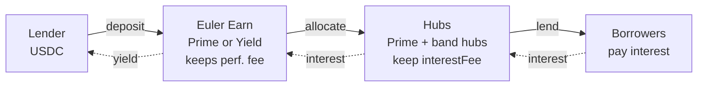
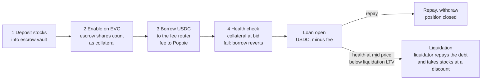
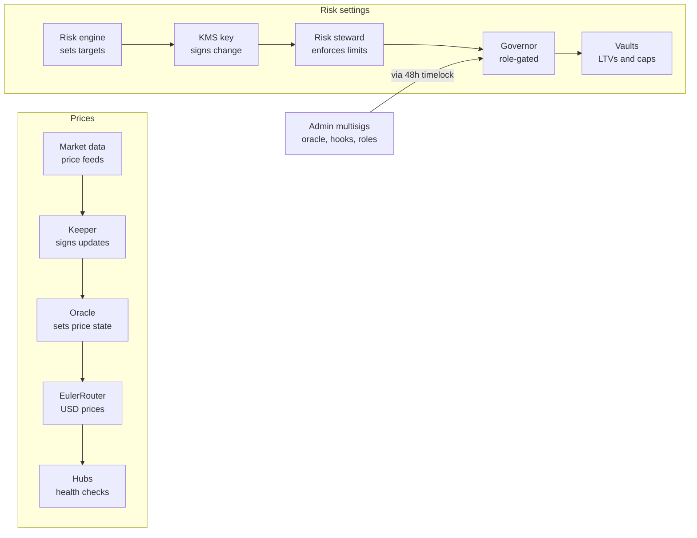

# Poppie on Arbitrum: Hub Architecture & Governance Plan

*Status: first draft. Contract interfaces are in the Smart Contract Specification.*

## TL;DR

Poppie lends USDC on Euler V2 against tokenized equities, from about 100 assets at launch to 500.

- **Hubs:** one Prime hub (blue chips only) plus one hub per long-tail risk band. Each band hub holds all blue chips and that band's long-tail names. A band is split only when its hub hits a real limit.
- **Lenders:** deposit USDC into Prime Earn or Yield Earn, which allocate across the hubs.
- **Governance:** all vaults are governed by Poppie, as on BSC.
- **Revenue:** interest fee and rate floor per hub, Earn performance fee, and an enforced origination fee. A slice of Poppie's fee funds a loss reserve.
- **Control:** a risk engine signs changes with KMS keys, and an on-chain steward caps them. Structural changes (oracle and adapter swaps, hooks, roles, IRMs) go through a 48h timelock; risk parameters, including the oracle's haircuts and price classes, don't.
- **Closed markets:** accounts stay usable. Borrowing uses a haircut price, and only liquidations pause.
- **Issuers:** supports Ondo, xStocks, Reality and similar. Tokens whose balances change are wrapped first, and the issuer is tracked as a risk.

| Choice | Gain | Cost |
| --- | --- | --- |
| One hub per band | Deep liquidity, simple config, fewer sub-accounts per user | Lenders in a hub share all its names' risk |
| Governed escrow vaults | Can adjust caps and pause during halts | Users trust Poppie not to block withdrawals |
| Off-chain exposure rules | Fast and flexible | Limits are soft |
| Timelock only on admin changes | Risk changes stay fast | Users trust Poppie's off-chain systems for risk changes |
| Enforced origination fee | A fee on every borrow | Integrators must add one call to each borrow |

Euler allows at most 10 collaterals per sub-account, so large portfolios need several sub-accounts. All numbers are proposed starting values.

## How it works

### Lenders

### Borrowers

### Prices and risk settings

## Asset classes

| | Blue chip | Long tail |
| --- | --- | --- |
| Criteria | Index ETF or top-50 US stock; daily volume ≥ $500M; on-chain exit depth ≥ $1M at ≤ 2% slippage; 90-day volatility ≤ 45% | All other listed names |
| Max borrow / liquidation LTV | 70% / 75% | Set by band (see Hubs) |
| Max supply cap | 20% of exit depth | 10% of exit depth |
| Listed in | Every hub | Its band's hub |

Names change class automatically: promoted after 30 days meeting the criteria, demoted after 5 days failing one, with LTV cuts ramped in. A promotion adds the name to the other hubs in one atomic steward call, under launch-style caps, so blue-chip settings can't drift apart between hubs.

**Must check first: exit depth on Arbitrum.** Caps and liquidations depend on liquidators being able to sell seized stock. If most long-tail Ondo tokens lack on-chain depth, or exit only via Ondo mint/redeem during market hours, the listable set may be far smaller than 500.

## Issuers

Each issuer handles dividends and splits differently, which decides how its tokens enter Euler.

| Mechanism | Issuers | Handling |
| --- | --- | --- |
| Multiplier; balances never change | Ondo GM, Robinhood | Escrow vault holds the token directly |
| Balances change on dividends or splits | xStocks; Reality (splits) | Wrapped first; the escrow vault holds the wrapper |
| Dividends paid out in stablecoins | Reality, Dinari | Wrapped first. The wrapper holds the token and receives the dividends, which fund the loss reserve. Users forgo them while deposited, disclosed at deposit. See Dividend handling. |

**Why the wrapper:** Euler doesn't support tokens whose balance changes without a transfer. Extra tokens from a split or dividend could be claimed by anyone through `skim`, and a reverse split would leave the vault owing more than it holds. The wrapper, like wstETH, issues shares that never change in number and tracks the real balance.

**Dividend handling.** *Flagged for review; see Decisions flagged for review.* An escrow vault has no way to recover tokens sent to it, so a dividend-paying token is wrapped like a balance-changing one. The issuer pays the holder of the token, which is the wrapper, so the dividends arrive there.

- **Who gets them:** the loss reserve. Depositors don't receive dividends while their tokens are deposited, and this is disclosed at deposit. Poppie doesn't keep them either.
- **How:** `sweep(token)` on the wrapper is permissionless and always sends to a recipient stored in the wrapper factory (the reserve Safe). Only `MS_ADMIN` can change that recipient, via the timelock.
- **Limit:** the wrapper can never sweep its own underlying token, so depositors' tokens can't be taken. The wrapper has no other admin function.
- **After the sweep:** the reserve holds whatever token the issuer paid, which may not be USDC. `MS_OPS` converts it to USDC or Prime hub shares.
- **Not built:** passing dividends through to depositors. It remains a possible later addition.

- **Issuer risk:** an issuer or custodian failure hits all of its tokens at once. Each hub caps exposure per issuer, and exposure is summed per underlying stock across issuers. Both are enforced off-chain.
- **Corporate actions:** a name unpauses only once both its token balance or multiplier and its price reflect the action.
- **Listing checks per issuer:** mechanism, admin powers (pause, freeze, seize), transfer restrictions, and how dividends reach on-chain holders. Reality's on-chain dividend handling on Arbitrum is to be confirmed.

## Hubs

- **Prime hub:** blue chips only, lowest rates, 8% max liquidation discount.
- **Band hubs (M1–M3):** all blue chips plus every long-tail name in that band. Split a band into two hubs only when one hub hits a real limit (borrow cap, liquidity, or concentration).

| Band | Long-tail profile (90-day volatility) | Max borrow / liquidation LTV | Max liquidation discount |
| --- | --- | --- | --- |
| M1 | ≤ 60%, deep liquidity | 50% / 58% | 10% |
| M2 | 60–90% | 45% / 52% | 15% |
| M3 | > 90%, or thin liquidity | 35% / 42% | 20% |

In each band hub, long-tail-backed debt stays at or below 50% of the hub's borrow cap, and no correlated group exceeds 30% of the hub's long-tail exposure. Both rules are enforced off-chain through supply caps.

| | More hubs | Fewer hubs |
| --- | --- | --- |
| Gained | Lender risk isolated per hub; settings tuned more finely | Deeper USDC per hub; far fewer LTV entries to sync; most users fit in one hub |
| Lost | Thin liquidity per hub; ~70 blue chips × N hubs of LTV entries; users split across sub-accounts | Lenders in a hub share every name's risk; one discount and IRM per band |

**Not affected by hub count:** per-asset LTVs and supply caps, the oracle, escrow vaults, the Earn products, and Euler's 10-collateral limit per sub-account. Since Yield Earn spans every hub, extra hubs mainly isolate Prime Earn's lenders, so fewer hubs gives up little.

| Fee | Prime | M1 | M2 | M3 |
| --- | --- | --- | --- | --- |
| Interest fee | 10% | 15% | 20% | 25% |
| Rate floor | 2% | 3% | 4% | 5% |
| Origination fee | 10 bps | 15 bps | 25 bps | 35 bps |

Prime Earn puts at least 70% in the Prime hub and charges a 5% performance fee. The 70% is enforced off-chain, because Earn caps are maximums. Yield Earn spans all hubs and charges 10%.

**Loss reserve.** Hubs have Euler's automatic loss-sharing turned off (`CFG_DONT_SOCIALIZE_DEBT`), so debt left on an account with no collateral stays on that account instead of being spread across depositors. A reserve then repays it with `repay(amount, account)`, which works for any account.

- **Funding:** 10–20% of Poppie's interest fee, a few bps of borrow, is swept into a reserve Safe. Dividends from wrapped dividend-paying tokens (see Issuers) also arrive there. It's held in USDC or Prime hub shares, and its balance is published.
- **Payouts:** `K_RESERVE` can only repay hub debt, within per-call and daily limits. Only `MS_OPS` can withdraw from the reserve.
- **Fallback:** if bad debt exceeds the reserve, `MS_OPS` turns loss-sharing back on, and the remainder is spread across the hub's depositors, and through them to Earn depositors.

**Why repay quickly:** until the reserve repays, the hub's share price overstates its assets, so early withdrawers would exit at full value and later ones would take the loss. The reserve is a buffer for occasional gaps, not insurance against a systemic event.

## Origination fee

Euler has no native origination fee, so Poppie enforces one without taking control of user accounts:

1. The user's EVC batch calls `hub.borrow(amount, receiver = feeRouter)`.
2. A borrow hook checks that the receiver is the router and records the amount as pending. It rejects `amount = max uint`, which Euler treats as "borrow all available cash."
3. Later in the batch, the account calls `router.forward(to)`. The router confirms the caller through the EVC, applies the hub's fee rate, sends the fee to the hub's fee receiver (`hub.feeReceiver()`, the same address that receives that hub's interest fee), and sends `amount − fee` to the receiver the account chose. The router has no treasury address of its own. If a hub has no fee receiver set, borrows on it revert. The router also rejects itself, or the zero address, as the receiver `to` or as the fee receiver, so it never keeps funds.
4. A hook on the hub's vault status check (`OP_VAULT_STATUS_CHECK`) reverts the batch if any router funds are still pending, so the router never holds funds.

A direct, un-batched borrow always reverts, so integrators must use EVC batches. The status-check hook runs after every operation, including liquidations and repays, and passes when nothing is pending.

**Why borrow to the router instead of paying first:** the hook runs before the borrow, so a pay-first flow would need USDC up front, which a first-time borrower holding only stock doesn't have.

**Why not make the router an EVC operator:** an operator can do anything on the account, including withdrawing collateral, so a router bug or upgrade could drain every opted-in user.

Liquidations, repayments and withdrawals are untouched, and the fee is capped at 100 bps on-chain. Integrators add one call to each borrow batch.

**Fee basis: every borrow.** The fee applies to each borrowed amount, so repaying and re-borrowing pays again. It's the simplest option, has the most precedent (Liquity V1, Aave V1, Abracadabra), and has no bypass paths.

**Possible later option: net-new debt only.** The router would track each account's peak debt and charge only above it. That's fairer to active traders, but it needs persistent per-account state and peak-reset rules, and must also charge `pullDebt`, so it adds code and audit scope. It has no known precedent in lending.

Flash loans are off at launch. They can be enabled later so liquidators can use hub USDC to repay debts without their own capital, optionally for a fee.

## Contracts Poppie deploys on Arbitrum

| Contract | Count | Controlled by |
| --- | --- | --- |
| PoppieEulerOracle (keeps the last confirmed price through pauses) | 1 | Roles: `MS_ADMIN` via timelock. Risk params (price classes, haircuts, staleness, `n`): `MS_OPS`, instant |
| Three-state price adapter | 1 | `MS_ADMIN` via timelock |
| USDC/USD fixed-rate oracle | 1 | Immutable |
| EulerRouter | 1 | `MS_ADMIN` via timelock; `MS_OPS` can only add new routes |
| IRMs | 1 per band, plus Prime | Swapped by `MS_ADMIN` via timelock |
| Hubs (borrow vaults) | 1 + 3 | Governor |
| Escrow vaults | 1 per asset | Governor |
| Balance wrapper (also used for dividend-paying tokens) | 1 per balance-changing or dividend-paying token | Immutable |
| Wrapper factory | 1 | `MS_ADMIN` via timelock (sets the dividend recipient) |
| Euler Earn vaults | 2 | `MS_OPS`, `K_ALLOC` |
| Governor, PoppieRiskSteward | 1 each | `MS_ADMIN` via timelock |
| Fee router; hub hook (fee and pause); escrow hook (closed-deposit and pause) | 1 each | `MS_ADMIN` via timelock |
| Timelock (48h) | 1 | `MS_ADMIN` proposes; `MS_OPS` can cancel |
| Loss reserve Safe (Roles module, no custom code) | 1 | `MS_OPS`; `K_RESERVE` can only repay |

**Why add-only routes:** listings stay instant, but a new route can never overwrite an existing price source. **Why IRM swaps are timelocked:** a hostile rate model could push borrowers into liquidation.

Euler's core contracts (EVC, factories, lenses) are used at Euler's Arbitrum addresses.

## RBAC

| Role | Held in | Can | Limit (enforced on-chain) |
| --- | --- | --- | --- |
| `K_PRICE` | KMS | Push prices | Moves within the class bound go live; larger moves wait for `K_CONFIRM` or n consistent pushes |
| `K_CONFIRM` | KMS, separate infrastructure | Confirm unconfirmed moves | Only the latest pending price, while fresh. Off-chain rule: only after its own independent checks pass |
| `K_TIGHTEN` | KMS | Lower LTVs and caps | Instant; liquidation-LTV cuts ≤ 5 pts per call, ramp over ≥ 72h, once per asset per hub per 24h. No limit on how many assets are cut; `MS_OPS` can cancel ramps |
| `K_LOOSEN` | `MS_OPS` in phase 1; a KMS key in phase 2 | Raise LTVs and caps; add promoted names to hubs | LTVs ≤ 3 pts per change, once per asset per week, up to class ceilings. Caps (escrow and hub) up to each vault's cap ceiling, with no rate limit. Promotions under launch caps, all hubs in one call |
| `K_ALLOC` | KMS | Reallocate Earn | Within Earn caps |
| `K_GUARD` | KMS | Pause deposits and borrows | Each pause lasts ≤ 24h and can be repeated as soon as it expires; one call can cover many vaults; never blocks repay or withdraw. `MS_OPS` can end a pause early |
| `K_RESERVE` | KMS | Repay bad debt from the reserve | Hub `repay` only; per-call and daily limits |
| `MS_OPS` | Safe 3-of-5 | Emergencies, listings (add-only price routes), unpausing (including ending any pause early), fees, oracle risk params, reserve withdrawals, revoking keys, liquidation pauses, ramp cancel, bounded override of borrow LTVs and caps, cap ceilings (escrows and hubs) | Override stays within class LTV ceilings and each vault's cap ceiling. Oracle params within hard bounds (`n` ≥ 2, haircut ≤ 100%). Tighten-only actions are instant |
| `MS_ADMIN` | Safe 4-of-7 | Oracle, adapter, router, hooks, roles, IRM swaps | 48h timelock; never a KMS key. At launch the deployer key holds the admin role only long enough to grant roles, then hands it to the timelock |

**If a key leaks:**

- `K_PRICE` is trusted. Alone, it can move a live price within the class bound per push, which can trigger liquidations. A larger move goes live without `K_CONFIRM` only after n consistent pushes, and while unconfirmed it can't lift the bid above the last confirmed price × (1 − h).
- `K_ALLOC` can move Yield Earn into the riskiest hubs, up to the Earn caps `MS_OPS` set.
- `K_TIGHTEN` can start liquidation-LTV cuts on every asset and hub at once, within the per-asset limits above. Each cut ramps over ≥ 72h, and `MS_OPS` can cancel the ramps.
- `K_LOOSEN`, once held by a KMS key in phase 2, can raise every cap to its ceiling in one call. Cap ceilings are the only on-chain limit on cap growth, so they are kept conservative, and every cap raise triggers an alert.
- `K_GUARD` can freeze borrowing or deposits, and can re-pause as soon as a pause expires. `MS_OPS` revokes the key.

**Why the 48h timelock on `MS_ADMIN`:** an instant oracle swap or a withdrawal-blocking hook could drain or trap funds. These changes are rare, and anything urgent is covered by instant tightening and pauses, so the delay costs almost nothing.

Poppie publishes signer addresses, these limits and every steward action.

### Risk steward limits

- **Tightening:** lowering borrow LTVs and caps is instant, batched, and has no limit on how many assets are changed. Liquidation-LTV cuts are limited per asset: ≤ 5 pts per call, ramp ≥ 72h, once per asset per hub per 24h.
- **Loosening (`K_LOOSEN`):** LTV raises are ≤ 3 pts per change, once per asset per week, within the class ceiling and the gap rule (5 pts for blue chips, 8 pts for long tail). Cap raises have no rate limit; they are bound only by the vault's cap ceiling.
- **Cap ceilings:** set per vault by `MS_OPS`: escrow vaults from measured exit depth, hubs from their intended size. Hub caps follow the same rules as escrow caps. `MS_OPS` can raise them instantly, so they bind `K_LOOSEN` but not `MS_OPS`, whose limit is policy. `K_LOOSEN` cannot change them, which makes them the only on-chain limit on its cap growth. They must be conservative. Escrow vaults' borrow caps stay at zero and the steward never raises them.
- **`MS_OPS` override:** `MS_OPS` can set borrow LTVs and caps anywhere up to the class LTV ceilings and each vault's cap ceiling, in batches, without the weekly limit. A borrow LTV still can't exceed the liquidation LTV, and the gap rule still applies. The override does not raise liquidation LTV, except through ramp cancel.
- **Ramp cancel:** `MS_OPS` can cancel a liquidation-LTV cut that is still ramping, in batches. It restores the liquidation LTV that was in force before the first cut of the current chain of cuts, which the steward records, and never goes above the class ceiling. It also cancels demotion ramps. Once a ramp has finished, raising the liquidation LTV again goes through the `K_LOOSEN` limits.
- **Demotion:** a demoted blue chip leaves the other hubs, with its borrow LTV set to 0 at once and its liquidation LTV ramped to 0 over at least (cut ÷ 5 pts) × 24h. In the band hub it stays in, the same rules apply: borrow LTV drops to the new class ceiling at once, and liquidation LTV ramps down over at least (cut ÷ 5 pts) × 24h, never under 72h. Demotions have their own rate limit: ≤ 3 per rolling 7 days.
- **Pauses:** `K_GUARD` borrow and deposit pauses follow the same rules: ≤ 24h per call, no cooldown, many vaults per call. `MS_OPS` liquidation pauses last ≤ 6h per call and can be repeated back to back. `MS_OPS` can end any pause early.

## Risk automation

The engine watches exit liquidity, volatility, earnings and corporate actions, market sessions, hub concentration and the USDC peg.

| When | What runs |
| --- | --- |
| Continuously | Exposure checks; tighten automatically on a breach |
| Hourly | Tightening checks |
| Daily | Recompute targets; bounded loosening |
| Before earnings or a corporate action | Lower that name's borrow LTV and cap new supply |
| Before weekends and holidays | Lower borrow LTVs, mainly on long-tail names |

## Price states and closed markets

Euler asks the price adapter two questions:

- **Bid** (`getQuotes`): used to value collateral in the account check after every borrow, withdrawal or collateral transfer. The bid sets borrowing power.
- **Mid** (`getQuote`): used for liquidations, including the health check, the discount and the amount seized. The mid decides liquidations.

Poppie's adapter answers the two differently, depending on each name's state.

| State | When | Mid → liquidations | Bid → borrowing and withdrawals |
| --- | --- | --- | --- |
| Live | Fresh push within the class bound | Latest price | Latest price |
| Closed | Market closed (nights, weekends, holidays), halt, pause, or no push for 1h | Reverts: liquidations pause | Last price × (1 − h) |
| Unconfirmed | Fresh price beyond the class bound, e.g. at reopen | Reverts until confirmed (see below) | Lower of the new price and last confirmed price × (1 − h) |

The haircut `h` equals the class's reopen bound:

| Class | Blue chip | M1 | M2 | M3 |
| --- | --- | --- | --- | --- |
| h and reopen bound | 10% | 15% | 20% | 30% |

**Transitions:**

- **Closed → Live:** the first fresh push within `h` of the last price.
- **Closed → Unconfirmed:** the first fresh push beyond `h`.
- **Unconfirmed → Live:** whichever comes first:
    - `K_CONFIRM` confirms the latest pending price, at any time after it's pushed, as long as it's still fresh; or
    - the price stays beyond the bound, in the same direction, for n consecutive pushes. A push back within the bound resets the count.
- **Any state → Closed:** no push for 1h, or a pause. The oracle keeps the last confirmed price through pauses, which BSC's oracle doesn't do today.

**What the back end must do before confirming.** `K_CONFIRM` adds safety only if it checks the price independently. A back end that confirms every large move automatically adds nothing.

- **Detect:** the back end itself flags every move beyond a class bound, as soon as it's pushed.
- **Verify:** an automated check, separate from the pricing path, establishes that the move is real. For example: Poppie's own sources agree, there's a known corporate action or news event, and the conversion multiplier and market session are consistent.
- **Confirm or escalate:** if the checks pass, confirm at once. If they can't decide, page a human immediately; never confirm by default.
- **Record:** log why each move was confirmed or escalated.
- **Fallback:** if nothing confirms, the move goes live after n pushes anyway. A confirmation system that's down delays liquidations by at most n pushes, never indefinitely.

While a name is closed, new deposits of it are blocked. The escrow hook covers deposit, mint, skim and share transfers into an account. Everything else stays open to existing holders.

**What this achieves:**

- **Accounts stay usable** through weekends and halts. Users can borrow, withdraw and rebalance as long as they're healthy at the bid. Repaying and adding other collateral always work.
- **No forced liquidations.** Neither the haircut nor a wrong price reaches the mid while a name is closed or unconfirmed.
- **No over-borrowing during closures.** Any reopening move within `h` was already priced into the bid. Larger moves wait for confirmation, with the bid at the lower price.
- **No buy-cheap exploit.** Blocking deposits stops anyone buying the token on-chain after bad news and borrowing against the stale bid.

**What it costs:**

- **Lender risk.** Liquidations wait while a name is closed or unconfirmed.
- **One closed name blocks liquidation of the whole account.** Euler prices every collateral at the mid during liquidation.
- **Two health figures.** "Can borrow" uses the bid and "liquidatable" uses the mid. Interfaces and integrators show both, via `accountLiquidity(account, liquidation)`.
- **A keeper outage looks like a closure.** The behaviour is the same and safe; monitoring tells the two apart.

## Listing

1. The engine assigns the name a class, band and hub, after the issuer checks (see Issuers).
2. A deployer key (KMS-backed) creates the escrow vault, and the wrapper if the token needs one (balance-changing or dividend-paying). It makes the seed deposits, sets the hook, and hands the escrow's governance to the Governor. This step needs no trust, because the router governor checks the result. The deployer therefore holds a stock of each token, and some issuers may need to allowlist the deployer, wrapper and escrow addresses. *Flagged for review; see Decisions flagged for review.*
3. One `MS_OPS` batch lists the token on the oracle, registers the wrapper (if any), adds the price routes and the escrow vault, and sets its LTVs and caps through the steward.
4. `MS_OPS` approves instantly, within on-chain constraints:
    - the token is on an approved Ondo token list, which only `MS_ADMIN` can change, via the timelock;
    - new routes may point only to PoppieEulerOracle's adapter and are add-only, both the token's price route and the escrow vault's share-to-asset entry;
    - the escrow vault comes from Euler's factory, verified as escrow;
    - the name starts as long tail, in one hub, under a hard launch cap, at half its class LTV ceiling.
5. The steward steps it up over time.

**Why these constraints:** without them, an instant listing could add a token Poppie controls, priced as a real stock, and borrow every hub's USDC against it. With them, the worst case is the launch cap × LTV.

## Monitoring

Alert when a listed asset has no price route, a hub breaks its exposure rule, a KMS signature doesn't match an engine action, prices go stale, or USDC moves more than 2% off its peg.

- **Keeper liveness:** run redundant keepers with an uptime target, and alert on any missed push. A missed hour sends every name to the closed state.
- **Closed versus outage:** alert when names go stale during market hours, since that means a keeper outage rather than a closure.
- **Monday open:** size liquidator capacity, including backstop liquidity for long-tail names, for the liquidations that resume when names reopen.
- **Two health figures:** interfaces and integrators show both "can borrow" (bid) and "liquidatable" (mid).
- **Bad debt:** alert on any account with debt and no collateral, and repay it from the reserve promptly.
- **Large moves:** alert on every unconfirmed move, and on any that takes longer than the target time to confirm or escalate.
- **Cap raises:** alert on every cap raise, by any role. Cap ceilings are the only on-chain limit on cap growth, so this alert must exist before `K_LOOSEN` is enabled.
- **Tightening and pause volume:** alert on unusual volumes of tightening, ramp starts and `K_GUARD` pauses, including repeated re-pauses, so a runaway engine or a stolen key is revoked quickly.
- **Dividends:** sweep wrapper dividends to the reserve regularly (anyone can call `sweep`; Poppie runs it), and alert on balances left unswept.

## Audits

| Track | Scope |
| --- | --- |
| Smart contracts | Steward, fee router, hub hook, escrow hook, balance wrapper, oracle and three-state adapter (state transitions, bid ≤ mid ≤ ask, every deposit route blocked while closed), role wiring |
| Off-chain systems | KMS policies, account separation, engine and keeper services, alerting, and whether K_CONFIRM's checks are truly independent of the keeper |
| Economic | Class and band thresholds, LTV and cap formulas, haircut sizing against real weekend and halt gaps |

## Rollout

| Phase | Scope | Gate to next phase |
| --- | --- | --- |
| 1 (~100 assets) | Prime hub plus 3 band hubs; both Earn vaults; no automated loosening: `K_LOOSEN` is held by `MS_OPS` | Audits clean; cap-raise alert live |
| 2 | Automated loosening: `K_LOOSEN` moves to a KMS key through the timelock | 60 days in shadow mode; gas and lens tests with 300+ collaterals in one hub; listing batches reproducible and diffable |
| 3 (→ 500 assets) | More hubs per band | — |

## Decisions flagged for review

Two choices were made to keep launch simple. Both should be revisited before launch.

1. **Seed deposits are paid by a deployer key.** A KMS-backed deployer key creates each wrapper and escrow vault, so the `MS_OPS` Safe never handles tokens (see Listing).
    - Why: a smaller, easier-to-review Safe batch; the router governor checks everything the deployer creates, so the key needs no trust.
    - Revisit: how the deployer is funded and secured, whether issuers must allowlist the deployer, wrapper and escrow addresses, and whether Safe-held seeds in a single batch would be better.
2. **Wrapped dividends fund the loss reserve.** Dividends paid in stablecoins to wrapped tokens are swept to the reserve, and depositors forgo them (see Issuers).
    - Why: an escrow vault can't recover tokens sent to it, and per-depositor pass-through needs much more code.
    - Revisit: the disclosure wording at deposit, the legal and tax treatment of diverting dividends, whether depositors should receive them, and whether the reserve is the right recipient.

Also accepted as a trade-off: `K_GUARD` has no cooldown between pauses, to avoid friction in normal operations. Its control is `MS_OPS` revoking the key, plus alerts.