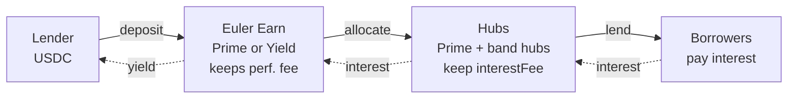
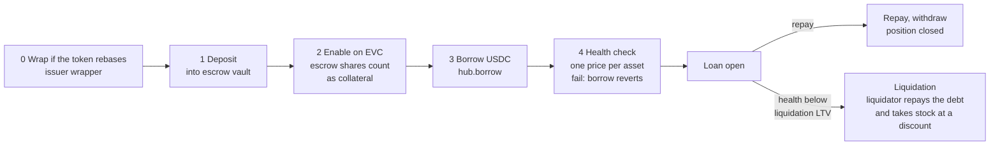
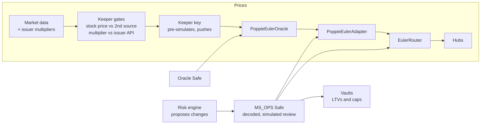

# Poppie v2 on Arbitrum: Overview (both designs)

*Nov 16, 2026. Everything here applies to both candidate designs, word for word. Design-specific parts (risk management, governance, pauses, contracts, fees, issuer pause windows, listing, audits, rollout, design decisions) are in each plan:*

- *zero-contract: `docs/zeroContracts/Poppie-Arbitrum-Hub-Architecture-Governance-Plan.md` (one page: `docs/zeroContracts/Overview.md`);*
- *peripheral-contract: `docs/peripheralContracts/Poppie-Arbitrum-Peripheral-Plan.md` (one page: `docs/peripheralContracts/Overview.md`; contract specifications: `docs/peripheralContracts/Peripheral-Contracts.md`).*

*Comparison: `docs/Design-Comparison.md`. Risk metrics: `docs/Risk-Metrics.md`. Findings and test evidence: `docs/EVAL_FINDINGS.md`.*

## Summary

Poppie lends USDC on Euler V2 (Arbitrum) against tokenized equities, from about 100 assets at launch toward 500. Both designs redeploy the audited v1 `PoppieEulerOracle` and `PoppieEulerAdapter` unchanged, and use stock Euler (EVK, EulerRouter, Earn, Euler's emergency governor and cap steward) and Safe. The peripheral design adds five small Poppie contracts in slots those contracts already expose.

Labels used below: **[v1]** enforced by the oracle or adapter; **[Euler]** by stock Euler code; **[Safe]** only by a Safe's signer threshold; **[Policy]** only by Poppie's back end or runbooks, a promise and not a guarantee.

## How it works

### Lenders

### Borrowers

There is one health figure per account. "Can borrow" and "liquidatable" differ only by the borrow LTV versus the liquidation LTV.

### Prices and risk settings

## Asset classes

| | Blue chip | Long tail |
| --- | --- | --- |
| Criteria | Index ETF or top-50 US stock; daily volume ≥ $500M; on-chain exit depth ≥ $1M at ≤ 2% slippage; 90-day volatility ≤ 45% | All other listed names |
| Max borrow / liquidation LTV | 70% / 75% **[Policy]** | Set by band **[Policy]** |
| Max supply cap | 20% of exit depth **[Policy]** | 10% of exit depth **[Policy]** |
| Listed in | Every hub | Its band's hub |

Class and band ceilings are not stored on-chain. Euler enforces only that borrow LTV ≤ liquidation LTV, and that lowering a liquidation LTV can ramp while raising one is instant **[Euler]**.

Names change class by policy: promoted after 30 days meeting the criteria, demoted after 5 days failing one. Each change is one `MS_OPS` batch across all hubs **[Policy]**.

## Issuers

At launch Poppie lists only tokens whose dividends are reinvested by the issuer.

| Issuer | Mechanism | Held in the escrow vault | Priced asset |
| --- | --- | --- | --- |
| xStocks | `balanceOf` rebases on multiplier changes (splits, reinvested dividends, optional management fee) | The V2 wrapper (`wrapperAddressV2`). Never the legacy wrapper. See "xStocks on Arbitrum" | The wrapper share |
| Dinari | Balances rebase on splits; cash dividends (USD+) to KYC-registered holders | Wrapped dShare, if its issues are resolved. See "Dinari on Arbitrum" | The wrapper share |
| Ondo GM | Static balances, dividends reinvested | The token | The token. **Not on Arbitrum**: the BSC token addresses have no code there |
| Robinhood | Static raw balances (ERC-8056); `uiMultiplier()` carries splits and reinvested dividends | The token. See "Robinhood Stock Tokens" | The token. **Robinhood Chain only today**; Arbitrum expected |
| Reality | Static raw balances (ERC-8056) since 2026-10-17, rebased before; cash (USDT0) and stock (rToken) dividends paid separately to the depositor via Merkl; withheld for unsupported protocols | The token, if listed. See "Reality rTokens" | The token. **On Arbitrum; not listable now** (D10) |
| Others | To research | — | — |

- **Ondo:** its docs do not currently list Arbitrum as a supported chain.
- **No issuer wrapper:** for a rebasing token without one, an unmodified OpenZeppelin `ERC4626` (`decimalsOffset = 0`, with a seed deposit) is the fallback (D3).
- **Not listed at launch:** tokens that pay dividends in cash to the holder (to revisit).

**Why the wrapper:** an EVK vault tracks its own cash. Tokens that arrive without a deposit can be taken by anyone through `skim`, and a reverse split leaves the vault owing more than it holds. A wrapper's share count never changes on its own.

**Pricing rule: the wrapper share is the oracle base** (for rebasing tokens; ERC-8056 tokens are their own base, see "Robinhood Stock Tokens").

- **The rule:** configure a direct `wrapper → USD → adapter` route, and never register the wrapper as a resolved vault.
- **Why:** resolving to the rebasing token makes collateral value jump the moment the multiplier activates, while the stored price is still old (EVAL_FINDINGS PATH-2).
- **Enforcement:** a config-check script checks this before every listing **[Policy]**.

**Keeper pricing:** price per wrapper share = equity price × equity per share, using the multiplier in effect at the push block. For xStocks, equity per share is `wrapper.convertToAssets(1e18) / 1e18`, which equals the token's `getCurrentMultiplier()`. For Robinhood, price per token = equity price × `uiMultiplier() / 1e18`.

### xStocks on Arbitrum

Read on-chain on 2026-11-02 (block ~520.7M) and exercised in `eval/fork/XStocksArbFork.t.sol`.

**How the V2 wrapper works** (`WrappedBackedTokenImplementation` v1.0.0):

- One wrapper share is one token share unit. `convertToAssets(1e18)` equals the multiplier: AAPLx `1003269012539818700`, SPYx `1007474126658766000`.
- `totalAssets` is supply × multiplier, so donations do not move the rate.
- A split leaves wrapper shares unchanged and scales `convertToAssets` (fork test).
- Deposit and redeem keep at least 1:1 backing; rounding leaves dust in the wrapper (fork test).
- 18 decimals; accepted by the adapter.

**Controls held by Backed** (same on AAPLx and SPYx):

| Role | Holder | Power |
| --- | --- | --- |
| Token and wrapper `owner`, owner of both ProxyAdmins | Safe `0x4975…3a65`, 2-of-3 | Upgrade token and wrapper logic instantly (no timelock); set pauser, fees, multiplier updater, sanctions list |
| Token and wrapper `pauser` | Safe `0x8768…FC50`, 3-of-5 | Pause all transfers of the token or the wrapper |
| Token `multiplierUpdater` and `burner` | **EOA** `0x5F7A…a2aD` | Set any multiplier at any activation time (see below). Also holds >99% of supply, owns `AtomicSwap`, signs for the pauser Safe |
| Token `minter` | EOA `0x0A93…4C2a` | Mint |
| Sanctions list | Chainalysis oracle `0x40C5…C8fb` | Blocks sanctioned senders, receivers and spenders on both token and wrapper |

**Multiplier updater:** an automated hot EOA. The contract bounds neither size nor notice: simulated updates of ×1000, ×0.001 and past activation times all succeed (EVAL_FINDINGS XS-9). Observed notice on AAPLx: 0 to about 4 hours.

- **Backed's notice:** normally about 2 hours; as little as 15 minutes when its data providers deliver late. No on-chain minimum delay was offered.
- **Schedule feed:** `GET https://api.xstocks.fi/api/v2/public/assets/{symbol}/multiplier?network=Arbitrum` returns `currentMultiplier`, `newMultiplier`, `activationDateTime` and `reason` (`FeeAccrual`, `Dividend`, `Split`, `ReverseSplit`, `Administrative`). Values are floats, so price from the on-chain multiplier and use the API for the reason.
- **Events are lazy:** `MultiplierUpdated` is emitted on the first interaction after activation, not at activation (XS-14). Read `newMultiplierActivationTime` and `getCurrentMultiplier()` on Arbitrum.
- **Past error:** on 2026-06-29 HONx's multiplier was halved for 8 h 25 min, with about 5 minutes' notice, then reset 2.44% below its prior value (XS-13, `docs/issuerResearch/HONx-Multiplier-Incident.md`). A keeper that followed it would have pushed −50%. This is why the keeper applies only multiplier changes that match a known corporate action.

Management fee: `feePerPeriod = 0`, `periodLength = 1 week`, so there is currently no fee decay. Backed's owner can turn it on.

**What pauses do to Poppie** (fork tests):

- Wrapper paused: no wrapper share can move, so escrow deposits and withdrawals revert. Prices are unaffected.
- Liquidation seizures move escrow shares, not wrapper shares, so they should still succeed during the pause (EVK seizes through the escrow's `transfer`; to confirm in the EVK harness). The liquidator cannot withdraw and sell until the pause ends.
- Token paused: wrapper shares still move, so escrow operations work; only unwrapping fails.

**Usage on Arbitrum.** The tokens exist, but nearly all supply is Backed inventory in the EOA above:

| Name | Arbitrum supply | Outside Backed's EOA | V2 wrapper supply |
| --- | --- | --- | --- |
| AAPLx | 72,045 | ~4 | 0 |
| SPYx | 29,101 | ~1.3 | 0 |
| TSLAx | 48,649 | ~2.1 | 0 |
| NVDAx | 108,045 | ~9.9 | 0.17 |
| QQQx | 32,883 | ~314 | 0 |
| MSFTx | 25,022 | ~1.3 | 0 |
| GOOGLx | 62,030 | ~606 | 0 |

There are no Uniswap v3 pools against USDC for AAPLx or SPYx, and 31 AAPLx transfers moved 0.7 tokens in the 80 hours checked. The wrappers are deployed but unused.

**Exit for liquidators.** The only liquidity is Backed's own inventory, sold through Backed's RFQ contract `AtomicSwap` (`0x6F86Ba14De57e61630f49f1136A5C608269d8852`). Each trade needs a quote signed by Backed, valid for about 60 seconds. The contract checks that both sides of the trade (the address paying and the address receiving) are on Backed's allowlist; it does not check who submits the transaction. Evidence: EVAL_FINDINGS XS-7.

The allowlist has 354 addresses: 342 EOAs and 12 contracts. One of the contracts is **Enso's shared executor** (`EnsoShortcuts`, `0x4Fe93ebC4Ce6Ae4f81601cC7Ce7139023919E003`), allowlisted since 2026-05-21. So Enso is already an onboarded party, and anyone using Enso's API reaches Backed's inventory without onboarding themselves.

| Counterparty on `AtomicSwap` (since 2026-05) | Swaps | Sells (liquidation direction) | Largest sell | Reached through |
| --- | --- | --- | --- | --- |
| **Enso** (`EnsoShortcuts`) | 125 | 41, $62k | $38k | Enso's router; 0x's API (which sources xStocks from Enso); Oku's router; ERC-4337 smart wallets; 47 different senders |
| Market maker or solver contract `0x083b…af53` | 90 | 49, $62k | $13k | CoW settlement and another intent settlement |
| Market maker or solver contract `0x0000…7628` | 82 | 26, $18k | $14k | CoW settlement and its own contract |
| Other | 2 | 0 | — | Direct |
| **Total** | 299 | 116, $142k | $38k | |

Buys: 183 swaps, $1.11M, largest $434k. All 27 names fill on weekdays in every session, including overnight (Enso: 10 of its 41 sells were overnight); **no fill on any weekend**. Only the token trades, so liquidators must unwrap first.

**What Backed quotes** (Backed, 2026-11-04):

| Session | Executable sell size per trade | Slippage, one way (NVDAx) |
| --- | --- | --- |
| Market hours, majors | Up to $1M | ~5 bps |
| Extended hours | Not stated | ~10 bps |
| Overnight, long-tail names | Down to $10k | ~20 bps |
| Weekends | **None** | — |

Poppie's own $1k NVDA test agrees: 6–7 bps round trip in market hours, about 40 bps overnight. Slippage is small next to liquidation discounts. The binding limits are quote size, settlement and weekends.

**Who liquidates.** Backed will not liquidate or act as a backstop buyer, and Poppie will not onboard with Backed or any other issuer (legal exposure). Poppie will not run its own liquidator at launch (D9). Liquidations are left to third parties, who can reach Backed's inventory without onboarding:

- **Through Enso or 0x (atomic):** Enso's executor is allowlisted, so any liquidator can liquidate, unwrap and sell through Enso's API in one transaction. 0x reaches the same route.
- **Through CoW (asynchronous):** solvers fill from Backed through their own allowlisted contracts. The liquidator needs its own USDC and carries price risk until the fill.

None of these is committed. The liquidity is Backed's inventory on Backed's terms (quote size, hours, no weekends), and Backed can remove Enso from its allowlist without notice. So the design treats thin exit liquidity as a risk to be capped, not solved: see "Thin liquidity and liquidations".

**Liquidation rules [Policy]:**

- Assume no exit at weekends; discounts cover holding until Monday.
- Size each name's supply cap to Backed's quoted size in the **weakest session in which the keeper prices it**, since liquidations can happen in any priced session. Alternatively, stop pricing a long-tail name in sessions without enough depth, so it goes stale instead.
- Rely on third-party liquidators; size caps and discounts so that liquidating is worth their while (see "Thin liquidity and liquidations").

**Reference addresses (Arbitrum; identical on other EVM chains):**

| | AAPLx | SPYx |
| --- | --- | --- |
| Token (proxy) | `0x9d275685dC284C8eB1C79f6ABA7a63Dc75ec890a` | `0x90A2a4c76b5D8c0bc892A69EA28Aa775a8f2dD48` |
| V2 wrapper (proxy), use this | `0x943BF64D566c32A2Bcd41AC92FB63C111cC9De8f` | `0xe7e553cd128f0011777323a0b44a7b96ea1cb540` |
| Legacy wrapper, never use | `0x5AA7649fdbDa47De64A07aC81D64B682AF9C0724` | `0xc88fcd8b874fdb3256e8b55b3decb8c24eab4c02` |

| Shared contract | Address |
| --- | --- |
| Wrapper implementation (`WrappedBackedTokenImplementation`) | `0x76C6851ea0B2741EeDcBBED240715E8817E85583` |
| Wrapper ProxyAdmin | `0x312063009E74142339Edc92BcfF6CfCfAA958BFA` |
| Token implementation (`BackedAutoFeeTokenImplementation`) | `0x65c40D624Af3B18C109fBF87B7DEff34CdC5f19b` |
| Token ProxyAdmin | `0x696c685a02a1fc6e2aacbe26cd6695f4f4a6a085` |

The implementation can be read from the proxy's EIP-1967 slot or from the ProxyAdmin's `getProxyImplementation`; both agree. Wrapper addresses come from `https://api.xstocks.fi/api/v2/public/assets/<SYMBOL>`, field `wrapperAddressV2`.

### Dinari on Arbitrum

Read on-chain on 2026-11-02 from Dinari's production `DShareFactory` `0xB4Ca72eA4d072C779254269FD56093D3ADf603b8` (address from Dinari's `sbt-contracts` release files). Not yet fork-tested.

- **Coverage:** 251 dShares, each with a wrapped dShare; 238 have supply. Largest by units: USFR 66.5k, ASST 22.1k, STRC 10.1k, MSTR 7.7k, MARA 5.1k, NVDA 4.5k, TSLA 1.6k.
- **Activity:** real but small and concentrated. NVDA had about 3,300 transfers in five weeks, but three EOAs hold about 90% of supply (likely Dinari or partner accounts). No Uniswap v3 USDC pool for NVDA.
- **Wrappers are almost unused:** 11 of 251 have any supply (NVDA 0.044 wrapped shares).

**How the wrapped dShare differs from xStocks' wrapper** (source: `WrappedDShare.sol` in `dinaricrypto/sbt-contracts`):

| | xStocks V2 wrapper | Dinari wrapped dShare |
| --- | --- | --- |
| Exchange rate | Supply × multiplier; donations can't move it | Wrapper's dShare balance (Solady `ERC4626`); **donations and reinvested dividends move it**. NVDA: 1 wrapped share = 15.08 dShares; USFR: 5 shares hold 727 dShares |
| Splits | Multiplier | `balancePerShare` rebase (NVDA shows its 10:1 split) |
| Dividends | Reinvested into the multiplier | Dinari deposits dShares into the wrapper |
| Issuer can remove backing | No | **Yes: `recover(account, amount)` sends the wrapper's dShares anywhere** (present in the deployed implementation) |
| Restrictions | Sanctions list | Dinari transfer restrictor (blacklist) on dShare and wrapper |
| Upgrades | 2-of-3 Safe | One beacon for all dShares and one for all wrappers, owned by **EOA** `0x06B0…60a3`, which also owns the transfer restrictor |

**Status: not listable as is.**

- The admin's `recover` lets Dinari remove the collateral backing, so every escrowed wrapped dShare depends on that key.
- With so few wrapped shares, the exchange rate is easy to push up with a donation. That only raises collateral value with the donor's own money, but it makes `convertToAssets` a poor keeper input until supply is meaningful.
- Raw dShares are not an option either: they rebase on splits and their dividends are cash.

**Listing rule for xStocks [Policy]:**

- hold only `wrapperAddressV2`, and check its implementation through the ProxyAdmin;
- reject the legacy `wrapperAddress`;
- require an exit route open to third-party liquidators before listing any name: Backed's quoted size for that name per session, reachable through Enso, 0x or CoW, or DEX depth;
- size the name's supply cap to that exit depth (see "Thin liquidity and liquidations").

### Robinhood Stock Tokens

Read on-chain on 2026-11-04 on Robinhood Chain (chain 4663, Arbitrum Nitro; block ~106.0M) and exercised in `eval/fork/RobinhoodChainFork.t.sol` and `eval/robinhood/`. Robinhood is expected to deploy on Arbitrum; these findings cover the token design. Evidence: EVAL_FINDINGS RH-1 to RH-11.

**How the token works** (ERC-8056 "Scaled UI Amount"):

- `balanceOf` and `totalSupply` are raw and **never change**. Robinhood's docs: "Stock tokens are not rebasing tokens."
- `uiMultiplier()` (18 dp) is underlying shares per token. Splits, reverse splits and reinvested cash dividends change only the multiplier.
- `newUIMultiplier()` and `effectiveAt()` show a pending change; `UIMultiplierUpdated(old, new, effectiveAt)` is emitted when one is scheduled.
- `oraclePaused()` is Robinhood's advisory flag that a corporate action is being processed. It does not stop transfers.
- 18 decimals; accepted by the adapter.

**Pricing rule: the token is the oracle base.**

- The escrow holds the token itself. No wrapper.
- Configure a direct `token → USD → adapter` route.
- Collateral value does not move when the multiplier activates; only a keeper push moves it. A split is a 0% push when the keeper uses the new multiplier (fork test).
- Robinhood reverse splits need no `adminSetPrice`, unlike per-token prices that ignore the multiplier.

**Keeper rules [Policy]:**

- Price per token = equity price × `uiMultiplier()` in effect at the push block. Chainlink's Robinhood feeds (58 of 203 tokens) quote the same value and can be used as a cross-check. Robinhood's REST `/prices` is raw equity, not multiplier-adjusted.
- Do not push while `oraclePaused()` is set; let the name go stale.
- Apply a multiplier change only if `/corporate-actions` lists a matching action. Otherwise alert and stop pushing that name. On 2026-11-04 SOXX's multiplier was set to 3.0 for three hours and then reverted, with no published SOXX split. The real 3:1 split took effect on 11-05, so the error was the date (RH-6).
- Splits: don't push between the ex-date session open and `effectiveAt`. Robinhood's splits so far took effect at the US open (13:30 / 14:30 UTC).
- Reinvested dividends: the multiplier rises about 10 minutes after scheduling, mid-session. Accept the dip of about the dividend size until it does.

**Controls held by Robinhood.** One registry contract, `0xe10b6f6B275de231345c20D14Ab812db62151b00`, is the beacon (implementation) for every token, the role store, the blocklist and a global pause. Every role holder is an EOA except one Robinhood contract.

| Role | Holder | Power |
| --- | --- | --- |
| `DEFAULT_ADMIN_ROLE` | EOA `0xd6F8…B66D` | Grant and revoke every role |
| `BEACON_UPGRADER_ROLE` | EOA `0xCd8C…E094` | Upgrade every token in one call |
| `MULTIPLIER_UPDATER_ROLE` | EOA `0x9290…8143` | Set any multiplier, instantly or at any future time |
| `ADMIN_BURNER_ROLE` | EOA `0x957B…74D4` | `adminBurn`: burn from any holder, no allowance |
| `BURNER_ROLE` | EOA `0x6E40…D8C1` (automated); contract `0x1364…9C08` | `burn`: burn from any holder, no allowance |
| `MINTER_ROLE` | EOA `0x2b94…3a87` (automated); contract `0x1364…9C08` | Mint |
| `PAUSER_ROLE` | EOA `0xe7BC…F22A` | Pause every token at once (registry) |
| `TOKEN_PAUSER_ROLE` | EOA `0xFCcF…Ab23` | Pause one token |
| `ORACLE_PAUSER_ROLE` | EOA `0x7369…4aBC` | Set or clear `oraclePaused` |
| `BLOCKER_ROLE` | EOA `0x913c…28fD` | Blocklist any address (247 so far) |

**Burns are issuer risk [Policy].** A Robinhood key can burn tokens straight out of a Poppie escrow. No contract can prevent this. It is accepted as issuer risk and bounded by per-issuer supply caps. If it happens:

- EVK tracks escrow cash internally, so the router keeps valuing the escrow at its pre-burn cash: collateral is overvalued, and the last depositors cannot withdraw (modelled in `test_RH_burnFromEscrow_ozSharesLoss_cashTrackingOvervalues`).
- Response: alert on any `Transfer` to `address(0)` from a Poppie escrow; pause the name in the oracle; cut its LTVs; treat the shortfall as bad debt for the reserve.

**What pauses do to Poppie** (fork tests):

- Token pause, registry pause or a blocklisted escrow: escrow deposits and withdrawals revert. Escrow shares still move, so EVK seizure should still succeed; the liquidator cannot withdraw until the pause ends.
- Oracle pause flag: transfers continue. The keeper stops pushing.

**Not yet known** (`docs/issuerResearch/Robinhood-Questions.md`): the Arbitrum deployment model; how non-multiplier corporate actions (mergers, spin-offs, redemptions; listed in the API but not active) pay out to contract holders; the cause of the SOXX change.

**Listing rule for Robinhood [Policy]:**

- list only addresses from Robinhood's `/assets` registry for the target chain, and check `ACCESS_CONTROLLED_REGISTRY()` and the beacon implementation;
- require ERC-165 support for `IScaledUIAmount` (`0xa60bf13d`) and `IScaledUIAmountNewUIMultiplier` (`0x4bd27648`);
- route the token directly; never wrap it;
- cap total Robinhood exposure as one issuer, since one registry and one set of keys cover every token.

**Reference addresses (Robinhood Chain):**

| | Address |
| --- | --- |
| AAPL token (beacon proxy) | `0xaF3D76f1834A1d425780943C99Ea8A608f8a93f9` |
| SOXX token (beacon proxy) | `0x75742c18BC1f1C5c5f448f4C9D9C6F66dafAAa38` |
| Registry (beacon, roles, blocklist, global pause) | `0xe10b6f6B275de231345c20D14Ab812db62151b00` |
| Token implementation | `0xb35490d6f9163DE4F80d88dc75c3516eb64C5aE2` |
| Chainlink AAPL/USD feed (proxy) | `0x6B22A786bAa607d76728168703a39Ea9C99f2cD0` |

Token addresses come from `https://api.robinhood.com/rhj/assets` (`deployments[].contractAddress` per `chainId`).

### Reality rTokens

Bitget's issuer, live on Arbitrum One since 2026-04. Read on-chain on 2026-11-05 (block ~521.34M) and exercised in `eval/fork/RealityArbFork.t.sol` and `eval/reality/`. Reality's docs are geo-blocked from where this was run. The Dividends & Claiming page was read through a VPN and is taken at its word; everything else rests on Bitget's press and on-chain data. **All Reality contracts are unverified**, so behaviour comes from simulation, not source. Evidence: EVAL_FINDINGS RE-1 to RE-12.

**How the token works today** (implementation since 2026-10-17):

- ERC-8056 with static `balanceOf`; `uiMultiplier()` carries splits. It changes the moment the Safe executes an action. `newUIMultiplier` and `effectiveAt` are never used for scheduling.
- Dividends are paid separately, never through the price or the multiplier: cash in USDT0, stock in rTokens.
  - They belong to the depositor. Merkl snapshots balances in supported protocols at the record date and traces them to the owner. Reality sends the dividend to the owner's wallet.
  - In a protocol Merkl doesn't support, the dividend is held by Reality and released once support is added (RE-9).
  - Poppie's escrows are not supported, so by default depositors' dividends are withheld. Nothing arrives at the escrow and no wrapper is needed.
  - The per-token price drops by the dividend on the ex-date, for stock dividends too, with no multiplier change.
- 18 decimals; accepted by the adapter.
- **Before 2026-10-17 the tokens rebased** (`rebaseIndex`). The upgrade that switched models changed every holder's balance on 18 tokens (RE-3).

**Pricing:** the token is the oracle base, as with Robinhood. Price per token = equity price × `uiMultiplier()`. A registry-backed 3:1 split is continuous through the router (fork test). Chainlink has no rToken feeds; underlying-equity Data Streams exist on Arbitrum.

**Corporate actions.** An on-chain action registry holds each split, its ratio and its effective time, usually created 3 days ahead. The admin Safe executes it on the token. The ratio is hash-checked and each action runs once, but nothing checks the effective time (RE-2). On record (RE-4):

- rCRWD's split was executed a week early, reversed and re-executed.
- The SOXX 3:1 split of 2026-11-05 was executed at 08:30 UTC by Reality, against 14:00 for xStocks and 14:30 for Robinhood. rMTUM and rQUAL from the same batch were not executed (RE-5).
- rHON's reverse split was executed twice on 2026-06-29, the day of the HONx incident.
- Six past-effective splits are still unexecuted.

**Controls held by Reality / Bitget:**

| Role | Holder | Power |
| --- | --- | --- |
| Beacon owner | Safe `0x7fD7A3Af05065fceEBbDa0B021206943423e4fdc`, 3-of-5 | Upgrade all 3,334 rTokens at once, no timelock (upgraded 2026-07-29, 08-27, 10-17) |
| `DEFAULT_ADMIN_ROLE`, `CONFIGURER_ROLE` | Safe `0xE6568007dB6E9188798AE0b65e5532F14a1ABcBB`, 3-of-5 (shares one signer with the beacon Safe) | Execute registry actions (multiplier), freeze accounts, unpause, delist, replace the action registry |
| `OPERATOR_ROLE` | EOA `0x6C5b3FdAB92BD311206e873806cB30E21cd11f00` | Pause transfers; `emergencyWithdraw` stray tokens to the vault EOA; execute dividend distributions |
| Action creator | EOA `0xdf8f9E822C2A70A175344c6E916202f9dDDaC62B` | Create and cancel registry actions |
| Minter | Contract `0x129Ea4DDb91C836f89Dfa9EF8102F9E505DFC4ba` | Inventory mint and burn; checked by the manager for pause flags |
| ID registry | Contract `0x36e2D13013b48862A818ec3394826F65c94618d4` (admin Safe adds IDs) | Who may mint and redeem through the manager |
| Dividend signer | EOA `0x632b93804A59207077a5B98d4F45639CD76bFe37` | Co-signs every dividend claim; claims pay the leaf's account |

No burn from holders was found. Freeze and pause block escrow withdrawals; escrow shares still move.

**Market on Arbitrum** (RE-10):

- 3,334 tokens; 1,178 have supply.
- In the major names, two or three EOAs hold 97–100% of supply.
- The only DEX liquidity is four Uniswap v3 USDC pools of about $190k each (rAAPL, rCRCL, rHOOD, rSPCX).
- Redemption is atomic (rToken in, USDC out, signed quote), but only for wallets that the admin Safe registers in `idRegistry` (7 IDs so far, mostly Reality's). A liquidator would need Reality to register it. Poppie won't register (D9), so unless a third-party provider is registered and opens the route, the exit is the four Uniswap pools.

**Status: not listable now (D10).**

- **Contracts:** the design fits, but the code is unverified and the beacon has no timelock.
- **Corporate actions:** the record has errors and lags.
- **Dividends:** withheld for depositors until Merkl supports Poppie's escrows (see below). Not a blocker on its own, but it needs disclosure. They are never protocol revenue.
- **Liquidity:** there is no third-party market or redemption route.

**Listing rule if revisited [Policy]:**

- require verified source and check the beacon implementation;
- route the token directly;
- follow only executed registry actions that match a second source; treat cash and stock dividends as an ex-date price drop with no multiplier change;
- disclose that Reality dividends are withheld until Merkl supports Poppie's escrows, and are paid to the holder at the record date (a liquidation before it moves the entitlement);
- cap Reality as one issuer.

**Merkl support (optional, needs a Merkl relationship; none assumed).** This would get depositors paid instead of withheld.

1. Ask Merkl to include Poppie's Euler escrows on Arbitrum in Reality's dividend snapshots. Merkl already lists Euler and EulerEarn as supported protocols in general.
2. Agree how a balance is traced: escrow shares per Euler sub-account, then to the sub-account's owner (EVC `getAccountOwner`). The owner may be an EOA, Safe or smart wallet. Also agree how seized collateral and shares held by other contracts are treated. **Precondition: dividends are never paid to the escrow address.** An escrow can't move USDT0, and same-name stock dividends sent to it can be `skim`med by anyone.
3. Confirm with Reality how dividends withheld before support began are released, and over what period.
4. No Poppie contract change is expected. Merkl reads balances off-chain, and the dividends are owed to depositors, not the escrow, so the escrow never claims. Optional later safeguard: an EVK hook that blocks `OP_SKIM` on Reality escrows (new code).

**Reference addresses (Arbitrum):**

| | Address |
| --- | --- |
| rNVDA (beacon proxy) | `0x0a85b6EBe3C150A1979a65656E304033D62b1E12` |
| rSOXX (beacon proxy) | `0x8E4Ad4Ee23d909AEfcC50A93fF367C36881C6fc0` |
| Beacon | `0x9a570740FaF9C77255e389a7BcCB7D460A5f4948` |
| Token implementation | `0x752C8073033046898aF127b3C78210E0D6e6C764` |
| Action registry | `0xd01f8AA971A3f4d13d52299bDD30225B1D7F40F1` |
| Mint/redeem manager (proxy) | `0x835b6725E6f017803d68a0AB78FDAaa6495C60Bc` |
| Dividend claim contract | `0x0B751b1DDd20ec589C14A3186161c97267f8d3Eb` |
| Sanctions list | `0x1faf98B0B31865dCD6ebAb4713a5C271d62e88A7` |
| Deployer / CREATE2 factory | `0x5f55Fd9F910976F4905cBc897E36f6B53b1e815B` / `0xcE6b0BDCAEDCcD291384551Bb812a74B59243872` |

Token addresses: `BeaconUpgraded(0x9a57…4948)` events, one per token.

### All issuers

**Issuer risk:** an issuer or custodian failure hits all its tokens at once. Exposure per issuer, and per underlying stock across issuers, is capped through supply caps **[Policy]**.

**Listing checks per issuer:**

- admin powers (pause, freeze, seize, burn from any holder);
- transfer restrictions, including who may receive seized collateral;
- whether the wrapper and escrow addresses must be allowlisted;
- whether token or wrapper contracts are upgradeable.

## Hubs

- **Prime hub:** blue chips only, lowest rates, 8% max liquidation discount.
- **Band hubs (M1–M3):** all blue chips plus every long-tail name in that band. Split a band only when one hub hits a real limit.

| Band | Long-tail profile (90-day volatility) | Max borrow / liquidation LTV **[Policy]** | Max liquidation discount **[Euler]** |
| --- | --- | --- | --- |
| M1 | ≤ 60%, deep liquidity | 50% / 58% | 10% |
| M2 | 60–90% | 45% / 52% | 15% |
| M3 | > 90%, or thin liquidity | 35% / 42% | 20% |

Exposure rules per band hub, enforced through supply caps **[Policy]**:

- long-tail-backed debt stays at or below 50% of the hub's borrow cap;
- no correlated group exceeds 30% of the hub's long-tail exposure.

Flash loans of hub USDC: on and free at launch, so third-party liquidators need no capital where the exit is atomic. What else can be done with them differs by design (each plan, "Flash loans and fees").

### Revenue

| Fee | Prime | M1 | M2 | M3 | Enforced by |
| --- | --- | --- | --- | --- | --- |
| Interest fee | 10% | 15% | 20% | 25% | [Euler]: 10–100% is always allowed |
| Rate floor (IRM base rate) | 2% | 3% | 4% | 5% | [Euler]: Kink IRM parameters |

- **Euler's protocol share:** EVK sends up to 50% of the interest fee to Euler's protocol receiver (`ProtocolConfig`). Check the Arbitrum value on a fork.
- **Earn fees:** Prime Earn charges a 5% performance fee and Yield Earn 10% **[Euler]**.
- **Prime Earn allocation:** at least 70% in the Prime hub, by policy **[Policy]**.
- **Origination fee:** differs by design; see each plan, "Flash loans and fees".

### Loss reserve

Hubs run with `CFG_DONT_SOCIALIZE_DEBT` **[Euler]**, so debt left on an account with no collateral stays there. The reserve Safe repays it with `repay(amount, account)` **[Safe]**.

- **Funding:** part of Poppie's interest fee (hub `feeReceiver`).
- **Fallback:** if bad debt exceeds the reserve, `MS_OPS` turns loss-sharing back on (`setConfigFlags`).

Repay quickly: until the reserve repays, the hub's share price overstates its assets.

## Thin liquidity and liquidations [Policy]

**The risk.** Exit liquidity for tokenized stocks on Arbitrum is thin, comes almost entirely from the issuer's own inventory, and stops at weekends. Poppie runs no liquidator and has no backstop buyer. If liquidators can't or won't sell seized collateral fast enough, positions go underwater and the hub takes bad debt.

**How the design caps it:**

| Lever | Rule |
| --- | --- |
| Listing gate | List a name only if a route open to third parties exists (issuer RFQ via Enso, 0x or CoW, or DEX depth), with observed sell fills |
| Supply caps | Each name's escrow cap ≤ a share of its exit depth in the **weakest session in which it is priced** (blue chip 20%, long tail 10%). For xStocks: Backed's quoted size per session |
| Sessions | Don't price a name in a session where its exit is too thin; it goes stale instead, which also pauses liquidations |
| LTV buffers | The gap between liquidation LTV and 100% must cover a weekend or overnight gap plus the discount (liquidation LTV: Prime 75%, bands 42–58%) |
| Liquidation discount | Large enough to pay a third party for slippage and for holding seized stock until the next quote, including over a weekend (8% Prime, up to 20% in M3) |
| Concentration | Per hub, long-tail debt ≤ 50% of the borrow cap and one correlated group ≤ 30% of long-tail exposure; per-issuer and per-stock caps across hubs |
| Loss reserve | Bad debt stays on the account (`CFG_DONT_SOCIALIZE_DEBT`) and the reserve Safe repays it |
| Monitoring | Alert on positions that stay liquidatable, on exit routes disappearing, and on any bad debt (see Monitoring) |
| Response | If liquidations lag: freeze the name's supply cap, ramp its liquidation LTV down, and pause new listings from that issuer until exit improves |

**Deferred:** a Poppie-run liquidator (contract and bot selling through Enso) and committed liquidator capital. Revisit if third-party liquidators prove unreliable at launch sizes.

## Prices and closed markets

### What the oracle enforces [v1]

| Control | Behaviour |
| --- | --- |
| Per-push circuit breaker | Per asset, 0–10000 bps against the last price. Strict `>`: a move of exactly the threshold passes |
| Cumulative deviation cap | Per asset, 1–10000 bps against an anchor that rotates to the accepted price each `anchorWindow` |
| Staleness | Reads revert after `maxPriceAge` (per-asset override, else global) |
| Pause | Keeper or admin; wipes price state; recovery needs `adminSetPrice` plus a keeper push |
| `adminSetPrice` | Any non-zero price, instantly; resets the anchor |
| Batches | One bad entry reverts the whole push. The keeper simulates the guards off-chain and drops failures, as the BSC keeper does **[Policy]** |

- One price serves both borrowing and liquidation.
- A move above the breaker, or above +100% at any setting, can only be applied by the Oracle Safe with `adminSetPrice`.
- A wrong keeper push within the bounds goes live immediately. The keeper is trusted; its blocking cross-checks are the defence **[Policy]**.

**Proposed thresholds:** blue chips: breaker 20%, cumulative cap 30%. Long tail: breaker 30% to 40%, cumulative cap 40% to 50%, by band. Tune these with gap data.

### Keeper: an iteration of the BSC keeper [Policy]

v2 reuses the BSC keeper and extends it. What the BSC keeper does today, from its source:

| Area | BSC keeper today | v2 |
| --- | --- | --- |
| Schedule | Push every 30 min (:15, :45); read-only monitor 5 min later; one run at a time (run lock) | Keep. Add deviation-triggered pushes if gas allows |
| Price | Chainlink Data Streams `midPrice` (stock price); freshest of the regular, extended and overnight feeds that is open and under 10 min old; otherwise skip and let the price go stale. Feeds fetched one at a time; schema guessed from report length | Keep. Fetch 8 feeds at a time and read the schema from the feed ID (KEEP-15). Coverage limits listings: 71 xStocks names on Arbitrum, 8 of them regular hours only (KEEP-4) |
| Multiplier | Ondo GM API (token price ÷ stock price), falling back to Ondo's on-chain SyntheticSharesOracle. The two are never compared | Read the issuer's multiplier on-chain at one pinned block, and check it against the issuer's API (see "Price sources and cross-check"). Call Backed's API only for names with a pending or changed multiplier, or no stored multiplier, since one call per name is too slow at 500 names (KEEP-6; prototyped: a normal 71-name run makes no such calls). Keep the last accepted multiplier per name between runs (KEEP-7) |
| Multiplier changes | Applied as they arrive; no corporate-action check, no limit | Apply only changes that match a known corporate action (see Corporate actions and the per-issuer rules) |
| Guards | Off-chain simulation of the breaker and cumulative cap drops failing assets; a reverting batch is retried once without the asset named in the revert | Keep. Chunk batches for 500 assets |
| Dropped assets | Logged as a warning; retried every 30 min against the same stored price; the monitor raises an error while the next price would be rejected | Page when a name is dropped on two consecutive pushes during a priced session. Planned skips never page and reset the count: market closed, a pending split, activation within 5 min (KEEP-12) |
| Second source | Alpha Vantage, alert-only: final price (after multiplier) vs Alpha Vantage's stock quote, 15%; missing data ignored | Blocking gate on the stock price, before the multiplier (see "Price sources and cross-check") |
| Issuer halts | Ondo status API: an active `ASSET_PAUSED` makes the keeper call `pauseAssets`, wiping the price; if the API fails, pricing continues | Don't pause on-chain for scheduled issuer windows; skip pushes for that name instead (see each plan, "Issuer pause windows"). `pauseAssets` stays for emergencies |
| Failure handling | Three failed runs in a row trip a halt latch; pushes stop until a person clears it. One asset's multiplier fetch error fails the whole run | Keep the latch, but count only infrastructure failures (RPC, signer, no chunk landing). Any per-name failure skips only that name (KEEP-8) |
| Signing and RPC | KMS HSM key; reads need a majority of several RPC endpoints | Keep. Add a timeout per signature: the KMS client retries an outage for up to 60 s per call (KEEP-9) |
| Alerting | Structured logs; any ERROR log alerts by email and Discord | Keep; add the alerts in Monitoring |
| Sequencer | — | No push while Arbitrum's sequencer is down, or within a grace period after it restarts (KEEP-17) |

A prototype of this keeper runs on an Arbitrum fork against the real xStocks contracts (oracleSystem branch `v2`; EVAL_FINDINGS KEEP-2 to KEEP-18).

### Price sources and cross-check [Policy]

**BSC today:**
- The keeper compares the final price with Alpha Vantage's stock quote and logs an error above 15%.
- It never blocks a push, and it skips any asset with no Alpha Vantage quote.
- It reads a `price` field that Alpha Vantage's bulk endpoint doesn't appear to return (the endpoint returns `close` and `extended_hours_quote`), so it may compare nothing (KEEP-3).
- Because the comparison is made after the multiplier, a multiplier error (such as a halving) does trigger the alert. But every legitimate multiplier also counts as deviation, so the threshold must stay wide.

**v2 rule (D11):**
- **Primary:** Chainlink Data Streams stock price × the issuer multiplier read on-chain at the push block.
- **Stock price gate (blocking):**
  - Compare the Data Streams stock price with an independent quote of the same stock, before applying the multiplier.
  - Above the tolerance: skip that asset and alert. Never push the second source's price.
  - The second-source quote must carry a timestamp and be fresh; a stale quote counts as no data.
- **Multiplier gate (blocking):**
  - The on-chain multiplier must match the issuer's published value (Backed's multiplier endpoint, Robinhood's `/corporate-actions`), within rounding.
  - Any change must match a known corporate action (Corporate actions, item 3).
  - On a mismatch: skip and alert.
- **Tolerance:** per session, tighter in regular hours than in extended and overnight sessions. Comparing stock to stock, without the multiplier, lets it be far tighter than BSC's 15%. Calibrate it from shadow recordings of the chosen vendors, and a replay of Data Streams against them, before launch; BSC's Alpha Vantage history may be empty (KEEP-3). First research data (Yahoo vs Nasdaq, KEEP-18): 99% of pairs agree within 0.17% in regular hours but only within 1.4% in extended hours, worst case 6.6%. So regular hours can be tight (about 2%), while extended-hours tolerances should depend on the name's liquidity. Neither source quotes overnight.
- **No second-source data:**
  - The gate fails closed: no fresh, agreeing quote means no push for that name, and the price goes stale after `maxPriceAge`.
  - So the keeper prices a name only in sessions its second source covers. Alpha Vantage covers 04:00–20:00 ET, so overnight pricing needs a second source that covers it, or none is priced overnight.
- **Outages:** use two second sources (the BSC keeper already has code for Polygon as well as Alpha Vantage). Push if at least one fresh source agrees and none disagrees. Page when every second source is unavailable during a priced session; at `maxPriceAge` 1 h, every name goes stale within the hour.
- **Split days:** no exception. If one source switches to split-adjusted prices before the other, the gate blocks and alerts, and the name goes stale briefly. Both sources usually switch together at the ex-date open, so the stock price gate passes. Only the multiplier gate can then catch the gap: the keeper skips a name while Backed shows a pending `Split` or `ReverseSplit` (fork-tested, KEEP-10).

**What each gate catches:**
- **Stock price gate:** a wrong or stale feed, a decoding error (BSC once read a timestamp as NFLX's price; the on-chain breaker caught it), wrong symbol mappings, and decimals errors inside the breaker bounds.
- **Multiplier gate:** issuer multiplier errors such as HONx, rHON and SOXX applied a day early (XS-13, RE-4, RH-6).
- **Neither:** an error shared by both stock sources, or an issuer error that the issuer's API also reports.

**To check before choosing vendors:** session coverage (overnight in particular), real-time vs delayed plans, rate limits and licence for about 500 names every 30 minutes, symbol coverage (ETFs, ADRs, new listings), quote timestamps, and split-adjustment timing.

**Primary coverage (KEEP-4):** Chainlink's Arbitrum catalog has at least one Data Streams feed for 71 of the 1,195 xStocks names with a USD underlying: 63 with a v11 regular-hours feed (61 of them in all three sessions), and 8 with only a v8 feed, priced in regular hours only. So Data Streams alone cannot reach phase 1's ~100 names. Options: ask Chainlink for more feeds, or accept a second primary (Pyth covers 771 of these names; Hermes now needs an API key) for names Chainlink doesn't cover. 293 more names have EUR, GBP or HKD underlyings and would also need FX.

### Closed markets

**Rule:** the keeper pushes whenever a reliable market price exists and passes the cross-checks, including the 24/5 overnight session if both the primary and a second source cover it. Otherwise it stops, and the price goes stale after `maxPriceAge`. That covers weekends, holidays and halts.

While a name is stale, for any account holding it as collateral:

| Operation | Result |
| --- | --- |
| Borrow | Reverts |
| Withdraw | Reverts if the account has debt (to confirm on EVK) |
| Liquidation | Reverts |
| Repay | Works |
| Add other collateral | Works |
| Deposits of that name | Work, but give no borrowing power until the price is fresh |

**Resume:** the first push within the breaker resumes the name, with no admin step. A gap beyond the breaker needs `adminSetPrice` from the Oracle Safe.

Size LTV buffers for weekend gaps, and size caps so third-party liquidators can absorb the Monday open. Liquidation discounts must also cover a liquidator holding seized stock until Backed quotes again; Backed gives no executable quotes at weekends.

### Corporate actions [Policy]

1. **Before the event:** drive this from market data (company announcements and ex-dates), not from the issuer's multiplier schedule: Backed's notice can be 15 minutes, too short for a Safe. Freeze the name's escrow supply cap. Cut its borrow LTV only if needed: a cut freezes every indebted account that relies on that name (see each plan, "Pauses").
2. **Breaker:** while a split of ratio r is pending, keep that name's breaker below the move a mis-push would cause, 1 − 1/r. For example, below 33% for a 3:2 split.
3. **Multiplier changes:** for any xStocks or Robinhood multiplier change, whether a split or a reinvested dividend (for Robinhood, read `newUIMultiplier()` and `effectiveAt()`, and see "Robinhood Stock Tokens" for its keeper rules):
   - read the activation time on-chain (`newMultiplierActivationTime`, `newMultiplier`); it varies, e.g. 23:55 and 13:45 UTC on SPYx. Poll these rather than rely on `multiplierUpdates` or events: 87% of xStocks tokens on Arbitrum run an older implementation with no history and no `MultiplierScheduled` events (KEEP-5). For xStocks, fetch Backed's multiplier endpoint for the `reason` whenever a change is pending; notice can be as short as 15 minutes, so this is automated in the keeper;
   - react to replaced schedules (a pending value or time that changes, or `MultiplierScheduleOverridden` on the newer implementation);
   - **splits:** don't push while a split is pending on-chain (from scheduling to activation), so the name goes stale briefly rather than mispriced. Skip any name whose activation falls within 5 minutes of the read block (KEEP-12);
   - **reinvested dividends:** accept the dip of about the dividend size until activation; it undervalues collateral and stays below the breaker. Match the change to the calendar using the dividend net of withholding (AAPLx's 2026-11-12 step matched AAPL's dividend net of 30% US withholding, KEEP-19). Backed activates them overnight (01:30 UTC in that case), so the calendar entry must exist before the overnight session;
   - **spin-offs (xStocks):** so far Backed has folded the spin-off's value into the parent's multiplier (CMCSAx +4.7% after the Versant spin-off, XS-11); no second token was delivered. Accept a rise of about the spin-off's value on or after the distribution date;
   - reject any multiplier change that doesn't match a known corporate action (alert, don't push). For xStocks, that includes any `Administrative` reason and any on-chain schedule with no API entry. A HONx halving in June 2026 would have passed the breaker (XS-13). Backed's API reported the same values, so only the corporate-action calendar catches this (KEEP-11);
   - **the calendar:** a market-data source of splits, dividends and spin-offs, with ex-dates and ratios, plus a reviewed file for manual approvals. Every reinvested dividend changes the multiplier, so without a feed each one stops pricing until someone adds it. The vendor is not chosen yet (KEEP-14).
4. **Large moves:** reverse splits, or gaps beyond the breaker, go through a pre-built `adminSetPrice` batch.
5. **Mergers, delistings and token migrations** (and any spin-off not handled through the multiplier): Backed handles these case by case and says users are made whole, with notice that depends on when Backed learns of the event. No mechanism or minimum notice is committed. On-chain, no merger or delisting with outside holders has completed yet; when Backed drops a token, the old contract stays live and nothing is burned or converted (XS-12). Kenvue (KVUEx, being acquired by Kimberly-Clark) is the first pending case: the API already shows it as redemption-only and halted. **Payouts do not reach V2 wrapper holders:** Backed requires holders to unwrap, and offers a way to sell the token (Atomic RFQ through protocols, or other ways). Poppie's escrows hold wrapper shares, so every position in the name must be closed or liquidated, and the wrapper redeemed, before the event. Robinhood's API lists these event types but marks none active, and their payout to contract holders is undocumented. So, for any such event, from either issuer, announced or detected from market data:
   - treat the name as a wind-down: freeze its escrow supply cap and ramp its liquidation LTV down, early enough that positions are closed or liquidated before Backed's unwrap deadline;
   - don't wait for notice from Backed. Early signals: a deal announcement in market data; the name losing `Issuance` from `allowedOperations`, or `isTradingHalted`, in Backed's API (KVUEx, QRVOx and WBDx showed these before their events).
6. **Reopen:** restore caps and LTVs only once both the multiplier or balance and the price reflect the action.

## Monitoring

Shared alerts. Each plan adds the alerts for its own governance keys and contracts.

- **Prices:**
  - stale prices during market hours (a keeper outage);
  - rejected pushes;
  - a name dropped by the guard check on two consecutive pushes during a priced session (the BSC keeper only logs this);
  - stock-price or multiplier gate failures, and every second source being unavailable during a priced session (D11);
  - a name skipped twice in a row in a priced session for any unplanned reason. Planned skips (market closed, pending split, activation within 5 min) only log (KEEP-12);
  - every `AdminPriceForced`.
- **Risk metrics:** R1–R10 above 80% of target (alert) or 100% (page), every run (`docs/Risk-Metrics.md`).
- **Governance keys:** every emergency-role, cap-steward and guardian action; any role grant or revocation on the emergency governor; any queued timelock call.
- **Routes and governance:** any route, adapter base, hook, rate-model, fee or governor change; any route not pointing to the Poppie adapter; any resolved-vault entry for a wrapper.
- **Exposure:** hub exposure-rule breaches; every cap or LTV raise.
- **Liquidations:** any account liquidatable for longer than N minutes during a priced session (third parties aren't acting); the debt of liquidatable accounts against each name's exit depth.
- **Bad debt:** any account with debt and no collateral.
- **Issuers:**
  - freezes or blacklisting of Poppie's wrapper or escrow addresses;
  - proxy upgrades of issuer tokens and wrappers (xStocks: `Upgraded` on the token and wrapper ProxyAdmins);
  - liquidation exit routes: `AddressDisallowed` for Enso's executor on Backed's `AtomicSwap`, `AtomicSwap` paused or upgraded, and no sell quote from Enso or 0x for a priced name during a priced session (page);
  - token or wrapper pause (`PauseModeChange`). Inside a scheduled window: log only. Outside one, or lasting past its end: page;
  - an issuer pause schedule that changes or cannot be fetched;
  - changes to the multiplier updater, fee parameters or sanctions list;
  - every scheduled, overridden or applied multiplier change. Backed's notice is normally about 2 hours but can be 15 minutes, so watch the chain and poll Backed's multiplier endpoint. Page on an `Administrative` reason, an on-chain schedule with no API entry, or a change of more than 10% with no matching split or spin-off. Poll on-chain schedules (`newMultiplierActivationTime`), because 87% of tokens emit no schedule events (KEEP-5);
  - Arbitrum's current or pending multiplier differing from Ethereum's for the same name (page if over 1%);
  - a listed name losing `Issuance` from `allowedOperations`, or being marked `isTradingHalted`, in Backed's API (wind-down signal);
  - Robinhood: every `UIMultiplierUpdated`; any change with no matching `/corporate-actions` entry (page); `oraclePaused` set outside a known corporate action; any burn from a Poppie escrow (page); registry role changes, `Upgraded`, registry pause and blocklist entries for Poppie addresses;
  - wrapper `convertToAssets(1e18)` differing from the token's `getCurrentMultiplier()`.
- **Earn:** any configuration change (caps, queues, curator, timelock).
- **USDC:** peg moves above 2%, since the USDC/USD route is a fixed rate.
- **Arbitrum sequencer:** downtime. After a restart the keeper waits N minutes before pushing, so users can act before liquidations resume.

## Decisions

Shared decisions. Decisions that differ by design (D5, D6, D8, D12–D17, D19) are in each plan.

| ID | Decision | Status |
| --- | --- | --- |
| D1 | Closed markets | Decided: one rule (push when a reliable price exists, else stale) |
| D2 | Revenue model | Interest fee, rate floor, Earn fees; confirm `ProtocolConfig` on a fork |
| D3 | Unmodified OZ `ERC4626` wrappers | Only where the issuer has none |
| D4 | Cash-dividend issuers | Decided: not at launch; revisit |
| D7 | Oracle instances | Decided: one |
| D9 | Liquidations | Decided: no onboarding with any issuer (legal), and no Poppie-run liquidator at launch. Liquidations are left to third parties, who can reach Backed's inventory through Enso, 0x or CoW without onboarding. Thin liquidity is managed with caps, discounts, buffers and the reserve (see "Thin liquidity and liquidations"). A Poppie liquidator is deferred |
| D10 | Reality rTokens | Proposed: not now. Revisit with third-party liquidity, verified source, a beacon timelock and answers on mergers and dividends |
| D11 | Second price source | Decided: blocking gates. The stock price must agree with an independent source before the multiplier is applied, and the multiplier must agree with the issuer's API. Either failing skips the name and alerts. Fails closed without fresh data. BSC's check is alert-only. Vendors to choose after checking coverage (overnight in particular). See "Price sources and cross-check" |
| D18 | Risk appetite | Open: `L_issuer`, `L_event`, `C_account`, `T_freeze` (`docs/Risk-Metrics.md`) |

## Known blockers and limitations

Ranked by likely impact. Each plan continues the list from 10 with its design-specific limits.

1. **No issuer currently has a listable market on Arbitrum.**
   - xStocks' contracts fit, but over 99% of supply is Backed inventory, the V2 wrappers are unused and there are no DEX pools.
   - The only exit is Backed's inventory, through its allowlisted `AtomicSwap` (directly, or via CoW solvers). Backed quotes up to $1M per trade on majors in market hours, down to $10k on long-tail names overnight, and nothing executable at weekends. It will not liquidate or backstop.
   - Liquidation depends on third parties: atomic through Enso (allowlisted by Backed), or asynchronous through CoW. None is committed, and Backed can remove Enso without notice (D9).
   - Dinari has some activity, but its wrapper lets the issuer remove backing (`recover`), is controlled by an EOA and is barely used. Ondo is not deployed.
   - Reality is deployed (3,334 rTokens), but supply sits with Reality-linked EOAs, the only DEX depth is four ~$190k pools, and redemption is Reality-only.
2. **Price coverage caps the listable set.** Chainlink Data Streams covers 71 of the 1,488 xStocks names on Arbitrum (KEEP-4), below phase 1's ~100. More names need more Chainlink feeds or a second primary source.
3. **xStocks pricing depends on one Backed EOA.** The `multiplierUpdater` is a single key that can set any multiplier instantly; a wrong multiplier changes the equity each wrapper share represents. It is an automated hot key with no on-chain bound on size or notice. The keeper alerts instead of pushing on unexplained changes, but users' wrapper balances already reflect it.
4. **Robinhood keys can burn from any holder and set any multiplier.** Two EOAs can burn tokens from a Poppie escrow; one EOA can set any multiplier instantly, and SOXX's 3:1 split was applied a day early on 2026-11-04, reverted within three hours, and re-applied on 11-05. Burns are accepted as issuer risk and capped; the keeper follows only explained multiplier changes.
5. **Corporate actions outside the multiplier are discretionary, and wrapper holders must exit first.** Backed handles mergers, spin-offs and delistings case by case, with no committed notice. Payouts do not reach V2 wrapper holders: holders must unwrap. So Poppie must wind a name down, and every position must be closed or liquidated, before Backed's deadline, which is not yet known.
6. **Earn may not accept the hubs.** An Earn vault can raise a hub's cap only if Euler's Earn factory allows it as a strategy, via a perspective contract Euler controls (`EulerEarnFactory.isStrategyAllowed`, `b2fd6e6`). Confirm on a fork. Fallback: lenders deposit into hubs directly. Earn's own timelock also delays new hubs and cap increases.
7. **Gaps beyond the breaker are routine at scale.** Each one leaves a name stale until the Oracle Safe signs `adminSetPrice`, and they cluster at Monday opens and earnings. An on-call signer rota is required.
8. **`MS_OPS` signing load.** It signs every risk change and every corporate action, so fatigue is a real risk. Every batch is reviewed decoded and simulated.
9. **Single admin and keeper for all names.** One incident affects every asset. Accepted for simplicity (D7).

## Open gaps

As of 2026-11-13. Each must be closed, or explicitly accepted, before listing.

**Issuers and markets**

1. **Exit liquidity:**
   - Backed's quote size and weekend hours, answered: up to $1M per trade on majors in market hours, down to $10k on long-tail names overnight, none at weekends;
   - whether Backed backstops, answered: no; solvers on CoW liquidate;
   - **D9:** whether third-party liquidators will act at launch sizes; Enso's limits and hours for sells (`docs/issuerResearch/Enso-Questions.md`); a fork test that a liquidation through Enso works end to end.
2. **xStocks follow-ups** (`docs/issuerResearch/xStocks-Backed-Questions.md`, Nov 4 list):
   - whether Backed's quote sizes and hours apply in full to Enso's route, and whether Backed will notify integrators before removing Enso from the allowlist;
   - whether $1M is repeatable (per hour, per day), which names count as majors, and sizes in the other sessions;
   - the unwrap deadline and notice in a merger or delisting, and what happens to wrapper shares left outstanding; how KVUEx will be settled (KMBx, cash, or both, and on which chains);
   - whether spin-offs will always be folded into the multiplier (as with Versant), and what the HONx 1.1% step on 2025-10-30 covered;
   - the cause of the HONx halving (2026-06-29, 8 h 25 min, ~5 min notice) and of the net −2.44% reset;
   - what the `Administrative` multiplier reason covers, and how sub-15-minute schedules happened.
3. **Dinari:**
   - who holds the wrapped dShare admin role (`recover`, `setBalancePerShare`), and whether Dinari would remove or timelock `recover`;
   - whether there is a market maker for wrapped dShares on Arbitrum;
   - their split and pause process on-chain;
   - a fork test like the xStocks one.
4. **Robinhood** (`docs/issuerResearch/Robinhood-Questions.md`):
   - when and how Stock Tokens come to Arbitrum (native or bridged), and whether the multiplier, `oraclePaused` and the blocklist stay in sync across chains;
   - controls behind the burn roles and the multiplier updater, and whether bounds or a minimum notice will be added;
   - how the SOXX 3:1 split came to be applied a day early on 2026-11-04 (the 11-05 split itself is confirmed);
   - how mergers, spin-offs and redemptions will pay out to contract holders such as escrows.
5. **Reality** (`docs/issuerResearch/Reality-Questions.md`; no contact yet):
   - verified source and a timelock on the beacon;
   - the cause of the rCRWD and rHON errors, the unexecuted past-effective splits (rMTUM, rQUAL and six older ones), and why splits are executed before the US open;
   - whether execution can be bound to the effective time;
   - payouts in mergers and delistings;
   - Merkl coverage of Poppie's escrows for Reality dividends, and how long withheld dividends are kept (no Merkl relationship assumed);
   - whether any third-party provider (for example Enso) is registered for Reality's atomic redemption and would open it to a liquidator, since Poppie will not register directly (D9); and whose EOAs hold 97–100% of supply;
   - whether using the tokens in permissionless lending is permitted (legal).
6. **Other issuers:** any other issuer on Arbitrum is not researched.

**Euler and Poppie side**

7. **EVK behaviour:** stale-price effects on borrow, withdraw and liquidation; supply- and borrow-cap freezes and `AmountCap` rounding; all-ops disable; liquidation seizure during an issuer wrapper pause. Needs an EVK harness.
8. **Euler Earn:** whether Euler's Earn factory accepts Poppie's hubs as strategies on Arbitrum.
9. **Fees:** Euler's protocol fee share on Arbitrum (`ProtocolConfig`).
10. **Scale:** gas for 300+ LTV entries in one hub.
11. **Second price sources (D11):**
   - choose the vendors;
   - confirm overnight coverage, quote timestamps and licence for about 500 names;
   - calibrate per-session tolerances from the shadow recordings (oracleSystem `scripts/v2/shadow`), not BSC's Alpha Vantage history, which may be empty (KEEP-3, KEEP-18).
12. **Primary coverage:** Data Streams covers 71 xStocks names on Arbitrum, 8 of them in regular hours only (KEEP-4). Ask Chainlink about more feeds, or decide on a second primary for the rest. **Decision needed:** cap phase 1 at Data Streams coverage, or keep ~100 names as the target and treat coverage as a blocker.
13. **Corporate-action data:** choose a vendor for splits, dividends and spin-offs, with ex-dates and amounts net of withholding; the multiplier gate depends on it (KEEP-14, KEEP-19).
14. **Keeper state and timings:** production storage for per-name keeper state (KEEP-7); the sequencer grace period (20 min for now); a timeout per KMS signature (KEEP-9). Losing keeper state forces every name back through Backed's API on the next run, and accepts current multipliers with an alert.
15. **Keeper build:** an issuer interface (needed before Robinhood), production wiring through `cmd/server`, and the v2 monitor.

## Expectations for integrators

Shared. Each plan adds what differs by design.

- **Stale prices:** an account holding a name with a stale price cannot borrow, withdraw (if indebted) or be liquidated until the price is fresh.
- **Price bounds:** prices are bounded per push and per window. A wrong push within those bounds, or any admin price write, goes live.
- **Pauses:** last until reversed. A vault-wide disable also blocks repay and liquidation while active.

## Deferred

- **Dividend capture:** a small wrapper that claims or receives cash dividends for the reserve. A test-only prototype is in `eval/prototypes/`. Revisit with legal and tax review, and with Dinari contract-wallet eligibility.
- **Poppie-run liquidator:** a contract and bot that liquidate and sell through Enso in one transaction, plus committed USDC for the CoW route. Revisit if third-party liquidations lag at launch sizes.
