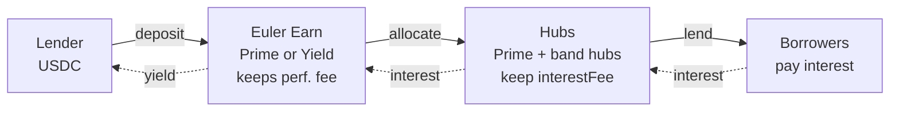
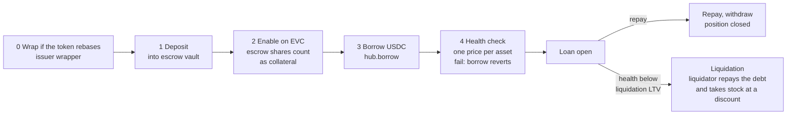
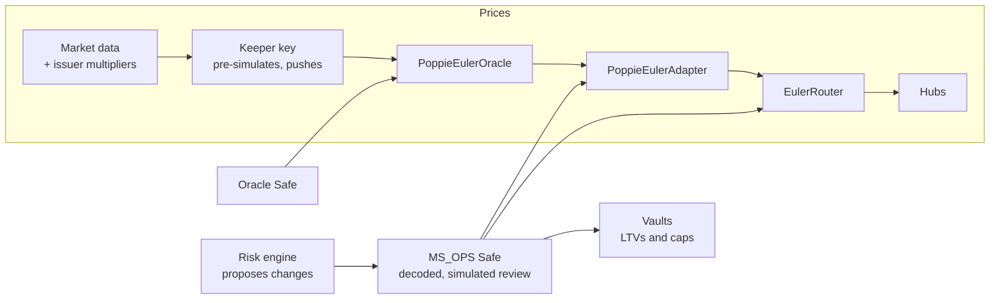

# Poppie on Arbitrum: Hub Architecture & Governance Plan

*Nov 2, 2026*

## TL;DR

Poppie lends USDC on Euler V2 against tokenized equities, from about 100 assets at launch toward 500.

- **Contracts:** Poppie's existing `PoppieEulerOracle` and `PoppieEulerAdapter` (tag `v1-bsc`) are redeployed unchanged. Everything else is stock:
  - Euler: EVK, EulerRouter and Earn;
  - Safe.

  **No new contracts at launch.**
- **Hubs:** one Prime hub (blue chips only) plus one hub per long-tail risk band. Each band hub holds all blue chips and that band's long-tail names.
- **Lenders:** deposit USDC into Prime Earn or Yield Earn, which allocate across the hubs.
- **Revenue:** interest fee and rate floor per hub, plus Earn performance fees. Part of Poppie's share funds a loss reserve.
- **Prices:** a keeper pushes one USD price per asset, used for both borrowing and liquidation. The oracle bounds each push and the drift per window.
- **Closed markets:** one rule. Push whenever a reliable price exists; otherwise let the price go stale, which freezes affected accounts until reopen.
- **Control:** the keeper key is the only back-end key with on-chain power. Two Safes hold everything else: the Oracle Safe holds the oracle admin, and `MS_OPS` governs the hubs, escrows, router, adapter and Earn. There is no timelock.
- **Issuers:** only tokens whose dividends are reinvested. Rebasing tokens enter through the issuer's non-rebasing wrapper, and the **wrapper share** is the priced asset.

| Choice | Gain | Cost |
| --- | --- | --- |
| Reuse the existing oracle | No new oracle code to audit | One price for borrowing and liquidation; pause wipes price state; one admin and one keeper address |
| Stock Euler contracts, governed directly by a Safe | Few moving parts; nothing new to audit; listings and fixes are instant | Coarse on-chain limits; `MS_OPS` signs every change; users get no notice and trust its signers |
| One hub per band | Deep liquidity, simple config | Lenders in a hub share every name's risk |
| Reinvesting issuers only | No dividend handling | Smaller listable set |

Euler allows at most 10 collaterals per account, so large portfolios need several sub-accounts. All numbers are proposed starting values.

## How to read the controls in this plan

| Label | Meaning |
| --- | --- |
| **[v1]** | Enforced by `PoppieEulerOracle` or `PoppieEulerAdapter` |
| **[Euler]** | Enforced by stock Euler code (EVK, EulerRouter, evk-periphery, Earn) |
| **[Safe]** | Enforced only by a Safe's signer threshold |
| **[Policy]** | Enforced only by Poppie's back end or runbooks. Not visible to or enforceable by the chain |

Anything labelled **[Policy]** is a promise, not a guarantee, and must be published as such.

Three Safes are used:

- **Oracle Safe**: holds the oracle admin.
- **`MS_OPS`**: 3-of-5; governs the hubs, escrows, router, adapter and Earn.
- **Reserve Safe**: holds the loss reserve.

## How it works

### Lenders

### Borrowers

There is one health figure per account. "Can borrow" and "liquidatable" differ only by the borrow LTV versus the liquidation LTV.

### Prices and risk settings

## Asset classes

| | Blue chip | Long tail |
| --- | --- | --- |
| Criteria | Index ETF or top-50 US stock; daily volume ≥ $500M; on-chain exit depth ≥ $1M at ≤ 2% slippage; 90-day volatility ≤ 45% | All other listed names |
| Max borrow / liquidation LTV | 70% / 75% **[Policy]** | Set by band **[Policy]** |
| Max supply cap | 20% of exit depth **[Policy]** | 10% of exit depth **[Policy]** |
| Listed in | Every hub | Its band's hub |

Class and band ceilings are not stored on-chain. Euler enforces only that borrow LTV ≤ liquidation LTV, and that lowering a liquidation LTV can ramp while raising one is instant **[Euler]**.

Names change class by policy: promoted after 30 days meeting the criteria, demoted after 5 days failing one. Each change is one `MS_OPS` batch across all hubs **[Policy]**.

## Issuers

At launch Poppie lists only tokens whose dividends are reinvested by the issuer.

| Issuer | Mechanism | Held in the escrow vault | Priced asset |
| --- | --- | --- | --- |
| xStocks | `balanceOf` rebases on multiplier changes (splits, reinvested dividends) | The issuer's **current** ERC-4626 wrapper. xStocks says its older v1 wrapper must not be used as collateral | The wrapper share |
| Dinari | Balances rebase on splits | Dinari wrapped dShare (dividends reinvested) | The wrapper share |
| Ondo GM | Static balances, dividends reinvested | The token | The token |
| Others | To research | — | — |

- **Ondo:** its docs do not currently list Arbitrum as a supported chain.
- **No issuer wrapper:** for a rebasing token without one, an unmodified OpenZeppelin `ERC4626` (`decimalsOffset = 0`, with a seed deposit) is the fallback (D3).
- **Not listed at launch:** tokens that pay dividends in cash to the holder (to revisit).

**Why the wrapper:** an EVK vault tracks its own cash. Tokens that arrive without a deposit can be taken by anyone through `skim`, and a reverse split leaves the vault owing more than it holds. A wrapper's share count never changes on its own.

**Pricing rule: the wrapper share is the oracle base.**

- **The rule:** configure a direct `wrapper → USD → adapter` route, and never register the wrapper as a resolved vault.
- **Why:** resolving to the rebasing token makes collateral value jump the moment the multiplier activates, while the stored price is still old (EVAL_FINDINGS PATH-2).
- **Enforcement:** a config-check script checks this before every listing **[Policy]**.

**Keeper pricing:** price per wrapper share = equity price × equity per share, using the multiplier in effect at the push block. The keeper reads xStocks' schedule on-chain (`multiplierUpdates`).

**Issuer risk:** an issuer or custodian failure hits all its tokens at once. Exposure per issuer, and per underlying stock across issuers, is capped through supply caps **[Policy]**.

**Listing checks per issuer:**

- admin powers (pause, freeze, seize);
- transfer restrictions, including who may receive seized collateral;
- whether the wrapper and escrow addresses must be allowlisted;
- whether token or wrapper contracts are upgradeable.

## Hubs

- **Prime hub:** blue chips only, lowest rates, 8% max liquidation discount.
- **Band hubs (M1–M3):** all blue chips plus every long-tail name in that band. Split a band only when one hub hits a real limit.

| Band | Long-tail profile (90-day volatility) | Max borrow / liquidation LTV **[Policy]** | Max liquidation discount **[Euler]** |
| --- | --- | --- | --- |
| M1 | ≤ 60%, deep liquidity | 50% / 58% | 10% |
| M2 | 60–90% | 45% / 52% | 15% |
| M3 | > 90%, or thin liquidity | 35% / 42% | 20% |

Exposure rules per band hub, enforced through supply caps **[Policy]**:

- long-tail-backed debt stays at or below 50% of the hub's borrow cap;
- no correlated group exceeds 30% of the hub's long-tail exposure.

Flash loans of hub USDC are left at the EVK default (on, free), which helps liquidators. `MS_OPS` can disable them later with a hook-config change.

### Revenue

| Fee | Prime | M1 | M2 | M3 | Enforced by |
| --- | --- | --- | --- | --- | --- |
| Interest fee | 10% | 15% | 20% | 25% | [Euler]: 10–100% is always allowed |
| Rate floor (IRM base rate) | 2% | 3% | 4% | 5% | [Euler]: Kink IRM parameters |

- **Euler's protocol share:** EVK sends up to 50% of the interest fee to Euler's protocol receiver (`ProtocolConfig`). Check the Arbitrum value on a fork.
- **Earn fees:** Prime Earn charges a 5% performance fee and Yield Earn 10% **[Euler]**.
- **Prime Earn allocation:** at least 70% in the Prime hub, by policy **[Policy]**.

### Loss reserve

Hubs run with `CFG_DONT_SOCIALIZE_DEBT` **[Euler]**, so debt left on an account with no collateral stays there. The reserve Safe repays it with `repay(amount, account)` **[Safe]**.

- **Funding:** part of Poppie's interest fee (hub `feeReceiver`).
- **Fallback:** if bad debt exceeds the reserve, `MS_OPS` turns loss-sharing back on (`setConfigFlags`).

Repay quickly: until the reserve repays, the hub's share price overstates its assets.

## Prices and closed markets

### What the oracle enforces [v1]

| Control | Behaviour |
| --- | --- |
| Per-push circuit breaker | Per asset, 0–10000 bps against the last price. Strict `>`: a move of exactly the threshold passes |
| Cumulative deviation cap | Per asset, 1–10000 bps against an anchor that rotates to the accepted price each `anchorWindow` |
| Staleness | Reads revert after `maxPriceAge` (per-asset override, else global) |
| Pause | Keeper or admin; wipes price state; recovery needs `adminSetPrice` plus a keeper push |
| `adminSetPrice` | Any non-zero price, instantly; resets the anchor |
| Batches | One bad entry reverts the whole push; the keeper pre-simulates and drops failures **[Policy]** |

- One price serves both borrowing and liquidation.
- A move above the breaker, or above +100% at any setting, can only be applied by the Oracle Safe with `adminSetPrice`.
- A wrong keeper push within the bounds goes live immediately. The keeper is trusted **[Policy]**.

**Proposed thresholds:** blue chips: breaker 20%, cumulative cap 30%. Long tail: breaker 30% to 40%, cumulative cap 40% to 50%, by band. Tune these with gap data.

### Closed markets

**Rule:** the keeper pushes whenever a reliable market price exists, including the 24/5 overnight session if the data covers it. Otherwise it stops, and the price goes stale after `maxPriceAge`. That covers weekends, holidays and halts.

While a name is stale, for any account holding it as collateral:

| Operation | Result |
| --- | --- |
| Borrow | Reverts |
| Withdraw | Reverts if the account has debt (to confirm on EVK) |
| Liquidation | Reverts |
| Repay | Works |
| Add other collateral | Works |
| Deposits of that name | Work, but give no borrowing power until the price is fresh |

**Resume:** the first push within the breaker resumes the name, with no admin step. A gap beyond the breaker needs `adminSetPrice` from the Oracle Safe.

Size LTV buffers for weekend gaps, and size liquidator capacity for the Monday open.

### Corporate actions [Policy]

1. **Before the event:** freeze the name's escrow supply cap. Cut its borrow LTV only if needed: a cut freezes every indebted account that relies on that name (see Pauses).
2. **Breaker:** while a split of ratio r is pending, keep that name's breaker below the move a mis-push would cause, 1 − 1/r. For example, below 33% for a 3:2 split.
3. **Multiplier changes:** for any xStocks multiplier change, whether a split or a reinvested dividend:
   - skip pushes within ±15 minutes of activation (00:30 UTC the day after the ex-date);
   - between the ex-date open and activation, adjust the per-share price for the multiplier that is not yet applied.
4. **Large moves:** reverse splits, or gaps beyond the breaker, go through a pre-built `adminSetPrice` batch.
5. **Reopen:** restore caps and LTVs only once both the multiplier or balance and the price reflect the action.

## Contracts Poppie deploys on Arbitrum

| Contract | Code | Count | Controlled by |
| --- | --- | --- | --- |
| `PoppieEulerOracle` | Existing, audited | 1 | `admin`: Oracle Safe. `keeper`: keeper key |
| `PoppieEulerAdapter` | Existing, audited | 1 | `admin`: `MS_OPS` |
| USDC/USD fixed-rate oracle | Euler `FixedRateOracle` | 1 | Immutable |
| EulerRouter | Euler | 1 | Governor: `MS_OPS` |
| Kink IRMs | Euler IRM factory | 1 per band, plus Prime | Set by `MS_OPS` |
| Hubs (borrow vaults) | EVK | 1 + 3 | `governorAdmin`: `MS_OPS` |
| Escrow vaults | EVK factory, escrow config | 1 per asset | `governorAdmin`: `MS_OPS` |
| Fallback wrappers | Unmodified OZ `ERC4626` | Only where no issuer wrapper exists | Immutable |
| Euler Earn vaults | Euler Earn `b2fd6e6` | 2 | Owner and curator: `MS_OPS` |
| Oracle Safe, `MS_OPS`, reserve Safe | Safe | 3 | Their signers |

Euler core contracts (EVC, factories, lenses, `ProtocolConfig`) are used at Euler's Arbitrum addresses. The oracle and adapter are compiled with their original settings (solc 0.8.24, `shanghai`) and verified byte-for-byte.

## Governance

Governance has three layers:

1. **Poppie contracts:** three address slots.
2. **Stock Euler contracts:** each has one governor address, set to `MS_OPS`.
3. **Back-end keys:** at launch only the keeper key has on-chain power.

### 1. Poppie contracts: three address slots [v1]

The oracle and adapter have no role system. Each slot holds one address, which may be a key or a contract, and that address has every power of the slot.

| Slot | Contract | Functions | Changed by | Holder |
| --- | --- | --- | --- | --- |
| `admin` | Oracle | `configureAssets`, `setAssetThresholds`, `adminSetPrice`, `setMaxPriceAge`, `setAssetMaxPriceAge`, `setAnchorWindow`, `setKeeper`, `pauseAssets`, `transferAdmin` | `transferAdmin`, then `acceptAdmin` | **Oracle Safe**, kept separate from `MS_OPS` so that a compromise of one does not give the other's powers |
| `keeper` | Oracle | `keeperPushPrices`, `pauseAssets` | `setKeeper` from the oracle admin (instant) | **Keeper key** (KMS) |
| `admin` | Adapter | `registerBase`, `unregisterBase`, `transferAdmin` | `transferAdmin`, then `acceptAdmin` | **`MS_OPS`**, as part of listing |

**One oracle instance.** One oracle and one adapter handle 500 assets: a 500-asset push measured 3.55M gas (EVAL_FINDINGS A7). The trade-off is blast radius: one admin and one keeper cover every name.

**The Oracle Safe is the largest trust point.** It can, instantly and without bounds:

- write any price;
- widen thresholds;
- disable staleness;
- replace the keeper.

Keep its signers separate from `MS_OPS` where possible, and alert on every admin event.

### 2. Stock components

| Component | How its access is set | Holder |
| --- | --- | --- |
| EVK vault (hub, escrow) | `setGovernorAdmin` | `MS_OPS` |
| EulerRouter | `transferGovernance` | `MS_OPS` |
| Euler Earn | `transferOwnership`, `setCurator`, `setIsAllocator` | Owner and curator: `MS_OPS`. The curator can also allocate |
| Safe | Owners and threshold | As listed above |

`MS_OPS` therefore holds every setting of every hub and escrow, instantly. Verified from source at EVK `422bf24`:

- **LTVs:** any LTV within Euler's rules. It can also cut a liquidation LTV with no ramp, which liquidates accounts at once.
- **Caps:** any cap. A raw cap of 0 means unlimited in EVK, so "closed" means the lowest finite cap.
- **Hook config:** it can disable **all** operations on a vault, including repay and liquidation, and undo that with the same call. It can also install an arbitrary hook contract.
- **Also:** interest rate models, interest fee, config flags, fee receiver, liquidation discount, and the vault's governor.
- **Router and adapter:** it can add, overwrite or delete any route, and register or remove any base.

None of this has an on-chain limit beyond the Safe's threshold **[Safe]**. A deployment script makes every assignment, and a check script reads them all back and diffs them against this section, before launch and after every change.

### 3. Back-end keys

| Key | On-chain power |
| --- | --- |
| Keeper key | Oracle `keeper` slot, bounded by the breaker, cumulative cap and staleness **[v1]** |
| Deployer key | None after deployment: creates escrows and makes seed deposits, then renounces everything |

The risk engine has no key. It proposes batches to `MS_OPS`, whose signers review every batch decoded and simulated in Safe tooling before signing **[Policy]**.

### Pauses

| Need | Mechanism | Who | Instant | Side effects |
| --- | --- | --- | --- | --- |
| Stop new deposits of a name | Escrow supply cap set to current supply | `MS_OPS` | Yes | Withdrawals and liquidations unaffected (to confirm on EVK) |
| Stop new borrowing against a name | Borrow LTV to 0 in each hub | `MS_OPS` | Yes | Every indebted account relying on that name freezes (no borrow, no withdraw) until it repays or adds collateral |
| Stop new borrowing in a hub | Hub borrow cap to current borrows | `MS_OPS` | Yes | `AmountCap` rounding to confirm on EVK |
| Stop pricing a name (e.g. a wrong price or wrong base decimals) | Oracle `pauseAssets` | Oracle Safe or keeper | Yes | Accounts holding it freeze; recovery needs `adminSetPrice` + push |
| Fix a wrong route or base | Router `govSetConfig`, adapter `unregisterBase` | `MS_OPS` | Yes | The name is unpriced, so accounts holding it freeze until it is re-routed |
| Stop everything on a vault | Hook config: disable all operations | `MS_OPS` | Yes | Blocks repay and liquidation while active; undone by the same call. Catastrophe only |

Pauses have no on-chain time limit; they last until reversed.

### If an address is compromised

- **Keeper key:**
  - can move each price by up to the breaker per push and the cumulative cap per window;
  - can pause **every** asset, wiping all prices and freezing the market;
  - is revoked with `setKeeper` from the Oracle Safe;
  - recovery from a full wipe is about 12M gas of `adminSetPrice` calls. Keep the batch pre-built and rehearsed.
- **Oracle Safe signers:** can set any price. No contract limits this.
- **`MS_OPS` signers:** can do anything to the hubs, escrows, router, adapter and Earn, instantly: change any LTV or cap, liquidate accounts by cutting liquidation LTVs, repoint any price route, install a hook that blocks withdrawals, or change rates and fees. Users get no notice. This is accepted for simplicity.

### Risk limits and what enforces them

| Limit | Enforced by |
| --- | --- |
| LTV ceilings per class and band | **[Policy]** |
| LTV raises: ≤ 3 pts per change, once per asset per week | **[Policy]** |
| Liquidation-LTV cuts: ≤ 5 pts per call, ramp ≥ 72h | **[Policy]** |
| Cap ceilings from exit depth | **[Policy]** |
| Borrow LTV ≤ liquidation LTV | **[Euler]** |
| All hub, escrow, router, adapter and Earn changes need `MS_OPS`'s threshold | **[Safe]** |
| Escrows cannot be borrowed from | **[Euler]**: escrows have no oracle |

## Risk automation

The engine watches exit liquidity, volatility, earnings and corporate actions, market sessions, hub concentration and the USDC peg. It proposes changes to `MS_OPS`; it signs nothing itself.

| When | What it proposes |
| --- | --- |
| On a breach | Tightening |
| Daily | Target updates; bounded raises |
| Before earnings or a corporate action | Supply-cap freeze; borrow-LTV cut if needed |

## Listing

1. The engine assigns the name a class, band and hub, after the issuer checks.
2. A deployer key creates the escrow vault from Euler's factory, makes the seed deposit and hands governance to `MS_OPS`.
3. The Oracle Safe calls `configureAssets` and `adminSetPrice`. From then on the keeper pushes the asset, so its price is fresh when the route goes live. `registerBase` needs the asset configured, not a live price.
4. An `MS_OPS` batch:
   - registers the base on the adapter;
   - adds the route and the escrow's resolved-vault entry;
   - sets launch LTVs at half the class ceiling;
   - sets finite launch caps.
5. `MS_OPS` steps it up over time **[Policy]**.

Before each batch, a config-check script verifies:

- routes point to the Poppie adapter;
- wrappers are never resolved vaults;
- escrows come from Euler's factory;
- caps are finite.

There is no on-chain notice period. The config-check script and decoded, simulated review of every batch are the protection **[Policy]**.

## Monitoring

Alert on:

- **Prices:**
  - stale prices during market hours (a keeper outage);
  - rejected pushes;
  - every `AdminPriceForced`.
- **Oracle admin:** any threshold, staleness, window or keeper change.
- **Routes and governance:** any route, adapter base, hook, rate-model, fee or governor change; any route not pointing to the Poppie adapter; any resolved-vault entry for a wrapper.
- **Exposure:** hub exposure-rule breaches; every cap or LTV raise.
- **Bad debt:** any account with debt and no collateral.
- **Issuers:**
  - freezes or blacklisting of Poppie's wrapper or escrow addresses;
  - proxy upgrades of issuer tokens and wrappers;
  - pending multiplier updates and split calendars, at least 48h ahead.
- **Earn:** any configuration change (caps, queues, curator, timelock).
- **USDC:** peg moves above 2%, since the USDC/USD route is a fixed rate.
- **Arbitrum sequencer:** downtime. After a restart the keeper waits N minutes before pushing, so users can act before liquidations resume.

## Audits

| Track | Scope |
| --- | --- |
| Deployment and configuration | The grant scripts and check script; Safe thresholds; byte-for-byte verification of the oracle and adapter |
| Off-chain systems | Keeper, corporate-action engine, alerting |
| Economic | Class and band thresholds; breaker and cap sizing against real weekend, earnings and split gaps |

## Rollout

| Phase | Scope | Gate to next phase |
| --- | --- | --- |
| 0 | EVK harness and Arbitrum fork tests: stale-price and cap behaviour, Earn accepting the hubs, 300+ LTV entries in one hub, `ProtocolConfig` values, a real xStocks multiplier change end to end | All pass |
| 1 (~100 assets) | Prime hub plus 3 band hubs; both Earn vaults | Check script passes; alerts live |
| 2 (→ 500 assets) | More names; more hubs per band if needed | — |

## Decisions

| ID | Decision | Status |
| --- | --- | --- |
| D1 | Closed markets | Decided: one rule (push when a reliable price exists, else stale) |
| D2 | Revenue model | Interest fee, rate floor, Earn fees; confirm `ProtocolConfig` on a fork |
| D3 | Unmodified OZ `ERC4626` wrappers | Only where the issuer has none |
| D4 | Cash-dividend issuers | Decided: not at launch; revisit |
| D5 | Listing | Decided: instant, by `MS_OPS` |
| D6 | `adminSetPrice` | Decided: Oracle Safe only, with an on-call signer rota |
| D7 | Oracle instances | Decided: one |

## Known blockers and limitations

Ranked by likely impact:

1. **The listable set may be far below 500.** Without Ondo on Arbitrum the set is mainly xStocks and Dinari wrapped dShares, filtered by exit depth. If seized collateral can only go to allowlisted holders, a backstop liquidator is needed.
2. **Earn may not accept the hubs.** An Earn vault can raise a hub's cap only if Euler's Earn factory allows it as a strategy, via a perspective contract Euler controls (`EulerEarnFactory.isStrategyAllowed`, `b2fd6e6`). Confirm on a fork. Fallback: lenders deposit into hubs directly. Earn's own timelock also delays new hubs and cap increases.
3. **Gaps beyond the breaker are routine at scale.** Each one leaves a name stale until the Oracle Safe signs `adminSetPrice`, and they cluster at Monday opens and earnings. An on-call signer rota is required.
4. **`MS_OPS` signing load.** It signs every risk change and every corporate action, so fatigue is a real risk. Every batch is reviewed decoded and simulated.
5. **Single admin and keeper for all names.** One incident affects every asset. Accepted for simplicity (D7).
6. **`MS_OPS` holds all structural power with no notice.** It can repoint routes, install hooks and change rates instantly. Users must trust its signers. A timelock can be added later by moving these slots to one (see Deferred).
7. **Single keeper address.** Several processes share one key, which needs careful nonce coordination.

## Expectations for integrators

- **Stale prices:** an account holding a name with a stale price cannot borrow, withdraw (if indebted) or be liquidated until the price is fresh.
- **Price bounds:** prices are bounded per push and per window. A wrong push within those bounds, or any admin price write, goes live.
- **Risk limits:** set by Poppie's published policy, not by contracts.
- **Pauses:** last until reversed. A vault-wide disable also blocks repay and liquidation while active.
- **Changes:** listings, route changes and risk changes take effect immediately, with no notice period.

## Deferred

- **Dividend capture:** a small wrapper that claims or receives cash dividends for the reserve. A test-only prototype is in `eval/prototypes/`. Revisit with legal and tax review, and with Dinari contract-wallet eligibility.
- **Timelock:** move the router governor, adapter admin and vault governance behind a timelock for advance public notice of structural changes.
- **Delegated risk keys:** let a back-end key tighten instantly through an intermediary Safe whose membership `MS_OPS` can revoke at once.
- **Multiple keeper keys:** a keeper Safe, or a second oracle instance.
