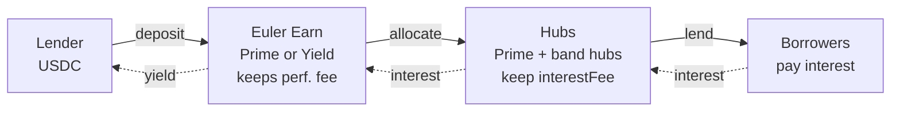
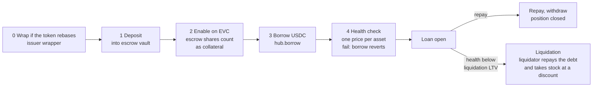
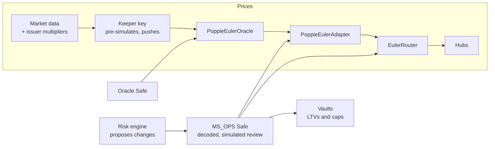

# Poppie on Arbitrum: Hub Architecture & Governance Plan

*Nov 2, 2026*

## TL;DR

Poppie lends USDC on Euler V2 against tokenized equities, from about 100 assets at launch toward 500.

- **Contracts:** Poppie's existing `PoppieEulerOracle` and `PoppieEulerAdapter` (tag `v1-bsc`) are redeployed unchanged. Everything else is stock:
  - Euler: EVK, EulerRouter and Earn;
  - Safe.

  **No new contracts at launch.**
- **Hubs:** one Prime hub (blue chips only) plus one hub per long-tail risk band. Each band hub holds all blue chips and that band's long-tail names.
- **Lenders:** deposit USDC into Prime Earn or Yield Earn, which allocate across the hubs.
- **Revenue:** interest fee and rate floor per hub, plus Earn performance fees. Part of Poppie's share funds a loss reserve.
- **Prices:** a keeper pushes one USD price per asset, used for both borrowing and liquidation. The oracle bounds each push and the drift per window.
- **Closed markets:** one rule. Push whenever a reliable price exists; otherwise let the price go stale, which freezes affected accounts until reopen.
- **Control:** the keeper key is the only back-end key with on-chain power. Two Safes hold everything else: the Oracle Safe holds the oracle admin, and `MS_OPS` governs the hubs, escrows, router, adapter and Earn. There is no timelock.
- **Issuers:** only tokens whose dividends are reinvested. Rebasing tokens enter through the issuer's non-rebasing wrapper, and the **wrapper share** is the priced asset. Tokens with static balances and a multiplier (ERC-8056, e.g. Robinhood) are held and priced directly.
- **Main open risk:** no issuer has a listable market on Arbitrum today. xStocks' contracts fit this design (tested on an Arbitrum fork), but nearly all supply is Backed inventory and there are no DEX pools. The only exit is Backed's inventory via its allowlisted `AtomicSwap`. Backed quotes up to $1M per trade on majors in market hours and $10k on long-tail names overnight, with nothing executable at weekends. Backed will not liquidate itself: solvers on CoW can, and an atomic route needs an onboarded party such as Oku (D9). Dinari's wrapper lets the issuer remove backing. Ondo is not deployed. Robinhood Stock Tokens fit with no wrapper (tested on a Robinhood Chain fork) but are not yet on Arbitrum, and Robinhood keys can burn from any holder. Reality's rTokens are on Arbitrum and fit with no wrapper (tested on a fork), but 97–100% of supply sits in two or three EOAs, their contracts are unverified, and their corporate-action record has errors (D10).

| Choice | Gain | Cost |
| --- | --- | --- |
| Reuse the existing oracle | No new oracle code to audit | One price for borrowing and liquidation; pause wipes price state; one admin and one keeper address |
| Stock Euler contracts, governed directly by a Safe | Few moving parts; nothing new to audit; listings and fixes are instant | Coarse on-chain limits; `MS_OPS` signs every change; users get no notice and trust its signers |
| One hub per band | Deep liquidity, simple config | Lenders in a hub share every name's risk |
| Reinvesting issuers only | No dividend handling | Smaller listable set |

Euler allows at most 10 collaterals per account, so large portfolios need several sub-accounts. All numbers are proposed starting values.

## How to read the controls in this plan

| Label | Meaning |
| --- | --- |
| **[v1]** | Enforced by `PoppieEulerOracle` or `PoppieEulerAdapter` |
| **[Euler]** | Enforced by stock Euler code (EVK, EulerRouter, evk-periphery, Earn) |
| **[Safe]** | Enforced only by a Safe's signer threshold |
| **[Policy]** | Enforced only by Poppie's back end or runbooks. Not visible to or enforceable by the chain |

Anything labelled **[Policy]** is a promise, not a guarantee, and must be published as such.

Three Safes are used:

- **Oracle Safe**: holds the oracle admin.
- **`MS_OPS`**: 3-of-5; governs the hubs, escrows, router, adapter and Earn.
- **Reserve Safe**: holds the loss reserve.

## How it works

### Lenders

### Borrowers

There is one health figure per account. "Can borrow" and "liquidatable" differ only by the borrow LTV versus the liquidation LTV.

### Prices and risk settings

## Asset classes

| | Blue chip | Long tail |
| --- | --- | --- |
| Criteria | Index ETF or top-50 US stock; daily volume ≥ $500M; on-chain exit depth ≥ $1M at ≤ 2% slippage; 90-day volatility ≤ 45% | All other listed names |
| Max borrow / liquidation LTV | 70% / 75% **[Policy]** | Set by band **[Policy]** |
| Max supply cap | 20% of exit depth **[Policy]** | 10% of exit depth **[Policy]** |
| Listed in | Every hub | Its band's hub |

Class and band ceilings are not stored on-chain. Euler enforces only that borrow LTV ≤ liquidation LTV, and that lowering a liquidation LTV can ramp while raising one is instant **[Euler]**.

Names change class by policy: promoted after 30 days meeting the criteria, demoted after 5 days failing one. Each change is one `MS_OPS` batch across all hubs **[Policy]**.

## Issuers

At launch Poppie lists only tokens whose dividends are reinvested by the issuer.

| Issuer | Mechanism | Held in the escrow vault | Priced asset |
| --- | --- | --- | --- |
| xStocks | `balanceOf` rebases on multiplier changes (splits, reinvested dividends, optional management fee) | The V2 wrapper (`wrapperAddressV2`). Never the legacy wrapper. See "xStocks on Arbitrum" | The wrapper share |
| Dinari | Balances rebase on splits; cash dividends (USD+) to KYC-registered holders | Wrapped dShare, if its issues are resolved. See "Dinari on Arbitrum" | The wrapper share |
| Ondo GM | Static balances, dividends reinvested | The token | The token. **Not on Arbitrum**: the BSC token addresses have no code there |
| Robinhood | Static raw balances (ERC-8056); `uiMultiplier()` carries splits and reinvested dividends | The token. See "Robinhood Stock Tokens" | The token. **Robinhood Chain only today**; Arbitrum expected |
| Reality | Static raw balances (ERC-8056) since 2026-10-17, rebased before; cash (USDT0) and stock (rToken) dividends paid separately to the depositor via Merkl; withheld for unsupported protocols | The token, if listed. See "Reality rTokens" | The token. **On Arbitrum; not listable now** (D10) |
| Others | To research | — | — |

- **Ondo:** its docs do not currently list Arbitrum as a supported chain.
- **No issuer wrapper:** for a rebasing token without one, an unmodified OpenZeppelin `ERC4626` (`decimalsOffset = 0`, with a seed deposit) is the fallback (D3).
- **Not listed at launch:** tokens that pay dividends in cash to the holder (to revisit).

**Why the wrapper:** an EVK vault tracks its own cash. Tokens that arrive without a deposit can be taken by anyone through `skim`, and a reverse split leaves the vault owing more than it holds. A wrapper's share count never changes on its own.

**Pricing rule: the wrapper share is the oracle base** (for rebasing tokens; ERC-8056 tokens are their own base, see "Robinhood Stock Tokens").

- **The rule:** configure a direct `wrapper → USD → adapter` route, and never register the wrapper as a resolved vault.
- **Why:** resolving to the rebasing token makes collateral value jump the moment the multiplier activates, while the stored price is still old (EVAL_FINDINGS PATH-2).
- **Enforcement:** a config-check script checks this before every listing **[Policy]**.

**Keeper pricing:** price per wrapper share = equity price × equity per share, using the multiplier in effect at the push block. For xStocks, equity per share is `wrapper.convertToAssets(1e18) / 1e18`, which equals the token's `getCurrentMultiplier()`. For Robinhood, price per token = equity price × `uiMultiplier() / 1e18`.

### xStocks on Arbitrum

Read on-chain on 2026-11-02 (block ~520.7M) and exercised in `eval/fork/XStocksArbFork.t.sol`.

**How the V2 wrapper works** (`WrappedBackedTokenImplementation` v1.0.0):

- One wrapper share is one token share unit. `convertToAssets(1e18)` equals the multiplier: AAPLx `1003269012539818700`, SPYx `1007474126658766000`.
- `totalAssets` is supply × multiplier, so donations do not move the rate.
- A split leaves wrapper shares unchanged and scales `convertToAssets` (fork test).
- Deposit and redeem keep at least 1:1 backing; rounding leaves dust in the wrapper (fork test).
- 18 decimals; accepted by the adapter.

**Controls held by Backed** (same on AAPLx and SPYx):

| Role | Holder | Power |
| --- | --- | --- |
| Token and wrapper `owner`, owner of both ProxyAdmins | Safe `0x4975…3a65`, 2-of-3 | Upgrade token and wrapper logic instantly (no timelock); set pauser, fees, multiplier updater, sanctions list |
| Token and wrapper `pauser` | Safe `0x8768…FC50`, 3-of-5 | Pause all transfers of the token or the wrapper |
| Token `multiplierUpdater` and `burner` | **EOA** `0x5F7A…a2aD` | Set any multiplier at any activation time (see below). Also holds >99% of supply, owns `AtomicSwap`, signs for the pauser Safe |
| Token `minter` | EOA `0x0A93…4C2a` | Mint |
| Sanctions list | Chainalysis oracle `0x40C5…C8fb` | Blocks sanctioned senders, receivers and spenders on both token and wrapper |

**Multiplier updater:** an automated hot EOA. The contract bounds neither size nor notice: simulated updates of ×1000, ×0.001 and past activation times all succeed (EVAL_FINDINGS XS-9). Observed notice on AAPLx: 0 to about 4 hours.

- **Backed's notice:** normally about 2 hours; as little as 15 minutes when its data providers deliver late. No on-chain minimum delay was offered.
- **Schedule feed:** `GET https://api.xstocks.fi/api/v2/public/assets/{symbol}/multiplier?network=Arbitrum` returns `currentMultiplier`, `newMultiplier`, `activationDateTime` and `reason` (`FeeAccrual`, `Dividend`, `Split`, `ReverseSplit`, `Administrative`). Values are floats, so price from the on-chain multiplier and use the API for the reason.
- **Events are lazy:** `MultiplierUpdated` is emitted on the first interaction after activation, not at activation (XS-14). Read `newMultiplierActivationTime` and `getCurrentMultiplier()` on Arbitrum.
- **Past error:** on 2026-06-29 HONx's multiplier was halved for 8 h 25 min, with about 5 minutes' notice, then reset 2.44% below its prior value (XS-13, `docs/HONx-Multiplier-Incident.md`). A keeper that followed it would have pushed −50%. This is why the keeper applies only multiplier changes that match a known corporate action.

Management fee: `feePerPeriod = 0`, `periodLength = 1 week`, so there is currently no fee decay. Backed's owner can turn it on.

**What pauses do to Poppie** (fork tests):

- Wrapper paused: no wrapper share can move, so escrow deposits and withdrawals revert. Prices are unaffected.
- Liquidation seizures move escrow shares, not wrapper shares, so they should still succeed during the pause (EVK seizes through the escrow's `transfer`; to confirm in the EVK harness). The liquidator cannot withdraw and sell until the pause ends.
- Token paused: wrapper shares still move, so escrow operations work; only unwrapping fails.

**Usage on Arbitrum.** The tokens exist, but nearly all supply is Backed inventory in the EOA above:

| Name | Arbitrum supply | Outside Backed's EOA | V2 wrapper supply |
| --- | --- | --- | --- |
| AAPLx | 72,045 | ~4 | 0 |
| SPYx | 29,101 | ~1.3 | 0 |
| TSLAx | 48,649 | ~2.1 | 0 |
| NVDAx | 108,045 | ~9.9 | 0.17 |
| QQQx | 32,883 | ~314 | 0 |
| MSFTx | 25,022 | ~1.3 | 0 |
| GOOGLx | 62,030 | ~606 | 0 |

There are no Uniswap v3 pools against USDC for AAPLx or SPYx, and 31 AAPLx transfers moved 0.7 tokens in the 80 hours checked. The wrappers are deployed but unused.

**Exit for liquidators.** The only liquidity is Backed's own inventory, sold through Backed's RFQ contract `AtomicSwap` (`0x6F86Ba14De57e61630f49f1136A5C608269d8852`): Backed-signed quotes, allowlisted callers only. CoW solvers use it too (58 of 59 CoW trades). Evidence: EVAL_FINDINGS XS-7.

| Since 2026-05 (27 names) | Swaps | Total | Largest |
| --- | --- | --- | --- |
| Sells (liquidation direction) | 115 | $142k | $38k |
| Buys | 181 | $1.03M | $434k |

Weekday fills in all sessions; **no weekend fills**. Only the token trades, so liquidators must unwrap first.

**What Backed quotes** (Backed, 2026-11-04):

| Session | Executable sell size per trade | Slippage, one way (NVDAx) |
| --- | --- | --- |
| Market hours, majors | Up to $1M | ~5 bps |
| Extended hours | Not stated | ~10 bps |
| Overnight, long-tail names | Down to $10k | ~20 bps |
| Weekends | **None** | — |

Poppie's own $1k NVDA test agrees: 6–7 bps round trip in market hours, about 40 bps overnight. Slippage is small next to liquidation discounts. The binding limits are quote size, settlement and weekends.

**Who liquidates.** Backed will not liquidate or act as a backstop buyer. Two routes remain:

- **CoW solvers** (available now): solvers fill from Backed through `AtomicSwap`. Asynchronous: no flash loans, so liquidators need their own USDC and carry price risk until the fill.
- **Direct `AtomicSwap`** (atomic: seize, unwrap, sell and repay in one transaction): Backed can allowlist a contract only behind an onboarded party. Backed suggested onboarding Oku (D9).

**Liquidation rules [Policy]:**

- Assume no exit at weekends; discounts cover holding until Monday.
- Size each name's supply cap to Backed's quoted size in the **weakest session in which the keeper prices it**, since liquidations can happen in any priced session. Alternatively, stop pricing a long-tail name in sessions without enough depth, so it goes stale instead.
- Poppie runs, or contracts, a liquidator with committed USDC before launch.

**Reference addresses (Arbitrum; identical on other EVM chains):**

| | AAPLx | SPYx |
| --- | --- | --- |
| Token (proxy) | `0x9d275685dC284C8eB1C79f6ABA7a63Dc75ec890a` | `0x90A2a4c76b5D8c0bc892A69EA28Aa775a8f2dD48` |
| V2 wrapper (proxy), use this | `0x943BF64D566c32A2Bcd41AC92FB63C111cC9De8f` | `0xe7e553cd128f0011777323a0b44a7b96ea1cb540` |
| Legacy wrapper, never use | `0x5AA7649fdbDa47De64A07aC81D64B682AF9C0724` | `0xc88fcd8b874fdb3256e8b55b3decb8c24eab4c02` |

| Shared contract | Address |
| --- | --- |
| Wrapper implementation (`WrappedBackedTokenImplementation`) | `0x76C6851ea0B2741EeDcBBED240715E8817E85583` |
| Wrapper ProxyAdmin | `0x312063009E74142339Edc92BcfF6CfCfAA958BFA` |
| Token implementation (`BackedAutoFeeTokenImplementation`) | `0x65c40D624Af3B18C109fBF87B7DEff34CdC5f19b` |
| Token ProxyAdmin | `0x696c685a02a1fc6e2aacbe26cd6695f4f4a6a085` |

The implementation can be read from the proxy's EIP-1967 slot or from the ProxyAdmin's `getProxyImplementation`; both agree. Wrapper addresses come from `https://api.xstocks.fi/api/v2/public/assets/<SYMBOL>`, field `wrapperAddressV2`.

### Dinari on Arbitrum

Read on-chain on 2026-11-02 from Dinari's production `DShareFactory` `0xB4Ca72eA4d072C779254269FD56093D3ADf603b8` (address from Dinari's `sbt-contracts` release files). Not yet fork-tested.

- **Coverage:** 251 dShares, each with a wrapped dShare; 238 have supply. Largest by units: USFR 66.5k, ASST 22.1k, STRC 10.1k, MSTR 7.7k, MARA 5.1k, NVDA 4.5k, TSLA 1.6k.
- **Activity:** real but small and concentrated. NVDA had about 3,300 transfers in five weeks, but three EOAs hold about 90% of supply (likely Dinari or partner accounts). No Uniswap v3 USDC pool for NVDA.
- **Wrappers are almost unused:** 11 of 251 have any supply (NVDA 0.044 wrapped shares).

**How the wrapped dShare differs from xStocks' wrapper** (source: `WrappedDShare.sol` in `dinaricrypto/sbt-contracts`):

| | xStocks V2 wrapper | Dinari wrapped dShare |
| --- | --- | --- |
| Exchange rate | Supply × multiplier; donations can't move it | Wrapper's dShare balance (Solady `ERC4626`); **donations and reinvested dividends move it**. NVDA: 1 wrapped share = 15.08 dShares; USFR: 5 shares hold 727 dShares |
| Splits | Multiplier | `balancePerShare` rebase (NVDA shows its 10:1 split) |
| Dividends | Reinvested into the multiplier | Dinari deposits dShares into the wrapper |
| Issuer can remove backing | No | **Yes: `recover(account, amount)` sends the wrapper's dShares anywhere** (present in the deployed implementation) |
| Restrictions | Sanctions list | Dinari transfer restrictor (blacklist) on dShare and wrapper |
| Upgrades | 2-of-3 Safe | One beacon for all dShares and one for all wrappers, owned by **EOA** `0x06B0…60a3`, which also owns the transfer restrictor |

**Status: not listable as is.**

- The admin's `recover` lets Dinari remove the collateral backing, so every escrowed wrapped dShare depends on that key.
- With so few wrapped shares, the exchange rate is easy to push up with a donation. That only raises collateral value with the donor's own money, but it makes `convertToAssets` a poor keeper input until supply is meaningful.
- Raw dShares are not an option either: they rebase on splits and their dividends are cash.

**Listing rule for xStocks [Policy]:**

- hold only `wrapperAddressV2`, and check its implementation through the ProxyAdmin;
- reject the legacy `wrapperAddress`;
- require a confirmed exit route before listing any name: Backed's quoted size for that name per session (via CoW solvers, or `AtomicSwap` once onboarded), DEX depth, or a committed market maker;
- size the name's supply cap so the committed liquidator capital can absorb its liquidations at the quoted depth.

### Robinhood Stock Tokens

Read on-chain on 2026-11-04 on Robinhood Chain (chain 4663, Arbitrum Nitro; block ~106.0M) and exercised in `eval/fork/RobinhoodChainFork.t.sol` and `eval/robinhood/`. Robinhood is expected to deploy on Arbitrum; these findings cover the token design. Evidence: EVAL_FINDINGS RH-1 to RH-11.

**How the token works** (ERC-8056 "Scaled UI Amount"):

- `balanceOf` and `totalSupply` are raw and **never change**. Robinhood's docs: "Stock tokens are not rebasing tokens."
- `uiMultiplier()` (18 dp) is underlying shares per token. Splits, reverse splits and reinvested cash dividends change only the multiplier.
- `newUIMultiplier()` and `effectiveAt()` show a pending change; `UIMultiplierUpdated(old, new, effectiveAt)` is emitted when one is scheduled.
- `oraclePaused()` is Robinhood's advisory flag that a corporate action is being processed. It does not stop transfers.
- 18 decimals; accepted by the adapter.

**Pricing rule: the token is the oracle base.**

- The escrow holds the token itself. No wrapper.
- Configure a direct `token → USD → adapter` route.
- Collateral value does not move when the multiplier activates; only a keeper push moves it. A split is a 0% push when the keeper uses the new multiplier (fork test).
- Robinhood reverse splits need no `adminSetPrice`, unlike per-token prices that ignore the multiplier.

**Keeper rules [Policy]:**

- Price per token = equity price × `uiMultiplier()` in effect at the push block. Chainlink's Robinhood feeds (58 of 203 tokens) quote the same value and can be used as a cross-check. Robinhood's REST `/prices` is raw equity, not multiplier-adjusted.
- Do not push while `oraclePaused()` is set; let the name go stale.
- Apply a multiplier change only if `/corporate-actions` lists a matching action. Otherwise alert and stop pushing that name. On 2026-11-04 SOXX's multiplier was set to 3.0 for three hours and then reverted, with no published SOXX split. The real 3:1 split took effect on 11-05, so the error was the date (RH-6).
- Splits: don't push between the ex-date session open and `effectiveAt`. Robinhood's splits so far took effect at the US open (13:30 / 14:30 UTC).
- Reinvested dividends: the multiplier rises about 10 minutes after scheduling, mid-session. Accept the dip of about the dividend size until it does.

**Controls held by Robinhood.** One registry contract, `0xe10b6f6B275de231345c20D14Ab812db62151b00`, is the beacon (implementation) for every token, the role store, the blocklist and a global pause. Every role holder is an EOA except one Robinhood contract.

| Role | Holder | Power |
| --- | --- | --- |
| `DEFAULT_ADMIN_ROLE` | EOA `0xd6F8…B66D` | Grant and revoke every role |
| `BEACON_UPGRADER_ROLE` | EOA `0xCd8C…E094` | Upgrade every token in one call |
| `MULTIPLIER_UPDATER_ROLE` | EOA `0x9290…8143` | Set any multiplier, instantly or at any future time |
| `ADMIN_BURNER_ROLE` | EOA `0x957B…74D4` | `adminBurn`: burn from any holder, no allowance |
| `BURNER_ROLE` | EOA `0x6E40…D8C1` (automated); contract `0x1364…9C08` | `burn`: burn from any holder, no allowance |
| `MINTER_ROLE` | EOA `0x2b94…3a87` (automated); contract `0x1364…9C08` | Mint |
| `PAUSER_ROLE` | EOA `0xe7BC…F22A` | Pause every token at once (registry) |
| `TOKEN_PAUSER_ROLE` | EOA `0xFCcF…Ab23` | Pause one token |
| `ORACLE_PAUSER_ROLE` | EOA `0x7369…4aBC` | Set or clear `oraclePaused` |
| `BLOCKER_ROLE` | EOA `0x913c…28fD` | Blocklist any address (247 so far) |

**Burns are issuer risk [Policy].** A Robinhood key can burn tokens straight out of a Poppie escrow. No contract can prevent this. It is accepted as issuer risk and bounded by per-issuer supply caps. If it happens:

- EVK tracks escrow cash internally, so the router keeps valuing the escrow at its pre-burn cash: collateral is overvalued, and the last depositors cannot withdraw (modelled in `test_RH_burnFromEscrow_ozSharesLoss_cashTrackingOvervalues`).
- Response: alert on any `Transfer` to `address(0)` from a Poppie escrow; pause the name in the oracle; cut its LTVs; treat the shortfall as bad debt for the reserve.

**What pauses do to Poppie** (fork tests):

- Token pause, registry pause or a blocklisted escrow: escrow deposits and withdrawals revert. Escrow shares still move, so EVK seizure should still succeed; the liquidator cannot withdraw until the pause ends.
- Oracle pause flag: transfers continue. The keeper stops pushing.

**Not yet known** (`docs/Robinhood-Questions.md`): the Arbitrum deployment model; how non-multiplier corporate actions (mergers, spin-offs, redemptions; listed in the API but not active) pay out to contract holders; the cause of the SOXX change.

**Listing rule for Robinhood [Policy]:**

- list only addresses from Robinhood's `/assets` registry for the target chain, and check `ACCESS_CONTROLLED_REGISTRY()` and the beacon implementation;
- require ERC-165 support for `IScaledUIAmount` (`0xa60bf13d`) and `IScaledUIAmountNewUIMultiplier` (`0x4bd27648`);
- route the token directly; never wrap it;
- cap total Robinhood exposure as one issuer, since one registry and one set of keys cover every token.

**Reference addresses (Robinhood Chain):**

| | Address |
| --- | --- |
| AAPL token (beacon proxy) | `0xaF3D76f1834A1d425780943C99Ea8A608f8a93f9` |
| SOXX token (beacon proxy) | `0x75742c18BC1f1C5c5f448f4C9D9C6F66dafAAa38` |
| Registry (beacon, roles, blocklist, global pause) | `0xe10b6f6B275de231345c20D14Ab812db62151b00` |
| Token implementation | `0xb35490d6f9163DE4F80d88dc75c3516eb64C5aE2` |
| Chainlink AAPL/USD feed (proxy) | `0x6B22A786bAa607d76728168703a39Ea9C99f2cD0` |

Token addresses come from `https://api.robinhood.com/rhj/assets` (`deployments[].contractAddress` per `chainId`).

### Reality rTokens

Bitget's issuer, live on Arbitrum One since 2026-04. Read on-chain on 2026-11-05 (block ~521.34M) and exercised in `eval/fork/RealityArbFork.t.sol` and `eval/reality/`. Reality's docs are geo-blocked from where this was run. The Dividends & Claiming page was read through a VPN and is taken at its word; everything else rests on Bitget's press and on-chain data. **All Reality contracts are unverified**, so behaviour comes from simulation, not source. Evidence: EVAL_FINDINGS RE-1 to RE-12.

**How the token works today** (implementation since 2026-10-17):

- ERC-8056 with static `balanceOf`; `uiMultiplier()` carries splits. It changes the moment the Safe executes an action. `newUIMultiplier` and `effectiveAt` are never used for scheduling.
- Dividends are paid separately, never through the price or the multiplier: cash in USDT0, stock in rTokens.
  - They belong to the depositor. Merkl snapshots balances in supported protocols at the record date and traces them to the owner. Reality sends the dividend to the owner's wallet.
  - In a protocol Merkl doesn't support, the dividend is held by Reality and released once support is added (RE-9).
  - Poppie's escrows are not supported, so by default depositors' dividends are withheld. Nothing arrives at the escrow and no wrapper is needed.
  - The per-token price drops by the dividend on the ex-date, for stock dividends too, with no multiplier change.
- 18 decimals; accepted by the adapter.
- **Before 2026-10-17 the tokens rebased** (`rebaseIndex`). The upgrade that switched models changed every holder's balance on 18 tokens (RE-3).

**Pricing:** the token is the oracle base, as with Robinhood. Price per token = equity price × `uiMultiplier()`. A registry-backed 3:1 split is continuous through the router (fork test). Chainlink has no rToken feeds; underlying-equity Data Streams exist on Arbitrum.

**Corporate actions.** An on-chain action registry holds each split, its ratio and its effective time, usually created 3 days ahead. The admin Safe executes it on the token. The ratio is hash-checked and each action runs once, but nothing checks the effective time (RE-2). On record (RE-4):

- rCRWD's split was executed a week early, reversed and re-executed.
- The SOXX 3:1 split of 2026-11-05 was executed at 08:30 UTC by Reality, against 14:00 for xStocks and 14:30 for Robinhood. rMTUM and rQUAL from the same batch were not executed (RE-5).
- rHON's reverse split was executed twice on 2026-06-29, the day of the HONx incident.
- Six past-effective splits are still unexecuted.

**Controls held by Reality / Bitget:**

| Role | Holder | Power |
| --- | --- | --- |
| Beacon owner | Safe `0x7fD7A3Af05065fceEBbDa0B021206943423e4fdc`, 3-of-5 | Upgrade all 3,334 rTokens at once, no timelock (upgraded 2026-07-29, 08-27, 10-17) |
| `DEFAULT_ADMIN_ROLE`, `CONFIGURER_ROLE` | Safe `0xE6568007dB6E9188798AE0b65e5532F14a1ABcBB`, 3-of-5 (shares one signer with the beacon Safe) | Execute registry actions (multiplier), freeze accounts, unpause, delist, replace the action registry |
| `OPERATOR_ROLE` | EOA `0x6C5b3FdAB92BD311206e873806cB30E21cd11f00` | Pause transfers; `emergencyWithdraw` stray tokens to the vault EOA; execute dividend distributions |
| Action creator | EOA `0xdf8f9E822C2A70A175344c6E916202f9dDDaC62B` | Create and cancel registry actions |
| Minter | Contract `0x129Ea4DDb91C836f89Dfa9EF8102F9E505DFC4ba` | Inventory mint and burn; checked by the manager for pause flags |
| ID registry | Contract `0x36e2D13013b48862A818ec3394826F65c94618d4` (admin Safe adds IDs) | Who may mint and redeem through the manager |
| Dividend signer | EOA `0x632b93804A59207077a5B98d4F45639CD76bFe37` | Co-signs every dividend claim; claims pay the leaf's account |

No burn from holders was found. Freeze and pause block escrow withdrawals; escrow shares still move.

**Market on Arbitrum** (RE-10):

- 3,334 tokens; 1,178 have supply.
- In the major names, two or three EOAs hold 97–100% of supply.
- The only DEX liquidity is four Uniswap v3 USDC pools of about $190k each (rAAPL, rCRCL, rHOOD, rSPCX).
- Redemption is atomic (rToken in, USDC out, signed quote), but only for wallets that the admin Safe registers in `idRegistry` (7 IDs so far, mostly Reality's). A Poppie liquidator would need Reality to register it.

**Status: not listable now (D10).**

- **Contracts:** the design fits, but the code is unverified and the beacon has no timelock.
- **Corporate actions:** the record has errors and lags.
- **Dividends:** withheld for depositors until Merkl supports Poppie's escrows (see below). Not a blocker on its own, but it needs disclosure. They are never protocol revenue.
- **Liquidity:** there is no third-party market or redemption route.

**Listing rule if revisited [Policy]:**

- require verified source and check the beacon implementation;
- route the token directly;
- follow only executed registry actions that match a second source; treat cash and stock dividends as an ex-date price drop with no multiplier change;
- disclose that Reality dividends are withheld until Merkl supports Poppie's escrows, and are paid to the holder at the record date (a liquidation before it moves the entitlement);
- cap Reality as one issuer.

**Merkl support (optional, needs a Merkl relationship; none assumed).** This would get depositors paid instead of withheld.

1. Ask Merkl to include Poppie's Euler escrows on Arbitrum in Reality's dividend snapshots. Merkl already lists Euler and EulerEarn as supported protocols in general.
2. Agree how a balance is traced: escrow shares per Euler sub-account, then to the sub-account's owner (EVC `getAccountOwner`). The owner may be an EOA, Safe or smart wallet. Also agree how seized collateral and shares held by other contracts are treated. **Precondition: dividends are never paid to the escrow address.** An escrow can't move USDT0, and same-name stock dividends sent to it can be `skim`med by anyone.
3. Confirm with Reality how dividends withheld before support began are released, and over what period.
4. No Poppie contract change is expected. Merkl reads balances off-chain, and the dividends are owed to depositors, not the escrow, so the escrow never claims. Optional later safeguard: an EVK hook that blocks `OP_SKIM` on Reality escrows (new code).

**Reference addresses (Arbitrum):**

| | Address |
| --- | --- |
| rNVDA (beacon proxy) | `0x0a85b6EBe3C150A1979a65656E304033D62b1E12` |
| rSOXX (beacon proxy) | `0x8E4Ad4Ee23d909AEfcC50A93fF367C36881C6fc0` |
| Beacon | `0x9a570740FaF9C77255e389a7BcCB7D460A5f4948` |
| Token implementation | `0x752C8073033046898aF127b3C78210E0D6e6C764` |
| Action registry | `0xd01f8AA971A3f4d13d52299bDD30225B1D7F40F1` |
| Mint/redeem manager (proxy) | `0x835b6725E6f017803d68a0AB78FDAaa6495C60Bc` |
| Dividend claim contract | `0x0B751b1DDd20ec589C14A3186161c97267f8d3Eb` |
| Sanctions list | `0x1faf98B0B31865dCD6ebAb4713a5C271d62e88A7` |
| Deployer / CREATE2 factory | `0x5f55Fd9F910976F4905cBc897E36f6B53b1e815B` / `0xcE6b0BDCAEDCcD291384551Bb812a74B59243872` |

Token addresses: `BeaconUpgraded(0x9a57…4948)` events, one per token.

### All issuers

**Issuer risk:** an issuer or custodian failure hits all its tokens at once. Exposure per issuer, and per underlying stock across issuers, is capped through supply caps **[Policy]**.

**Listing checks per issuer:**

- admin powers (pause, freeze, seize, burn from any holder);
- transfer restrictions, including who may receive seized collateral;
- whether the wrapper and escrow addresses must be allowlisted;
- whether token or wrapper contracts are upgradeable.

## Hubs

- **Prime hub:** blue chips only, lowest rates, 8% max liquidation discount.
- **Band hubs (M1–M3):** all blue chips plus every long-tail name in that band. Split a band only when one hub hits a real limit.

| Band | Long-tail profile (90-day volatility) | Max borrow / liquidation LTV **[Policy]** | Max liquidation discount **[Euler]** |
| --- | --- | --- | --- |
| M1 | ≤ 60%, deep liquidity | 50% / 58% | 10% |
| M2 | 60–90% | 45% / 52% | 15% |
| M3 | > 90%, or thin liquidity | 35% / 42% | 20% |

Exposure rules per band hub, enforced through supply caps **[Policy]**:

- long-tail-backed debt stays at or below 50% of the hub's borrow cap;
- no correlated group exceeds 30% of the hub's long-tail exposure.

Flash loans of hub USDC are left at the EVK default (on, free). They help only where exit is atomic (a DEX pool, or an allowlisted liquidator on `AtomicSwap`), not via CoW. `MS_OPS` can disable them later with a hook-config change.

### Revenue

| Fee | Prime | M1 | M2 | M3 | Enforced by |
| --- | --- | --- | --- | --- | --- |
| Interest fee | 10% | 15% | 20% | 25% | [Euler]: 10–100% is always allowed |
| Rate floor (IRM base rate) | 2% | 3% | 4% | 5% | [Euler]: Kink IRM parameters |

- **Euler's protocol share:** EVK sends up to 50% of the interest fee to Euler's protocol receiver (`ProtocolConfig`). Check the Arbitrum value on a fork.
- **Earn fees:** Prime Earn charges a 5% performance fee and Yield Earn 10% **[Euler]**.
- **Prime Earn allocation:** at least 70% in the Prime hub, by policy **[Policy]**.

### Loss reserve

Hubs run with `CFG_DONT_SOCIALIZE_DEBT` **[Euler]**, so debt left on an account with no collateral stays there. The reserve Safe repays it with `repay(amount, account)` **[Safe]**.

- **Funding:** part of Poppie's interest fee (hub `feeReceiver`).
- **Fallback:** if bad debt exceeds the reserve, `MS_OPS` turns loss-sharing back on (`setConfigFlags`).

Repay quickly: until the reserve repays, the hub's share price overstates its assets.

## Prices and closed markets

### What the oracle enforces [v1]

| Control | Behaviour |
| --- | --- |
| Per-push circuit breaker | Per asset, 0–10000 bps against the last price. Strict `>`: a move of exactly the threshold passes |
| Cumulative deviation cap | Per asset, 1–10000 bps against an anchor that rotates to the accepted price each `anchorWindow` |
| Staleness | Reads revert after `maxPriceAge` (per-asset override, else global) |
| Pause | Keeper or admin; wipes price state; recovery needs `adminSetPrice` plus a keeper push |
| `adminSetPrice` | Any non-zero price, instantly; resets the anchor |
| Batches | One bad entry reverts the whole push; the keeper pre-simulates and drops failures **[Policy]** |

- One price serves both borrowing and liquidation.
- A move above the breaker, or above +100% at any setting, can only be applied by the Oracle Safe with `adminSetPrice`.
- A wrong keeper push within the bounds goes live immediately. The keeper is trusted **[Policy]**.

**Proposed thresholds:** blue chips: breaker 20%, cumulative cap 30%. Long tail: breaker 30% to 40%, cumulative cap 40% to 50%, by band. Tune these with gap data.

### Closed markets

**Rule:** the keeper pushes whenever a reliable market price exists, including the 24/5 overnight session if the data covers it. Otherwise it stops, and the price goes stale after `maxPriceAge`. That covers weekends, holidays and halts.

While a name is stale, for any account holding it as collateral:

| Operation | Result |
| --- | --- |
| Borrow | Reverts |
| Withdraw | Reverts if the account has debt (to confirm on EVK) |
| Liquidation | Reverts |
| Repay | Works |
| Add other collateral | Works |
| Deposits of that name | Work, but give no borrowing power until the price is fresh |

**Resume:** the first push within the breaker resumes the name, with no admin step. A gap beyond the breaker needs `adminSetPrice` from the Oracle Safe.

Size LTV buffers for weekend gaps, and size liquidator capacity for the Monday open. Liquidation discounts must also cover a liquidator holding seized stock until Backed quotes again; Backed gives no executable quotes at weekends.

### Corporate actions [Policy]

1. **Before the event:** drive this from market data (company announcements and ex-dates), not from the issuer's multiplier schedule: Backed's notice can be 15 minutes, too short for a Safe. Freeze the name's escrow supply cap. Cut its borrow LTV only if needed: a cut freezes every indebted account that relies on that name (see Pauses).
2. **Breaker:** while a split of ratio r is pending, keep that name's breaker below the move a mis-push would cause, 1 − 1/r. For example, below 33% for a 3:2 split.
3. **Multiplier changes:** for any xStocks or Robinhood multiplier change, whether a split or a reinvested dividend (for Robinhood, read `newUIMultiplier()` and `effectiveAt()`, and see "Robinhood Stock Tokens" for its keeper rules):
   - read the activation time on-chain (`newMultiplierActivationTime`, `multiplierUpdates`); it varies, e.g. 23:55 and 13:45 UTC on SPYx. For xStocks, also poll Backed's multiplier endpoint for the `reason`; notice can be as short as 15 minutes, so this is automated in the keeper;
   - react to replaced schedules (`MultiplierScheduleOverridden`);
   - **splits:** don't push between the ex-date open and activation, so the name goes stale briefly rather than mispriced;
   - **reinvested dividends:** accept the dip of about the dividend size until activation; it undervalues collateral and stays below the breaker;
   - **spin-offs (xStocks):** so far Backed has folded the spin-off's value into the parent's multiplier (CMCSAx +4.7% after the Versant spin-off, XS-11); no second token was delivered. Accept a rise of about the spin-off's value on or after the distribution date;
   - reject any multiplier change that doesn't match a known corporate action (alert, don't push). For xStocks, that includes any `Administrative` reason and any on-chain schedule with no API entry. A HONx halving in June 2026 would have passed the breaker (XS-13).
4. **Large moves:** reverse splits, or gaps beyond the breaker, go through a pre-built `adminSetPrice` batch.
5. **Mergers, delistings and token migrations** (and any spin-off not handled through the multiplier): Backed handles these case by case and says users are made whole, with notice that depends on when Backed learns of the event. No mechanism or minimum notice is committed. On-chain, no merger or delisting with outside holders has completed yet; when Backed drops a token, the old contract stays live and nothing is burned or converted (XS-12). Kenvue (KVUEx, being acquired by Kimberly-Clark) is the first pending case: the API already shows it as redemption-only and halted. **Payouts do not reach V2 wrapper holders:** Backed requires holders to unwrap, and offers a way to sell the token (Atomic RFQ through protocols, or other ways). Poppie's escrows hold wrapper shares, so every position in the name must be closed or liquidated, and the wrapper redeemed, before the event. Robinhood's API lists these event types but marks none active, and their payout to contract holders is undocumented. So, for any such event, from either issuer, announced or detected from market data:
   - treat the name as a wind-down: freeze its escrow supply cap and ramp its liquidation LTV down, early enough that positions are closed or liquidated before Backed's unwrap deadline;
   - don't wait for notice from Backed. Early signals: a deal announcement in market data; the name losing `Issuance` from `allowedOperations`, or `isTradingHalted`, in Backed's API (KVUEx, QRVOx and WBDx showed these before their events).
6. **Reopen:** restore caps and LTVs only once both the multiplier or balance and the price reflect the action.

### Issuer pause windows [Policy]

Issuers pause assets on-chain for scheduled operations. Example: Ondo pauses with reason `ASSET_PAUSED` for 20 minutes (00:52–01:12 UTC, weekdays) to apply its daily dividend share-multiplier update.

- **Schedule:** the back end loads each issuer's pause schedule (status API, or on-chain schedules such as xStocks' `multiplierUpdates`) and serves it to the app and SDK.
- **App:** during a window, plus a few minutes' buffer, deposit and withdraw for that name are disabled, with a banner.
- **SDK:** deposit and withdraw calls for that name throw a typed error during a window. Borrow, repay and liquidation are unaffected.
- **On-chain:** the issuer's own pause enforces the freeze, since token transfers revert. Poppie does not block direct contract calls.
- **Pricing:** the keeper applies the issuer's new multiplier from its activation time. Daily dividend changes are far below the breaker.
- **Notify:** an issuer pause inside a known window is logged, not paged. An unscheduled pause, or one that outlasts its window, pages on-call (see Monitoring).

## Contracts Poppie deploys on Arbitrum

| Contract | Code | Count | Controlled by |
| --- | --- | --- | --- |
| `PoppieEulerOracle` | Existing, audited | 1 | `admin`: Oracle Safe. `keeper`: keeper key |
| `PoppieEulerAdapter` | Existing, audited | 1 | `admin`: `MS_OPS` |
| USDC/USD fixed-rate oracle | Euler `FixedRateOracle` | 1 | Immutable |
| EulerRouter | Euler | 1 | Governor: `MS_OPS` |
| Kink IRMs | Euler IRM factory | 1 per band, plus Prime | Set by `MS_OPS` |
| Hubs (borrow vaults) | EVK | 1 + 3 | `governorAdmin`: `MS_OPS` |
| Escrow vaults | EVK factory, escrow config | 1 per asset | `governorAdmin`: `MS_OPS` |
| Fallback wrappers | Unmodified OZ `ERC4626` | Only where no issuer wrapper exists | Immutable |
| Euler Earn vaults | Euler Earn `b2fd6e6` | 2 | Owner and curator: `MS_OPS` |
| Oracle Safe, `MS_OPS`, reserve Safe | Safe | 3 | Their signers |

Euler core contracts (EVC, factories, lenses, `ProtocolConfig`) are used at Euler's Arbitrum addresses. The oracle and adapter are compiled with their original settings (solc 0.8.24, `shanghai`) and verified byte-for-byte.

## Governance

Governance has three layers:

1. **Poppie contracts:** three address slots.
2. **Stock Euler contracts:** each has one governor address, set to `MS_OPS`.
3. **Back-end keys:** at launch only the keeper key has on-chain power.

### 1. Poppie contracts: three address slots [v1]

The oracle and adapter have no role system. Each slot holds one address, which may be a key or a contract, and that address has every power of the slot.

| Slot | Contract | Functions | Changed by | Holder |
| --- | --- | --- | --- | --- |
| `admin` | Oracle | `configureAssets`, `setAssetThresholds`, `adminSetPrice`, `setMaxPriceAge`, `setAssetMaxPriceAge`, `setAnchorWindow`, `setKeeper`, `pauseAssets`, `transferAdmin` | `transferAdmin`, then `acceptAdmin` | **Oracle Safe**, kept separate from `MS_OPS` so that a compromise of one does not give the other's powers |
| `keeper` | Oracle | `keeperPushPrices`, `pauseAssets` | `setKeeper` from the oracle admin (instant) | **Keeper key** (KMS) |
| `admin` | Adapter | `registerBase`, `unregisterBase`, `transferAdmin` | `transferAdmin`, then `acceptAdmin` | **`MS_OPS`**, as part of listing |

**One oracle instance.** One oracle and one adapter handle 500 assets: a 500-asset push measured 3.55M gas (EVAL_FINDINGS A7). The trade-off is blast radius: one admin and one keeper cover every name.

**The Oracle Safe is the largest trust point.** It can, instantly and without bounds:

- write any price;
- widen thresholds;
- disable staleness;
- replace the keeper.

Keep its signers separate from `MS_OPS` where possible, and alert on every admin event.

### 2. Stock components

| Component | How its access is set | Holder |
| --- | --- | --- |
| EVK vault (hub, escrow) | `setGovernorAdmin` | `MS_OPS` |
| EulerRouter | `transferGovernance` | `MS_OPS` |
| Euler Earn | `transferOwnership`, `setCurator`, `setIsAllocator` | Owner and curator: `MS_OPS`. The curator can also allocate |
| Safe | Owners and threshold | As listed above |

`MS_OPS` therefore holds every setting of every hub and escrow, instantly. Verified from source at EVK `422bf24`:

- **LTVs:** any LTV within Euler's rules. It can also cut a liquidation LTV with no ramp, which liquidates accounts at once.
- **Caps:** any cap. A raw cap of 0 means unlimited in EVK, so "closed" means the lowest finite cap.
- **Hook config:** it can disable **all** operations on a vault, including repay and liquidation, and undo that with the same call. It can also install an arbitrary hook contract.
- **Also:** interest rate models, interest fee, config flags, fee receiver, liquidation discount, and the vault's governor.
- **Router and adapter:** it can add, overwrite or delete any route, and register or remove any base.

None of this has an on-chain limit beyond the Safe's threshold **[Safe]**. A deployment script makes every assignment, and a check script reads them all back and diffs them against this section, before launch and after every change.

### 3. Back-end keys

| Key | On-chain power |
| --- | --- |
| Keeper key | Oracle `keeper` slot, bounded by the breaker, cumulative cap and staleness **[v1]** |
| Deployer key | None after deployment: creates escrows and makes seed deposits, then renounces everything |

The risk engine has no key. It proposes batches to `MS_OPS`, whose signers review every batch decoded and simulated in Safe tooling before signing **[Policy]**.

### Pauses

| Need | Mechanism | Who | Instant | Side effects |
| --- | --- | --- | --- | --- |
| Stop new deposits of a name | Escrow supply cap set to current supply | `MS_OPS` | Yes | Withdrawals and liquidations unaffected (to confirm on EVK) |
| Stop new borrowing against a name | Borrow LTV to 0 in each hub | `MS_OPS` | Yes | Every indebted account relying on that name freezes (no borrow, no withdraw) until it repays or adds collateral |
| Stop new borrowing in a hub | Hub borrow cap to current borrows | `MS_OPS` | Yes | `AmountCap` rounding to confirm on EVK |
| Stop pricing a name (e.g. a wrong price or wrong base decimals) | Oracle `pauseAssets` | Oracle Safe or keeper | Yes | Accounts holding it freeze; recovery needs `adminSetPrice` + push |
| Fix a wrong route or base | Router `govSetConfig`, adapter `unregisterBase` | `MS_OPS` | Yes | The name is unpriced, so accounts holding it freeze until it is re-routed |
| Block a name during issuer pause windows | App and SDK block deposit and withdraw | Back end | Scheduled | Direct contract calls are not blocked; the issuer's own pause enforces on-chain |
| Stop everything on a vault | Hook config: disable all operations | `MS_OPS` | Yes | Blocks repay and liquidation while active; undone by the same call. Catastrophe only |

Pauses have no on-chain time limit; they last until reversed.

### If an address is compromised

- **Keeper key:**
  - can move each price by up to the breaker per push and the cumulative cap per window;
  - can pause **every** asset, wiping all prices and freezing the market;
  - is revoked with `setKeeper` from the Oracle Safe;
  - recovery from a full wipe is about 12M gas of `adminSetPrice` calls. Keep the batch pre-built and rehearsed.
- **Oracle Safe signers:** can set any price. No contract limits this.
- **`MS_OPS` signers:** can do anything to the hubs, escrows, router, adapter and Earn, instantly: change any LTV or cap, liquidate accounts by cutting liquidation LTVs, repoint any price route, install a hook that blocks withdrawals, or change rates and fees. Users get no notice. This is accepted for simplicity.

### Risk limits and what enforces them

| Limit | Enforced by |
| --- | --- |
| LTV ceilings per class and band | **[Policy]** |
| LTV raises: ≤ 3 pts per change, once per asset per week | **[Policy]** |
| Liquidation-LTV cuts: ≤ 5 pts per call, ramp ≥ 72h | **[Policy]** |
| Cap ceilings from exit depth | **[Policy]** |
| Borrow LTV ≤ liquidation LTV | **[Euler]** |
| All hub, escrow, router, adapter and Earn changes need `MS_OPS`'s threshold | **[Safe]** |
| Escrows cannot be borrowed from | **[Euler]**: escrows have no oracle |

## Risk automation

The engine watches exit liquidity, volatility, earnings and corporate actions, market sessions, hub concentration and the USDC peg. It proposes changes to `MS_OPS`; it signs nothing itself.

| When | What it proposes |
| --- | --- |
| On a breach | Tightening |
| Daily | Target updates; bounded raises |
| Before earnings or a corporate action | Supply-cap freeze; borrow-LTV cut if needed |

## Listing

1. The engine assigns the name a class, band and hub, after the issuer checks.
2. A deployer key creates the escrow vault from Euler's factory, makes the seed deposit and hands governance to `MS_OPS`.
3. The Oracle Safe calls `configureAssets` and `adminSetPrice`. From then on the keeper pushes the asset, so its price is fresh when the route goes live. `registerBase` needs the asset configured, not a live price.
4. An `MS_OPS` batch:
   - registers the base on the adapter;
   - adds the route and the escrow's resolved-vault entry;
   - sets launch LTVs at half the class ceiling;
   - sets finite launch caps.
5. `MS_OPS` steps it up over time **[Policy]**.

Before each batch, a config-check script verifies:

- routes point to the Poppie adapter;
- wrappers are never resolved vaults;
- escrows come from Euler's factory;
- caps are finite;
- the name's issuer pause schedule is loaded and served to the app and SDK.

There is no on-chain notice period. The config-check script and decoded, simulated review of every batch are the protection **[Policy]**.

## Monitoring

Alert on:

- **Prices:**
  - stale prices during market hours (a keeper outage);
  - rejected pushes;
  - every `AdminPriceForced`.
- **Oracle admin:** any threshold, staleness, window or keeper change.
- **Routes and governance:** any route, adapter base, hook, rate-model, fee or governor change; any route not pointing to the Poppie adapter; any resolved-vault entry for a wrapper.
- **Exposure:** hub exposure-rule breaches; every cap or LTV raise.
- **Bad debt:** any account with debt and no collateral.
- **Issuers:**
  - freezes or blacklisting of Poppie's wrapper or escrow addresses;
  - proxy upgrades of issuer tokens and wrappers (xStocks: `Upgraded` on the token and wrapper ProxyAdmins);
  - token or wrapper pause (`PauseModeChange`). Inside a scheduled window: log only. Outside one, or lasting past its end: page;
  - an issuer pause schedule that changes or cannot be fetched;
  - changes to the multiplier updater, fee parameters or sanctions list;
  - every scheduled, overridden or applied multiplier change. Backed's notice is normally about 2 hours but can be 15 minutes, so watch the chain and poll Backed's multiplier endpoint. Page on an `Administrative` reason, an on-chain schedule with no API entry, or a change of more than 10% with no matching split or spin-off;
  - Arbitrum's current or pending multiplier differing from Ethereum's for the same name (page if over 1%);
  - a listed name losing `Issuance` from `allowedOperations`, or being marked `isTradingHalted`, in Backed's API (wind-down signal);
  - Robinhood: every `UIMultiplierUpdated`; any change with no matching `/corporate-actions` entry (page); `oraclePaused` set outside a known corporate action; any burn from a Poppie escrow (page); registry role changes, `Upgraded`, registry pause and blocklist entries for Poppie addresses;
  - wrapper `convertToAssets(1e18)` differing from the token's `getCurrentMultiplier()`.
- **Earn:** any configuration change (caps, queues, curator, timelock).
- **USDC:** peg moves above 2%, since the USDC/USD route is a fixed rate.
- **Arbitrum sequencer:** downtime. After a restart the keeper waits N minutes before pushing, so users can act before liquidations resume.

## Audits

| Track | Scope |
| --- | --- |
| Deployment and configuration | The grant scripts and check script; Safe thresholds; byte-for-byte verification of the oracle and adapter |
| Off-chain systems | Keeper, corporate-action engine, alerting, pause-window sync to app and SDK |
| Economic | Class and band thresholds; breaker and cap sizing against real weekend, earnings and split gaps |

## Rollout

| Phase | Scope | Gate to next phase |
| --- | --- | --- |
| 0 | EVK harness and Arbitrum fork tests: stale-price and cap behaviour, Earn accepting the hubs, 300+ LTV entries in one hub, `ProtocolConfig` values. (A real xStocks multiplier change through the router and adapter already passes: `eval/fork/`) | All pass; issuer questions answered; exit route confirmed per name |
| 1 (~100 assets) | Prime hub plus 3 band hubs; both Earn vaults | Check script passes; alerts live |
| 2 (→ 500 assets) | More names; more hubs per band if needed | — |

## Decisions

| ID | Decision | Status |
| --- | --- | --- |
| D1 | Closed markets | Decided: one rule (push when a reliable price exists, else stale) |
| D2 | Revenue model | Interest fee, rate floor, Earn fees; confirm `ProtocolConfig` on a fork |
| D3 | Unmodified OZ `ERC4626` wrappers | Only where the issuer has none |
| D4 | Cash-dividend issuers | Decided: not at launch; revisit |
| D5 | Listing | Decided: instant, by `MS_OPS` |
| D6 | `adminSetPrice` | Decided: Oracle Safe only, with an on-call signer rota |
| D7 | Oracle instances | Decided: one |
| D8 | Issuer pause windows | Decided: off-chain. App and SDK block deposit and withdraw during issuer windows; the issuer's on-chain pause enforces; alerts matched to schedules |
| D9 | Atomic xStocks liquidations | Open: onboard Oku with Backed so its liquidator contract can be allowlisted on `AtomicSwap`; otherwise CoW solvers only (asynchronous) |
| D10 | Reality rTokens | Proposed: not now. Revisit with third-party liquidity, verified source, a beacon timelock and answers on mergers and dividends |

## Known blockers and limitations

Ranked by likely impact:

1. **No issuer currently has a listable market on Arbitrum.**
   - xStocks' contracts fit, but over 99% of supply is Backed inventory, the V2 wrappers are unused and there are no DEX pools.
   - The only exit is Backed's inventory, through its allowlisted `AtomicSwap` (directly, or via CoW solvers). Backed quotes up to $1M per trade on majors in market hours, down to $10k on long-tail names overnight, and nothing executable at weekends. It will not liquidate or backstop.
   - Via CoW, liquidation is asynchronous and needs liquidator capital. An atomic route needs an onboarded party (Oku) before Backed can allowlist a liquidator contract (D9).
   - Dinari has some activity, but its wrapper lets the issuer remove backing (`recover`), is controlled by an EOA and is barely used. Ondo is not deployed.
   - Reality is deployed (3,334 rTokens), but supply sits with Reality-linked EOAs, the only DEX depth is four ~$190k pools, and redemption is Reality-only.
2. **xStocks pricing depends on one Backed EOA.** The `multiplierUpdater` is a single key that can set any multiplier instantly; a wrong multiplier changes the equity each wrapper share represents. It is an automated hot key with no on-chain bound on size or notice. The keeper alerts instead of pushing on unexplained changes, but users' wrapper balances already reflect it.
3. **Robinhood keys can burn from any holder and set any multiplier.** Two EOAs can burn tokens from a Poppie escrow; one EOA can set any multiplier instantly, and SOXX's 3:1 split was applied a day early on 2026-11-04, reverted within three hours, and re-applied on 11-05. Burns are accepted as issuer risk and capped; the keeper follows only explained multiplier changes.
4. **Corporate actions outside the multiplier are discretionary, and wrapper holders must exit first.** Backed handles mergers, spin-offs and delistings case by case, with no committed notice. Payouts do not reach V2 wrapper holders: holders must unwrap. So Poppie must wind a name down, and every position must be closed or liquidated, before Backed's deadline, which is not yet known.
5. **Earn may not accept the hubs.** An Earn vault can raise a hub's cap only if Euler's Earn factory allows it as a strategy, via a perspective contract Euler controls (`EulerEarnFactory.isStrategyAllowed`, `b2fd6e6`). Confirm on a fork. Fallback: lenders deposit into hubs directly. Earn's own timelock also delays new hubs and cap increases.
6. **Gaps beyond the breaker are routine at scale.** Each one leaves a name stale until the Oracle Safe signs `adminSetPrice`, and they cluster at Monday opens and earnings. An on-call signer rota is required.
7. **`MS_OPS` signing load.** It signs every risk change and every corporate action, so fatigue is a real risk. Every batch is reviewed decoded and simulated.
8. **Single admin and keeper for all names.** One incident affects every asset. Accepted for simplicity (D7).
9. **`MS_OPS` holds all structural power with no notice.** It can repoint routes, install hooks and change rates instantly. Users must trust its signers. A timelock can be added later by moving these slots to one (see Deferred).
10. **Single keeper address.** Several processes share one key, which needs careful nonce coordination.

## Open gaps

As of 2026-11-05. Each must be closed, or explicitly accepted, before listing.

**Issuers and markets**

1. **Exit liquidity:**
   - Backed's quote size and weekend hours, answered: up to $1M per trade on majors in market hours, down to $10k on long-tail names overnight, none at weekends;
   - whether Backed backstops, answered: no; solvers on CoW liquidate;
   - **D9:** whether to onboard Oku with Backed, so a Poppie liquidator contract can be allowlisted on `AtomicSwap` for atomic liquidations;
   - committed liquidator capital (Poppie-run or a partner), sized to the caps.
2. **xStocks follow-ups** (`docs/xStocks-Backed-Questions.md`, Nov 4 list):
   - what Oku onboarding involves, and whether a contract can then get signed sell quotes by API;
   - whether $1M is repeatable (per hour, per day), which names count as majors, and sizes in the other sessions;
   - the unwrap deadline and notice in a merger or delisting, and what happens to wrapper shares left outstanding; how KVUEx will be settled (KMBx, cash, or both, and on which chains);
   - whether spin-offs will always be folded into the multiplier (as with Versant), and what the HONx 1.1% step on 2025-10-30 covered;
   - the cause of the HONx halving (2026-06-29, 8 h 25 min, ~5 min notice) and of the net −2.44% reset;
   - what the `Administrative` multiplier reason covers, and how sub-15-minute schedules happened.
3. **Dinari:**
   - who holds the wrapped dShare admin role (`recover`, `setBalancePerShare`), and whether Dinari would remove or timelock `recover`;
   - whether there is a market maker for wrapped dShares on Arbitrum;
   - their split and pause process on-chain;
   - a fork test like the xStocks one.
4. **Robinhood** (`docs/Robinhood-Questions.md`):
   - when and how Stock Tokens come to Arbitrum (native or bridged), and whether the multiplier, `oraclePaused` and the blocklist stay in sync across chains;
   - controls behind the burn roles and the multiplier updater, and whether bounds or a minimum notice will be added;
   - how the SOXX 3:1 split came to be applied a day early on 2026-11-04 (the 11-05 split itself is confirmed);
   - how mergers, spin-offs and redemptions will pay out to contract holders such as escrows.
5. **Reality** (`docs/Reality-Questions.md`; no contact yet):
   - verified source and a timelock on the beacon;
   - the cause of the rCRWD and rHON errors, the unexecuted past-effective splits (rMTUM, rQUAL and six older ones), and why splits are executed before the US open;
   - whether execution can be bound to the effective time;
   - payouts in mergers and delistings;
   - Merkl coverage of Poppie's escrows for Reality dividends, and how long withheld dividends are kept (no Merkl relationship assumed);
   - whether Reality would register a Poppie liquidator for atomic redemption, with what limits and hours; and whose EOAs hold 97–100% of supply;
   - whether using the tokens in permissionless lending is permitted (legal).
6. **Other issuers:** any other issuer on Arbitrum is not researched.

**Euler and Poppie side**

7. **EVK behaviour:** stale-price effects on borrow, withdraw and liquidation; supply- and borrow-cap freezes and `AmountCap` rounding; all-ops disable; liquidation seizure during an issuer wrapper pause. Needs an EVK harness.
8. **Euler Earn:** whether Euler's Earn factory accepts Poppie's hubs as strategies on Arbitrum.
9. **Fees:** Euler's protocol fee share on Arbitrum (`ProtocolConfig`).
10. **Scale:** gas for 300+ LTV entries in one hub.

## Expectations for integrators

- **Stale prices:** an account holding a name with a stale price cannot borrow, withdraw (if indebted) or be liquidated until the price is fresh.
- **Price bounds:** prices are bounded per push and per window. A wrong push within those bounds, or any admin price write, goes live.
- **Risk limits:** set by Poppie's published policy, not by contracts.
- **Pauses:** last until reversed. A vault-wide disable also blocks repay and liquidation while active.
- **Pause windows:** Poppie's app and SDK block deposits and withdrawals of a name during its issuer's published pause windows. Direct calls may revert because of the issuer's own pause. Borrowing, repaying and liquidation continue.
- **Changes:** listings, route changes and risk changes take effect immediately, with no notice period.

## Deferred

- **Dividend capture:** a small wrapper that claims or receives cash dividends for the reserve. A test-only prototype is in `eval/prototypes/`. Revisit with legal and tax review, and with Dinari contract-wallet eligibility.
- **Timelock:** move the router governor, adapter admin and vault governance behind a timelock for advance public notice of structural changes.
- **Delegated risk keys:** let a back-end key tighten instantly through an intermediary Safe whose membership `MS_OPS` can revoke at once.
- **Multiple keeper keys:** a keeper Safe, or a second oracle instance.
- **Scheduled pause hook:** an EVK hook that freezes escrow deposits and withdrawals on-chain during issuer windows, leaving liquidations open. Design on branch `v2-scheduled-pause-hook`.
