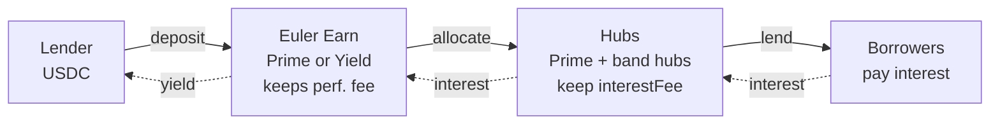
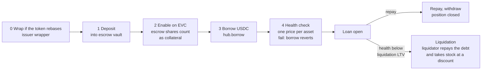
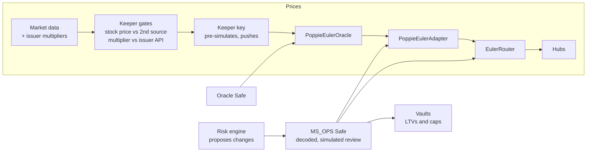

# Poppie v2 on Arbitrum: Design (zero-contract)

*Nov 16, 2026. This is the baseline design. Poppie deploys no new contracts: the audited v1 `PoppieEulerOracle` and `PoppieEulerAdapter` (tag `v1-bsc`) are redeployed unchanged, and everything else is stock Euler and Safe. The peripheral-contract design (`docs/peripheralContracts/Design.md`) is this design plus five small Poppie contracts, and documents only what differs. Executive comparison: `docs/Overview.md`.*

*Evidence is cited by finding ID: XS (`docs/issuerResearch/xStocks.md`), RH (`Robinhood.md`), RE (`Reality.md`), DN and ON (`Dinari-Ondo.md`), KEEP-2 to KEEP-20 (`docs/evaluation/Keeper.md`), and A, B, DIV, PATH, PAUSE, KEEP-1 (`docs/evaluation/Contracts.md`).*

## Summary

- **What:** USDC lending on Euler V2 (Arbitrum) against tokenized equities, from about 100 assets at launch toward 500.
- **Contracts:** the v1 oracle and adapter, plus stock Euler (EVK, EulerRouter, Earn, `GovernorAccessControlEmergency`, `CapRiskSteward`, optionally `HookTargetGuardian` and timelocks), Safe, Zodiac Roles and OpenZeppelin `TimelockController`. **No new Poppie contracts.**
- **Prices:** a keeper extended from the BSC keeper pushes one USD price per asset, used for both borrowing and liquidation, after blocking checks on the stock price and the issuer multiplier (D11).
- **Risk:** losses are bounded by limits set in advance (supply caps, borrow-cap headroom, LTV buffers, the loss reserve). Tightening is instant through a hot key; loosening needs `MS_OPS`.
- **Main open risk:** no issuer has a listable market on Arbitrum today; xStocks is the only launch candidate, and its exit is Backed's own inventory.

| Choice | Gain | Cost |
| --- | --- | --- |
| Reuse the existing oracle | No new oracle code to audit | One price for borrowing and liquidation; pause wipes price state; one admin and one keeper address |
| Stock Euler contracts, governed by a Safe through Euler's emergency governor | Nothing new to audit; no Poppie code in the borrow path; instant tightening by a hot key; bounded cap raises without signing | Coarse on-chain limits; no per-account controls; no borrow rate limit; Oracle Safe unbounded or fully delayed; users trust `MS_OPS`'s signers |
| One hub per band | Deep liquidity, simple config | Lenders in a hub share every name's risk |
| Reinvesting issuers only | No dividend handling | Smaller listable set |

Euler allows at most 10 collaterals per account, so large portfolios need several sub-accounts. All numbers are proposed starting values.

## How to read the controls

| Label | Meaning |
| --- | --- |
| **[v1]** | Enforced by `PoppieEulerOracle` or `PoppieEulerAdapter` |
| **[Euler]** | Enforced by stock Euler code (EVK, EulerRouter, evk-periphery, Earn) |
| **[Safe]** | Enforced only by a Safe's signer threshold |
| **[Policy]** | Enforced only by Poppie's back end or runbooks. Not visible to or enforceable by the chain |

Anything labelled **[Policy]** is a promise, not a guarantee, and must be published as such.

Three Safes are used:

- **Oracle Safe**: holds the oracle admin.
- **`MS_OPS`**: 3-of-5; governs the hubs, escrows, router, adapter and Earn.
- **Reserve Safe**: holds the loss reserve.

## How it works

### Lenders

### Borrowers

There is one health figure per account. "Can borrow" and "liquidatable" differ only by the borrow LTV versus the liquidation LTV.

### Prices and risk settings

## Asset classes

| | Blue chip | Long tail |
| --- | --- | --- |
| Criteria | Index ETF or top-50 US stock; daily volume ≥ $500M; on-chain exit depth ≥ $1M at ≤ 2% slippage; 90-day volatility ≤ 45% | All other listed names |
| Max borrow / liquidation LTV | 70% / 75% **[Policy]** | Set by band **[Policy]** |
| Max supply cap | 20% of exit depth **[Policy]** | 10% of exit depth **[Policy]** |
| Listed in | Every hub | Its band's hub |

Class and band ceilings are not stored on-chain. Euler enforces only that borrow LTV ≤ liquidation LTV, and that lowering a liquidation LTV can ramp while raising one is instant **[Euler]**.

Names change class by policy: promoted after 30 days meeting the criteria, demoted after 5 days failing one. Each change is one `MS_OPS` batch across all hubs **[Policy]**.

## Hubs

- **Prime hub:** blue chips only, lowest rates, 8% max liquidation discount.
- **Band hubs (M1–M3):** all blue chips plus every long-tail name in that band. Split a band only when one hub hits a real limit.

| Band | Long-tail profile (90-day volatility) | Max borrow / liquidation LTV **[Policy]** | Max liquidation discount **[Euler]** |
| --- | --- | --- | --- |
| M1 | ≤ 60%, deep liquidity | 50% / 58% | 10% |
| M2 | 60–90% | 45% / 52% | 15% |
| M3 | > 90%, or thin liquidity | 35% / 42% | 20% |

Exposure rules per band hub, enforced through supply caps **[Policy]**:

- long-tail-backed debt stays at or below 50% of the hub's borrow cap;
- no correlated group exceeds 30% of the hub's long-tail exposure.

Flash loans of hub USDC: on and free at launch, so third-party liquidators need no capital where the exit is atomic. See "Flash loans and fees".

### Revenue

| Fee | Prime | M1 | M2 | M3 | Enforced by |
| --- | --- | --- | --- | --- | --- |
| Interest fee | 10% | 15% | 20% | 25% | [Euler]: 10–100% is always allowed |
| Rate floor (IRM base rate) | 2% | 3% | 4% | 5% | [Euler]: Kink IRM parameters |

- **Euler's protocol share:** EVK sends up to 50% of the interest fee to Euler's protocol receiver (`ProtocolConfig`). Check the Arbitrum value on a fork.
- **Earn fees:** Prime Earn charges a 5% performance fee and Yield Earn 10% **[Euler]**.
- **Prime Earn allocation:** at least 70% in the Prime hub, by policy **[Policy]**.
- **Origination fee:** see "Flash loans and fees".

### Loss reserve

Hubs run with `CFG_DONT_SOCIALIZE_DEBT` **[Euler]**, so debt left on an account with no collateral stays there. The reserve Safe repays it with `repay(amount, account)` **[Safe]**.

- **Funding:** part of Poppie's interest fee (hub `feeReceiver`).
- **Fallback:** if bad debt exceeds the reserve, `MS_OPS` turns loss-sharing back on (`setConfigFlags`).

Repay quickly: until the reserve repays, the hub's share price overstates its assets.

## Issuers

At launch Poppie lists only tokens whose dividends are reinvested by the issuer.

| Issuer | Mechanism | Held in the escrow vault | Priced asset |
| --- | --- | --- | --- |
| xStocks | `balanceOf` rebases on multiplier changes (splits, reinvested dividends, optional management fee) | The V2 wrapper (`wrapperAddressV2`). Never the legacy wrapper. See `docs/issuerResearch/xStocks.md` | The wrapper share |
| Dinari | Balances rebase on splits; cash dividends (USD+) to KYC-registered holders | Wrapped dShare, if its issues are resolved. See `docs/issuerResearch/Dinari-Ondo.md` | The wrapper share |
| Ondo GM | Static balances, dividends reinvested | The token | The token. **Not on Arbitrum**: the BSC token addresses have no code there |
| Robinhood | Static raw balances (ERC-8056); `uiMultiplier()` carries splits and reinvested dividends | The token. See `docs/issuerResearch/Robinhood.md` | The token. **Robinhood Chain only today**; Arbitrum expected |
| Reality | Static raw balances (ERC-8056) since 2026-10-17, rebased before; cash (USDT0) and stock (rToken) dividends paid separately to the depositor via Merkl; withheld for unsupported protocols | The token, if listed. See `docs/issuerResearch/Reality.md` | The token. **On Arbitrum; not listable now** (D10) |
| Others | To research | — | — |

- **Ondo:** its docs do not currently list Arbitrum as a supported chain.
- **No issuer wrapper:** for a rebasing token without one, an unmodified OpenZeppelin `ERC4626` (`decimalsOffset = 0`, with a seed deposit) is the fallback (D3).
- **Not listed at launch:** tokens that pay dividends in cash to the holder (to revisit).

**Why the wrapper:** an EVK vault tracks its own cash. Tokens that arrive without a deposit can be taken by anyone through `skim`, and a reverse split leaves the vault owing more than it holds. A wrapper's share count never changes on its own.

**Pricing rule: the wrapper share is the oracle base** (for rebasing tokens; ERC-8056 tokens are their own base).

- **The rule:** configure a direct `wrapper → USD → adapter` route, and never register the wrapper as a resolved vault.
- **Why:** resolving to the rebasing token makes collateral value jump the moment the multiplier activates, while the stored price is still old (PATH-2).
- **Enforcement:** a config-check script checks this before every listing **[Policy]**.

**Keeper pricing:** price per wrapper share = equity price × equity per share, using the multiplier in effect at the push block. For xStocks, equity per share is `wrapper.convertToAssets(1e18) / 1e18`, which equals the token's `getCurrentMultiplier()`. For Robinhood, price per token = equity price × `uiMultiplier() / 1e18`.

Per-issuer mechanics, controls, liquidity, keeper rules, listing rules and reference addresses: `docs/issuerResearch/xStocks.md`, `Robinhood.md`, `Reality.md`, `Dinari-Ondo.md`. One-page comparison: `docs/issuerResearch/Issuer-Overview.md`.

### All issuers

**Issuer risk:** an issuer or custodian failure hits all its tokens at once. Exposure per issuer, and per underlying stock across issuers, is capped through supply caps **[Policy]**.

**Listing checks per issuer:**

- admin powers (pause, freeze, seize, burn from any holder);
- transfer restrictions, including who may receive seized collateral;
- whether the wrapper and escrow addresses must be allowlisted;
- whether token or wrapper contracts are upgradeable.

## Risk management

Risk management is the primary goal of this design. This chapter lists what can go wrong, which levers bound each risk, how fast each lever acts and who holds it, and what this design cannot do. The metrics (R1–R10) are defined below. The levers the peripheral design adds are in `docs/peripheralContracts/Design.md`.

### Principles

1. **Losses are bounded by what is set in advance, not by how fast we react.** The Kelp/Aave attacker borrowed about $230M within minutes; a Safe takes minutes to hours to sign. So supply caps, borrow-cap headroom and LTVs, set before an incident, are the real bound. Response levers only stop it from growing.
2. **Tightening is fast; loosening is slow.** Keys that can only tighten may be hot and act in seconds. Anything that raises exposure needs `MS_OPS`, or a bounded steward.
3. **Repay and liquidation stay open.** Every lever below except the vault-wide disable leaves them working, so a freeze never traps a borrower or blocks the hub from recovering.
4. **Anything labelled [Policy] is a promise, not a guarantee.**

### Risk appetite

Set by Poppie, not yet set: the largest loss from one issuer's collateral turning out unbacked (`L_issuer`), the largest loss from one fast event (`L_event`), the largest account's share of a hub's debt (`C_account`), and the time to freeze (`T_freeze`). Caps, borrow-cap headroom and the loss reserve are sized from them (R1–R3, R7–R8 below).

### Risk register

| Risk | Levers in this design | What bounds the loss | What remains |
| --- | --- | --- | --- |
| **Unbacked or forged collateral**: an issuer minter key is stolen, an issuer upgrade goes wrong, or a bridged token is exploited (the Kelp route) | No bridged tokens at launch **[Policy]**; supply caps per name and per issuer (R1) **[Euler]**; hub borrow cap kept a set headroom above borrows (R2) **[Euler]**; alerts on issuer mints, upgrades and supply jumps; emergency freeze of caps or borrow LTV | The smaller of R1 and R2 | Up to that bound is lost before anyone acts; the reserve covers it (R3) |
| **Wrong price within the oracle's bounds** (keeper bug, bad feed, wrong multiplier) | Keeper's blocking gates (D11) **[Policy]**; per-push breaker and cumulative cap **[v1]**; borrow headroom (R2); emergency freeze | Breaker and cumulative cap per name; R2 across hubs | A wrong price inside the breaker goes live until the next push or a freeze |
| **Issuer multiplier error** (HONx, SOXX) | Keeper's multiplier gate: unexplained changes are not pushed (KEEP-11) **[Policy]** | The price stays at the last good value | Wrapper balances already reflect the error; the name goes stale until fixed |
| **Oracle Safe compromised** | Signer hygiene; alerts on every admin call; option to put the oracle admin behind a timelock (D13) | **None** if the admin is a Safe: any price, instantly. With a timelock: nothing lands before the delay | Unbounded (Safe) or slow corrections (timelock). R2 limits how much can be borrowed against a forged price |
| **Keeper key stolen** | Breaker and cumulative cap **[v1]**; Oracle Safe revokes with `setKeeper`; keeper behind a Safe with Zodiac Roles (D14) | Breaker per push, cumulative cap per window | It can pause **every** asset, wiping every price; recovery is about 12M gas of `adminSetPrice` |
| **`MS_OPS` compromised** | Signer hygiene; decoded, simulated review; alerts on every governance change; Euler's emergency governor, with optional timelocks (D12) | Without a timelock, nothing: any LTV, route or hook, instantly. With a timelock: visible for the delay and cancellable | Users trust its signers |
| **Liquidations fail** (thin exit, weekends) | Caps sized to exit depth per priced session, LTV buffers, discounts, session gating, loss reserve (see "Thin liquidity and liquidations") **[Policy]** | Exit depth × cap share per name (R5) | Bad debt above the reserve is socialized (`MS_OPS` turns loss-sharing on) |
| **Gap through the breaker** (Monday open, earnings) | Price goes stale (borrow, withdraw and liquidation freeze for holders); LTV buffers; pre-built `adminSetPrice` batches | LTV buffer per class | Stale names can't be liquidated until the Oracle Safe signs |
| **Issuer burns from, freezes or pauses an escrow** | Per-issuer caps; alerts; `pauseAssets`; LTV cuts | R1 for that issuer | Escrow cash is overstated after a burn; the last depositors can't withdraw |
| **Stolen funds or sanctioned users** | Issuer-token and USDC screening; app and SDK screening (see "Sanctions") | Nothing on-chain beyond the issuer and USDC lists | Direct contract callers are not screened by Poppie; funds can't be frozen or returned |
| **Lender run** | Kink IRM; Earn allocation; utilization alerts (R6) | Utilization above the kink makes borrowing expensive | Lenders wait for repayments or liquidations |
| **USDC depeg or a Circle blacklist of a hub** | Alerts; borrow-cap freeze | — | Route is a fixed rate; a blacklisted hub's USDC is frozen |
| **Arbitrum sequencer outage** | Keeper waits after a restart (KEEP-17) | — | Liquidations resume on the first push |
| **Bug in Euler, Safe or the v1 contracts** | Audits by their authors; caps | R1, R2 | Outside Poppie's control |

### Levers to restrict capital

| Lever | Who holds it | Speed | Stops | Leaves working | Enforced by |
| --- | --- | --- | --- | --- | --- |
| Escrow supply cap down to current supply | Emergency key, or `MS_OPS` | Seconds (key), minutes to hours (Safe) | New collateral in one name | Withdraw, liquidation | **[Euler]** |
| Hub borrow cap down to current borrows | Emergency key, or `MS_OPS` | Same | All new borrowing in one hub | Repay, liquidation | **[Euler]** |
| Borrow LTV lowered for a name | Emergency key, or `MS_OPS` | Same | Borrowing power against that name; at 0, every indebted account using it freezes | Repay, liquidation | **[Euler]** |
| Borrow-cap headroom (cap = borrows + headroom, raised daily) | Cap steward key, within a bounded factor | Daily | Bursts larger than the headroom | Everything | **[Euler]** `CapRiskSteward` |
| Pause borrows and flash loans on a hub, for a fixed time | Guardian on Euler's `HookTargetGuardian` (D15) | Seconds | Borrowing and flash loans | Repay, liquidation, deposits | **[Euler]** |
| Disable all operations on a vault | Emergency key (hook role), or `MS_OPS` | Seconds (key) | Everything, including repay and liquidation | Nothing | **[Euler]**; catastrophe only |
| `pauseAssets` | Keeper or Oracle Safe | Seconds (keeper) | Pricing of a name; wipes its price | — | **[v1]** |
| Liquidation-LTV cut with a ramp | `MS_OPS` | Hours | Winds a name down | — | **[Euler]** |
| Earn allocation to a hub to 0 | `MS_OPS` (curator) | Minutes to hours | New lender USDC into a hub | Existing deposits | **[Euler]** |
| Stop listing an issuer; delist | `MS_OPS` | Hours to days | New exposure | — | **[Policy]** |

The emergency key holds Euler's emergency roles on `GovernorAccessControlEmergency`: it can only lower caps, lower borrow LTVs (liquidation LTV untouched), or disable a vault. It cannot raise anything (D12).

### What this design cannot do

Poppie writes no contracts, so it has no on-chain way to:

- **freeze, seize or return one account's funds**, for a court order, a regulator or a hack victim;
- **limit borrowing per hour.** The only rate limit is borrow-cap headroom, which costs daily cap raises and "cap reached" errors on busy days;
- **bound the Oracle Safe.** It either sets any price instantly, or every admin action waits for a timelock, including legitimate gap corrections;
- **limit how many assets a keeper key can pause.** One stolen key can wipe every price;
- **list instantly while delaying route overwrites.** Router changes are either all instant or all timelocked;
- **screen direct contract callers for sanctions**, beyond the issuer tokens' and USDC's own lists;
- **enforce the origination fee.** The SDK charges it; direct callers don't pay;
- **enforce issuer pause windows on-chain.** The app and SDK block them; direct callers rely on the issuer's own pause;
- **cap one account's debt.**

### What not writing contracts saves

- **No new audit scope.** The only Poppie code on-chain is the audited oracle and adapter. Euler's governor, steward and guardian are Euler-written (audit coverage at our pin to confirm).
- **No new liveness risk.** No Poppie hook sits in the borrow or deposit path, so a Poppie bug can't block borrowing, deposits or withdrawals.
- **Simpler integration.** Integrators call EVK directly; no batch is required for a borrow.
- **Less gas** per borrow and deposit, and per push.
- **Fewer keys and parameters** to secure and tune.
- **Faster to launch**, and nothing to upgrade or migrate later.

### Risk metrics

Both designs track the same metrics; the last two columns show what enforces each.

| # | Metric | Formula | Target | Zero-contract enforcement | Peripheral enforcement |
| --- | --- | --- | --- | --- | --- |
| R1 | Unbacked-collateral loss, per issuer | Σ over the issuer's names of (escrow supply cap × price × highest borrow LTV), capped at the borrowable cash of the hubs that list them | ≤ L_issuer | Supply caps **[Policy]** | Same |
| R2 | Loss before Poppie can respond | Σ over hubs of the USDC that can be borrowed before a response lands: (borrow cap − current borrows) in the zero-contract design; the hourly borrow limit × response time in the peripheral design | ≤ L_event | Borrow-cap headroom, kept tight and raised daily by Euler's `CapRiskSteward` | Hourly borrow limit in the hub guard (P1) |
| R3 | Reserve coverage | Loss reserve ÷ max(R1 for the largest issuer, R2) | ≥ 1 | Policy and alert | Same |
| R4 | Bridged-token exposure | Value of collateral that is a bridged representation of the issuer's token | 0 at launch | Listing rule **[Policy]** | Same |
| R5 | Liquidatable debt vs exit depth | Per name and session: debt of accounts below liquidation LTV ÷ exit depth in that session | ≤ 1, alert above 0.5 | Caps sized to exit depth; alert | Same |
| R6 | Lender liquidity | Hub utilization; USDC Earn lenders can withdraw now | Utilization below the IRM kink most of the time | Interest-rate model; alert | Same |
| R7 | Account concentration | Largest single owner's share of a hub's debt (sub-accounts grouped by EVC owner) | ≤ C_account | Alert only | Optional debt cap per account in the hub guard (easy to split across addresses) |
| R8 | Time to freeze | Time from alert to a borrow freeze landing on-chain | ≤ T_freeze | Drilled; an emergency key on Euler's emergency governor makes it seconds | Guardian pause in the hub guard: seconds |
| R9 | Sanctions matches | Deposits, borrows or receivers on the Chainalysis list or Poppie's denylist | 0 | App and SDK screening; monitoring | Hook screening on borrow and deposit, plus the same |
| R10 | Oracle admin exposure | Largest price move the oracle admin can make without delay | Bounded | None: the Oracle Safe can set any price, unless its admin is a timelock, which delays every admin action (D13) | Oracle admin guard (P3): ±X% instant, larger moves delayed |

`L_issuer`, `L_event`, `C_account` and `T_freeze` are Poppie's risk appetite and are **not set yet**. They have to come from Poppie: the largest loss it will accept from one event, as dollars or a share of lender deposits, and the target size of the loss reserve.

#### Worked example (illustrative)

Caps are sized to exit depth in the weakest priced session (blue chip 20%, long tail 10%). With Backed's stated sizes (up to $1M per trade on majors in market hours; about $10k on long-tail names overnight):

- **Blue chip priced only in market hours:** cap ≈ 20% × $1M = $200k of collateral; at 70% borrow LTV, about $140k of borrowing per name.
- **Long-tail name priced overnight:** cap ≈ 10% × $10k = $1k. That is too small to be worth listing, so long-tail names should be priced only in sessions where Backed quotes larger sizes. This needs Backed's per-session sizes (`docs/issuerResearch/xStocks-Backed-Questions.md`, Q10–Q11).
- **R1 for xStocks** with 20 blue chips at $200k: about $2.8M of borrowing if every xStocks token were unbacked at once.
- **R2** in the zero-contract design is the sum of borrow-cap headroom across 4 hubs. Keeping each hub's headroom at, say, $250k bounds a fast attack to $1M, at the cost of a daily cap raise.

**Data and alerts:**

- R1, R2, R5, R6 and R7 come from EVK lens reads plus oracle prices; compute them in the v2 monitor every run.
- R8 is measured in drills; record each drill.
- R9 comes from screening logs and the Chainalysis oracle on Arbitrum (`0x40C57923924B5c5c5455c48D93317139ADDaC8fb`, the same list xStocks tokens use).
- Alert when any metric is above 80% of its target; page above 100%.

#### Why these metrics: the Kelp/Aave case

From news coverage (April–May 2026; the court filings were not read):

- On 18 April 2026 an attacker broke KelpDAO's LayerZero bridge for rsETH and released about $292M of rsETH with nothing behind it. Reports say compromised RPC nodes were used.
- The attacker posted that rsETH on Aave as collateral and borrowed about $230M of real ETH from Aave's lenders. Up to $13B left DeFi in the following days.
- Arbitrum's Security Council froze 30,766 ETH (about $71M) held by the attacker. Arbitrum DAO voted to move it to a recovery multisig.
- On 1 May, holders of $877M in terrorism judgments against North Korea filed a restraining notice, arguing the ETH was North Korean (Lazarus) property. Aave argued the attribution is unproven and that the funds belong to the users who lost them. Around 8 May a New York federal judge let the transfer proceed, with the claim following the funds.

What it shows for Poppie:

1. **Collateral can look real and not be.** Poppie's prices come from the stock price, so an unbacked token prices like a real one. Routes: a stolen issuer minter key, an issuer upgrade, or a bridged token.
2. **The loss happens in minutes.** A Safe takes minutes to hours to sign. What bounds the loss is what was set in advance: caps and borrow headroom.
3. **Stolen funds bring legal claims.** Recovered or frozen funds can be contested in court for months.
4. **Signer compromise is the other large route.** Lazarus took $1.5B from Bybit in 2025 by deceiving its Safe signers.

### Sanctions

**On-chain today, with no Poppie code:**

- xStocks tokens and V2 wrappers check Chainalysis's on-chain list (`0x40C5…C8fb` on Arbitrum) for every sender, receiver and spender, and on wrap and unwrap. A listed address can't deposit or withdraw xStocks.
- Robinhood's registry blocks listed addresses (`BLOCKER_ROLE`).
- Circle's USDC blacklist blocks a listed address from receiving borrowed USDC or repaying. If Circle blacklisted a hub, its USDC would freeze.

**Poppie can:** screen addresses, including borrow receivers, in the app and SDK before building any transaction; geo-block the app; publish terms; monitor listed addresses' on-chain activity (R9); tighten caps or LTVs for everyone in response.

**Poppie can't:** stop a listed address that calls the contracts directly, except where the issuer token or USDC blocks it; freeze or return one account's funds; catch an attacker before they are listed (lists lag, often by days); stop a listed account being liquidated.

Poppie needs a legal view on whether this is enough before launch, and counsel ready for claims like the one Aave faced over the Kelp funds.

## Thin liquidity and liquidations [Policy]

**The risk.** Exit liquidity for tokenized stocks on Arbitrum is thin, comes almost entirely from the issuer's own inventory, and stops at weekends. Poppie runs no liquidator and has no backstop buyer. If liquidators can't or won't sell seized collateral fast enough, positions go underwater and the hub takes bad debt.

**How the design caps it:**

| Lever | Rule |
| --- | --- |
| Listing gate | List a name only if a route open to third parties exists (issuer RFQ via Enso, 0x or CoW, or DEX depth), with observed sell fills |
| Supply caps | Each name's escrow cap ≤ a share of its exit depth in the **weakest session in which it is priced** (blue chip 20%, long tail 10%). For xStocks: Backed's quoted size per session |
| Sessions | Don't price a name in a session where its exit is too thin; it goes stale instead, which also pauses liquidations |
| LTV buffers | The gap between liquidation LTV and 100% must cover a weekend or overnight gap plus the discount (liquidation LTV: Prime 75%, bands 42–58%) |
| Liquidation discount | Large enough to pay a third party for slippage and for holding seized stock until the next quote, including over a weekend (8% Prime, up to 20% in M3) |
| Concentration | Per hub, long-tail debt ≤ 50% of the borrow cap and one correlated group ≤ 30% of long-tail exposure; per-issuer and per-stock caps across hubs |
| Loss reserve | Bad debt stays on the account (`CFG_DONT_SOCIALIZE_DEBT`) and the reserve Safe repays it |
| Monitoring | Alert on positions that stay liquidatable, on exit routes disappearing, and on any bad debt (see Monitoring) |
| Response | If liquidations lag: freeze the name's supply cap, ramp its liquidation LTV down, and pause new listings from that issuer until exit improves |

**Deferred:** a Poppie-run liquidator (contract and bot selling through Enso) and committed liquidator capital. Revisit if third-party liquidators prove unreliable at launch sizes.

## Prices and closed markets

### What the oracle enforces [v1]

| Control | Behaviour |
| --- | --- |
| Per-push circuit breaker | Per asset, 0–10000 bps against the last price. Strict `>`: a move of exactly the threshold passes |
| Cumulative deviation cap | Per asset, 1–10000 bps against an anchor that rotates to the accepted price each `anchorWindow` |
| Staleness | Reads revert after `maxPriceAge` (per-asset override, else global) |
| Pause | Keeper or admin; wipes price state; recovery needs `adminSetPrice` plus a keeper push |
| `adminSetPrice` | Any non-zero price, instantly; resets the anchor |
| Batches | One bad entry reverts the whole push. The keeper simulates the guards off-chain and drops failures, as the BSC keeper does **[Policy]** |

- One price serves both borrowing and liquidation.
- A move above the breaker, or above +100% at any setting, can only be applied by the Oracle Safe with `adminSetPrice`.
- A wrong keeper push within the bounds goes live immediately. The keeper is trusted; its blocking cross-checks are the defence **[Policy]**.

**Proposed thresholds:** blue chips: breaker 20%, cumulative cap 30%. Long tail: breaker 30% to 40%, cumulative cap 40% to 50%, by band. Tune these with gap data.

### Keeper: an iteration of the BSC keeper [Policy]

v2 reuses the BSC keeper and extends it. What the BSC keeper does today, from its source:

| Area | BSC keeper today | v2 |
| --- | --- | --- |
| Schedule | Push every 30 min (:15, :45); read-only monitor 5 min later; one run at a time (run lock) | Keep. Add deviation-triggered pushes if gas allows |
| Price | Chainlink Data Streams `midPrice` (stock price); freshest of the regular, extended and overnight feeds that is open and under 10 min old; otherwise skip and let the price go stale. Feeds fetched one at a time; schema guessed from report length | Keep. Fetch 8 feeds at a time and read the schema from the feed ID (KEEP-15). Coverage limits listings: 71 xStocks names on Arbitrum, 8 of them regular hours only (KEEP-4) |
| Multiplier | Ondo GM API (token price ÷ stock price), falling back to Ondo's on-chain SyntheticSharesOracle. The two are never compared | Read the issuer's multiplier on-chain at one pinned block, and check it against the issuer's API (see "Price sources and cross-check"). Call Backed's API only for names with a pending or changed multiplier, or no stored multiplier, since one call per name is too slow at 500 names (KEEP-6; prototyped: a normal 71-name run makes no such calls). Keep the last accepted multiplier per name between runs (KEEP-7) |
| Multiplier changes | Applied as they arrive; no corporate-action check, no limit | Apply only changes that match a known corporate action (see Corporate actions and the per-issuer rules) |
| Guards | Off-chain simulation of the breaker and cumulative cap drops failing assets; a reverting batch is retried once without the asset named in the revert | Keep. Chunk batches for 500 assets |
| Dropped assets | Logged as a warning; retried every 30 min against the same stored price; the monitor raises an error while the next price would be rejected | Page when a name is dropped on two consecutive pushes during a priced session. Planned skips never page and reset the count: market closed, a pending split, activation within 5 min (KEEP-12) |
| Second source | Alpha Vantage, alert-only: final price (after multiplier) vs Alpha Vantage's stock quote, 15%; missing data ignored | Blocking gate on the stock price, before the multiplier (see "Price sources and cross-check") |
| Issuer halts | Ondo status API: an active `ASSET_PAUSED` makes the keeper call `pauseAssets`, wiping the price; if the API fails, pricing continues | Don't pause on-chain for scheduled issuer windows; skip pushes for that name instead (see "Issuer pause windows"). `pauseAssets` stays for emergencies |
| Failure handling | Three failed runs in a row trip a halt latch; pushes stop until a person clears it. One asset's multiplier fetch error fails the whole run | Keep the latch, but count only infrastructure failures (RPC, signer, no chunk landing). Any per-name failure skips only that name (KEEP-8) |
| Signing and RPC | KMS HSM key; reads need a majority of several RPC endpoints | Keep. Add a timeout per signature: the KMS client retries an outage for up to 60 s per call (KEEP-9) |
| Alerting | Structured logs; any ERROR log alerts by email and Discord | Keep; add the alerts in Monitoring |
| Sequencer | — | No push while Arbitrum's sequencer is down, or within a grace period after it restarts (KEEP-17) |

A prototype of this keeper runs on an Arbitrum fork against the real xStocks contracts (oracleSystem branch `v2`; KEEP-2 to KEEP-20).

### Price sources and cross-check [Policy]

**BSC today:**
- The keeper compares the final price with Alpha Vantage's stock quote and logs an error above 15%.
- It never blocks a push, and it skips any asset with no Alpha Vantage quote.
- It reads a `price` field that Alpha Vantage's bulk endpoint doesn't appear to return (the endpoint returns `close` and `extended_hours_quote`), so it may compare nothing (KEEP-3).
- Because the comparison is made after the multiplier, a multiplier error (such as a halving) does trigger the alert. But every legitimate multiplier also counts as deviation, so the threshold must stay wide.

**v2 rule (D11):**
- **Primary:** Chainlink Data Streams stock price × the issuer multiplier read on-chain at the push block.
- **Stock price gate (blocking):**
  - Compare the Data Streams stock price with an independent quote of the same stock, before applying the multiplier.
  - Above the tolerance: skip that asset and alert. Never push the second source's price.
  - The second-source quote must carry a timestamp and be fresh; a stale quote counts as no data.
- **Multiplier gate (blocking):**
  - The on-chain multiplier must match the issuer's published value (Backed's multiplier endpoint, Robinhood's `/corporate-actions`), within rounding.
  - Any change must match a known corporate action (Corporate actions, item 3).
  - On a mismatch: skip and alert.
- **Tolerance:** per session, tighter in regular hours than in extended and overnight sessions. Comparing stock to stock, without the multiplier, lets it be far tighter than BSC's 15%. Calibrate it from shadow recordings of the chosen vendors, and a replay of Data Streams against them, before launch; BSC's Alpha Vantage history may be empty (KEEP-3). First research data (Yahoo vs Nasdaq, KEEP-18): 99% of pairs agree within 0.17% in regular hours but only within 1.4% in extended hours, worst case 6.6%. So regular hours can be tight (about 2%), while extended-hours tolerances should depend on the name's liquidity. Neither source quotes overnight.
- **No second-source data:**
  - The gate fails closed: no fresh, agreeing quote means no push for that name, and the price goes stale after `maxPriceAge`.
  - So the keeper prices a name only in sessions its second source covers. Alpha Vantage covers 04:00–20:00 ET, so overnight pricing needs a second source that covers it, or none is priced overnight.
- **Outages:** use two second sources (the BSC keeper already has code for Polygon as well as Alpha Vantage). Push if at least one fresh source agrees and none disagrees. Page when every second source is unavailable during a priced session; at `maxPriceAge` 1 h, every name goes stale within the hour.
- **Split days:** no exception. If one source switches to split-adjusted prices before the other, the gate blocks and alerts, and the name goes stale briefly. Both sources usually switch together at the ex-date open, so the stock price gate passes. Only the multiplier gate can then catch the gap: the keeper skips a name while Backed shows a pending `Split` or `ReverseSplit` (fork-tested, KEEP-10).

**What each gate catches:**
- **Stock price gate:** a wrong or stale feed, a decoding error (BSC once read a timestamp as NFLX's price; the on-chain breaker caught it), wrong symbol mappings, and decimals errors inside the breaker bounds.
- **Multiplier gate:** issuer multiplier errors such as HONx, rHON and SOXX applied a day early (XS-13, RE-4, RH-6).
- **Neither:** an error shared by both stock sources, or an issuer error that the issuer's API also reports.

**To check before choosing vendors:** session coverage (overnight in particular), real-time vs delayed plans, rate limits and licence for about 500 names every 30 minutes, symbol coverage (ETFs, ADRs, new listings), quote timestamps, and split-adjustment timing.

**Primary coverage (KEEP-4):** Chainlink's Arbitrum catalog has at least one Data Streams feed for 71 of the 1,195 xStocks names with a USD underlying: 63 with a v11 regular-hours feed (61 of them in all three sessions), and 8 with only a v8 feed, priced in regular hours only. So Data Streams alone cannot reach phase 1's ~100 names. Options: ask Chainlink for more feeds, or accept a second primary (Pyth covers 771 of these names; Hermes now needs an API key) for names Chainlink doesn't cover. 293 more names have EUR, GBP or HKD underlyings and would also need FX.

### Closed markets

**Rule:** the keeper pushes whenever a reliable market price exists and passes the cross-checks, including the 24/5 overnight session if both the primary and a second source cover it. Otherwise it stops, and the price goes stale after `maxPriceAge`. That covers weekends, holidays and halts.

While a name is stale, for any account holding it as collateral:

| Operation | Result |
| --- | --- |
| Borrow | Reverts |
| Withdraw | Reverts if the account has debt (to confirm on EVK) |
| Liquidation | Reverts |
| Repay | Works |
| Add other collateral | Works |
| Deposits of that name | Work, but give no borrowing power until the price is fresh |

**Resume:** the first push within the breaker resumes the name, with no admin step. A gap beyond the breaker needs `adminSetPrice` from the Oracle Safe.

Size LTV buffers for weekend gaps, and size caps so third-party liquidators can absorb the Monday open. Liquidation discounts must also cover a liquidator holding seized stock until Backed quotes again; Backed gives no executable quotes at weekends.

### Corporate actions [Policy]

1. **Before the event:** drive this from market data (company announcements and ex-dates), not from the issuer's multiplier schedule: Backed's notice can be 15 minutes, too short for a Safe. Freeze the name's escrow supply cap. Cut its borrow LTV only if needed: a cut freezes every indebted account that relies on that name (see "Pauses").
2. **Breaker:** while a split of ratio r is pending, keep that name's breaker below the move a mis-push would cause, 1 − 1/r. For example, below 33% for a 3:2 split.
3. **Multiplier changes:** for any xStocks or Robinhood multiplier change, whether a split or a reinvested dividend (for Robinhood, read `newUIMultiplier()` and `effectiveAt()`, and see `docs/issuerResearch/Robinhood.md` for its keeper rules):
   - read the activation time on-chain (`newMultiplierActivationTime`, `newMultiplier`); it varies, e.g. 23:55 and 13:45 UTC on SPYx. Poll these rather than rely on `multiplierUpdates` or events: 87% of xStocks tokens on Arbitrum run an older implementation with no history and no `MultiplierScheduled` events (KEEP-5). For xStocks, fetch Backed's multiplier endpoint for the `reason` whenever a change is pending; notice can be as short as 15 minutes, so this is automated in the keeper;
   - react to replaced schedules (a pending value or time that changes, or `MultiplierScheduleOverridden` on the newer implementation);
   - **splits:** don't push while a split is pending on-chain (from scheduling to activation), so the name goes stale briefly rather than mispriced. Skip any name whose activation falls within 5 minutes of the read block (KEEP-12);
   - **reinvested dividends:** accept the dip of about the dividend size until activation; it undervalues collateral and stays below the breaker. Match the change to the calendar using the dividend net of withholding (AAPLx's 2026-11-12 step matched AAPL's dividend net of 30% US withholding, KEEP-19). Backed activates them overnight (01:30 UTC in that case), so the calendar entry must exist before the overnight session;
   - **spin-offs (xStocks):** so far Backed has folded the spin-off's value into the parent's multiplier (CMCSAx +4.7% after the Versant spin-off, XS-11); no second token was delivered. Accept a rise of about the spin-off's value on or after the distribution date;
   - reject any multiplier change that doesn't match a known corporate action (alert, don't push). For xStocks, that includes any `Administrative` reason and any on-chain schedule with no API entry. A HONx halving in June 2026 would have passed the breaker (XS-13). Backed's API reported the same values, so only the corporate-action calendar catches this (KEEP-11);
   - **the calendar:** a market-data source of splits, dividends and spin-offs, with ex-dates and ratios, plus a reviewed file for manual approvals. Every reinvested dividend changes the multiplier, so without a feed each one stops pricing until someone adds it. The vendor is not chosen yet (KEEP-14).
4. **Large moves:** reverse splits, or gaps beyond the breaker, go through a pre-built `adminSetPrice` batch.
5. **Mergers, delistings and token migrations** (and any spin-off not handled through the multiplier): Backed handles these case by case and says users are made whole, with notice that depends on when Backed learns of the event. No mechanism or minimum notice is committed. On-chain, no merger or delisting with outside holders has completed yet; when Backed drops a token, the old contract stays live and nothing is burned or converted (XS-12). Kenvue (KVUEx, being acquired by Kimberly-Clark) is the first pending case: the API already shows it as redemption-only and halted. **Payouts do not reach V2 wrapper holders:** Backed requires holders to unwrap, and offers a way to sell the token (Atomic RFQ through protocols, or other ways). Poppie's escrows hold wrapper shares, so every position in the name must be closed or liquidated, and the wrapper redeemed, before the event. Robinhood's API lists these event types but marks none active, and their payout to contract holders is undocumented. So, for any such event, from either issuer, announced or detected from market data:
   - treat the name as a wind-down: freeze its escrow supply cap and ramp its liquidation LTV down, early enough that positions are closed or liquidated before Backed's unwrap deadline;
   - don't wait for notice from Backed. Early signals: a deal announcement in market data; the name losing `Issuance` from `allowedOperations`, or `isTradingHalted`, in Backed's API (KVUEx, QRVOx and WBDx showed these before their events).
6. **Reopen:** restore caps and LTVs only once both the multiplier or balance and the price reflect the action.

## Flash loans and fees

Flash loans of hub USDC are left at the EVK default (on, free), so third-party liquidators need no capital where the exit is atomic (a DEX pool, or a sale through Enso to Backed). `MS_OPS` can disable them later with a hook-config change.

- **Origination fee (SDK only, D16):** Poppie's app and SDK add a second borrow in the same EVC batch, `hub.borrow(fee, feeReceiver)`, next to the user's `hub.borrow(amount, receiver)`. The fee becomes part of the user's debt, so a first-time borrower needs no USDC up front, and no Poppie contract holds funds. Nothing enforces it: direct callers, other front ends and aggregators pay no fee. Plan revenue on the interest fee and rate floor; treat the origination fee as extra.

## Issuer pause windows [Policy]

Issuers pause assets on-chain for scheduled operations. Example: Ondo pauses with reason `ASSET_PAUSED` for 20 minutes (00:52–01:12 UTC, weekdays) to apply its daily dividend share-multiplier update.

- **Schedule:** the back end loads each issuer's pause schedule (status API, or on-chain schedules such as xStocks' `multiplierUpdates`) and serves it to the app and SDK.
- **App:** during a window, plus a few minutes' buffer, deposit and withdraw for that name are disabled, with a banner.
- **SDK:** deposit and withdraw calls for that name throw a typed error during a window. Borrow, repay and liquidation are unaffected.
- **On-chain:** the issuer's own pause enforces the freeze, since token transfers revert. Poppie does not block direct contract calls.
- **Pricing:** the keeper skips pushes for that name during the window, and applies the issuer's new multiplier from its activation time. Daily dividend changes are far below the breaker.
- **No on-chain pause:** unlike the BSC keeper, which calls `pauseAssets` when Ondo reports `ASSET_PAUSED`, the v2 keeper doesn't pause the oracle for scheduled windows: a pause wipes the price and needs the Oracle Safe to re-seed it (PAUSE-1).
- **Notify:** an issuer pause inside a known window is logged, not paged. An unscheduled pause, or one that outlasts its window, pages on-call (see Monitoring).

## Contracts Poppie deploys on Arbitrum

No Poppie-written contract is deployed. Euler's governance contracts are used as published at the `evk-periphery` pin; their audit coverage at that pin is to confirm.

| Contract | Code | Count | Controlled by |
| --- | --- | --- | --- |
| `PoppieEulerOracle` | Existing, audited | 1 | `admin`: Oracle Safe. `keeper`: keeper key |
| `PoppieEulerAdapter` | Existing, audited | 1 | `admin`: `MS_OPS` |
| USDC/USD fixed-rate oracle | Euler `FixedRateOracle` | 1 | Immutable |
| EulerRouter | Euler | 1 | Governor: `MS_OPS` |
| Kink IRMs | Euler IRM factory | 1 per band, plus Prime | Set by `MS_OPS` |
| Hubs (borrow vaults) | EVK | 1 + 3 | `governorAdmin`: Euler's emergency governor (D12); roles held by `MS_OPS` |
| Escrow vaults | EVK factory, escrow config | 1 per asset | `governorAdmin`: Euler's emergency governor (D12) |
| Fallback wrappers | Unmodified OZ `ERC4626` | Only where no issuer wrapper exists | Immutable |
| Euler Earn vaults | Euler Earn `b2fd6e6` | 2 | Owner and curator: `MS_OPS` |
| Emergency governor | Euler `GovernorAccessControlEmergency` (D12) | 1, as `governorAdmin` of every vault | Roles: `MS_OPS` (or its timelock), emergency key |
| Cap steward | Euler `CapRiskSteward` | 1 | Cap steward key, within its factor |
| Timelocks (optional) | OZ `TimelockController`, via Euler's factory | 0 or 2 | Proposer: `MS_OPS` |
| Hub guardian (optional, D15) | Euler `HookTargetGuardian` | 1 | Guardian key |
| Keeper Safe (optional, D14) | Safe + Zodiac Roles | 1 | Keeper keys may call only `keeperPushPrices`, `pauseAssets` |
| Oracle Safe, `MS_OPS`, reserve Safe | Safe | 3 | Their signers |

Euler core contracts (EVC, factories, lenses, `ProtocolConfig`) are used at Euler's Arbitrum addresses. The oracle and adapter are compiled with their original settings (solc 0.8.24, `shanghai`) and verified byte-for-byte.

## Governance

Governance has three layers:

1. **Poppie contracts:** three address slots.
2. **Stock Euler contracts:** each vault's governor is Euler's `GovernorAccessControlEmergency` (proposed, D12), which splits `MS_OPS`'s powers from tighten-only emergency roles and a bounded cap steward.
3. **Back-end keys:** the keeper, plus keys that can only tighten or raise caps within bounds.

### 1. Poppie contracts: three address slots [v1]

The oracle and adapter have no role system. Each slot holds one address, which may be a key or a contract, and that address has every power of the slot.

| Slot | Contract | Functions | Changed by | Holder |
| --- | --- | --- | --- | --- |
| `admin` | Oracle | `configureAssets`, `setAssetThresholds`, `adminSetPrice`, `setMaxPriceAge`, `setAssetMaxPriceAge`, `setAnchorWindow`, `setKeeper`, `pauseAssets`, `transferAdmin` | `transferAdmin`, then `acceptAdmin` | **Oracle Safe** (D13: or an OZ timelock whose proposer is the Oracle Safe). Kept separate from `MS_OPS` so a compromise of one does not give the other's powers |
| `keeper` | Oracle | `keeperPushPrices`, `pauseAssets` | `setKeeper` from the oracle admin (instant) | **Keeper key** (KMS); D14: or a keeper Safe with a Zodiac Roles module so several KMS keys can push |
| `admin` | Adapter | `registerBase`, `unregisterBase`, `transferAdmin` | `transferAdmin`, then `acceptAdmin` | **`MS_OPS`**, as part of listing |

**One oracle instance.** One oracle and one adapter handle 500 assets: a 500-asset push measured 3.55M gas (A7). The trade-off is blast radius: one admin and one keeper cover every name.

**The Oracle Safe is the largest unbounded trust point.** As a Safe it can, instantly and without bounds, write any price, widen thresholds, disable staleness and replace the keeper. With no new contracts there are only two settings (D13):

| Option | Bound | Cost |
| --- | --- | --- |
| A. Safe | None. Hardware wallets, independent calldata checks, alerts on every admin event | — |
| B. Timelock (proposer: Oracle Safe; canceller: a second Safe) | Nothing lands before the delay; any call can be cancelled | Every `adminSetPrice`, including gaps beyond the breaker and re-seeds after a pause, waits for the delay; those names stay stale longer. Emergency `pauseAssets` stays with the keeper |

### 2. Stock Euler governance

**Proposed (D12):** every hub's and escrow's `governorAdmin` is Euler's `GovernorAccessControlEmergency` (`evk-periphery` `96b83f8`) rather than `MS_OPS` directly. It forwards governance calls by per-function role:

| Role | Holder | Allows |
| --- | --- | --- |
| Every governance function (setLTV, setCaps, setHookConfig, IRM, fees, flags, governor) | `MS_OPS`; or, through Euler's factory, a "wildcard" timelock proposed by `MS_OPS` (delay ≥ 1 day) | Everything, as today |
| `CAPS_EMERGENCY_ROLE` | Emergency key | Lower supply or borrow caps only, instantly |
| `LTV_EMERGENCY_ROLE` | Emergency key | Lower a borrow LTV only, instantly; liquidation LTV and its ramp untouched |
| `HOOK_EMERGENCY_ROLE` | Emergency key | Disable all operations on a vault, instantly (catastrophe only; blocks repay and liquidation) |
| `setCaps` | Euler's `CapRiskSteward`, driven by the cap steward key | Raise or lower caps within a factor that recharges over time (`MAX_ADJUST_FACTOR`, `CHARGE_INTERVAL`); set IRMs only from Euler's IRM factory |
| Admin of the governor itself | `MS_OPS`, or Euler's factory's admin timelock (delay ≥ the wildcard delay) | Grant and revoke roles |

Two settings for `MS_OPS`'s own calls (D12):

| Setting | Effect |
| --- | --- |
| **Instant** (governor deployed directly; `MS_OPS` holds the roles) | Listings, LTV raises and fixes are instant, as in the original plan. Gains the emergency key and the steward only |
| **Timelocked** (Euler's factory; ≥ 1 day) | Every loosening change is public for the delay and cancellable. Listings and LTV raises wait for it; tightening stays instant through the emergency roles |

| Component | How its access is set | Holder |
| --- | --- | --- |
| EVK vault (hub, escrow) | `setGovernorAdmin` | Euler's emergency governor (D12) |
| EulerRouter | `transferGovernance` | `MS_OPS`, or the same timelock (to verify that Euler's governor can front the router) |
| Euler Earn | `transferOwnership`, `setCurator`, `setIsAllocator` | Owner and curator: `MS_OPS`. The curator can also allocate |
| Safe | Owners and threshold | As listed above |

Whoever holds the governance roles holds every setting of every hub and escrow. Verified from source at EVK `422bf24`:

- **LTVs:** any LTV within Euler's rules. It can also cut a liquidation LTV with no ramp, which liquidates accounts at once.
- **Caps:** any cap. A raw cap of 0 means unlimited in EVK, so "closed" means the lowest finite cap.
- **Hook config:** it can disable **all** operations on a vault, including repay and liquidation, and undo that with the same call. It can also install an arbitrary hook contract. Each vault has one hook slot.
- **Also:** interest rate models, interest fee, config flags, fee receiver, liquidation discount, and the vault's governor.
- **Router and adapter:** it can add, overwrite or delete any route, and register or remove any base.

A deployment script makes every assignment, and a check script reads them all back and diffs them against this section, before launch and after every change.

### 3. Back-end keys

| Key | On-chain power | Bounded by |
| --- | --- | --- |
| Keeper key(s) | Oracle `keeper` slot: push prices, pause assets | Breaker, cumulative cap and staleness **[v1]**; Roles module if D14 |
| Emergency key | Lower caps, lower borrow LTVs, disable a vault | Euler's emergency roles: tighten only **[Euler]** |
| Cap steward key | Raise or lower caps within the steward's factor; set factory IRMs | `CapRiskSteward` **[Euler]** |
| Guardian key (if D15) | Pause hooked hub operations (borrow, flash loan) for a fixed time | `HookTargetGuardian`'s duration and cooldown **[Euler]** |
| Deployer key | None after deployment: creates escrows and makes seed deposits, then renounces everything | — |

The risk engine proposes; the cap steward key executes bounded cap raises, and `MS_OPS` signs everything else after decoded, simulated review **[Policy]**. The emergency and guardian keys are held by on-call staff and by the monitoring system, which can freeze automatically on a page-level alert.

### Pauses

| Need | Mechanism | Who | Instant | Side effects |
| --- | --- | --- | --- | --- |
| Stop new deposits of a name | Escrow supply cap set to current supply | Emergency key or `MS_OPS` | Yes (key) | Withdrawals and liquidations unaffected (to confirm on EVK) |
| Stop new borrowing against a name | Borrow LTV lowered (to 0 if needed) in each hub | Emergency key or `MS_OPS` | Yes (key) | At 0, every indebted account relying on that name freezes (no borrow, no withdraw) until it repays or adds collateral |
| Stop new borrowing in a hub | Hub borrow cap to current borrows; or the guardian pause (D15) | Emergency key, guardian or `MS_OPS` | Yes | `AmountCap` rounding to confirm on EVK. The guardian pause expires and has a cooldown |
| Stop pricing a name (e.g. a wrong price or wrong base decimals) | Oracle `pauseAssets` | Oracle admin or keeper (emergencies only) | Yes | Accounts holding it freeze; recovery needs `adminSetPrice` + push |
| Fix a wrong route or base | Router `govSetConfig`, adapter `unregisterBase` | `MS_OPS` | Yes, unless timelocked | The name is unpriced, so accounts holding it freeze until it is re-routed |
| Block a name during issuer pause windows | App and SDK block deposit and withdraw | Back end | Scheduled | Direct contract calls are not blocked; the issuer's own pause enforces on-chain |
| Stop everything on a vault | Hook config: disable all operations | Emergency key or `MS_OPS` | Yes | Blocks repay and liquidation while active; undone by `MS_OPS`. Catastrophe only |

Pauses other than the guardian's have no on-chain time limit; they last until reversed.

### If an address is compromised

- **Keeper key:**
  - can move each price by up to the breaker per push and the cumulative cap per window;
  - can pause **every** asset, wiping all prices and freezing the market;
  - is revoked with `setKeeper` from the oracle admin (or removed from the keeper Safe's Roles module, D14);
  - recovery from a full wipe is about 12M gas of `adminSetPrice` calls. Keep the batch pre-built and rehearsed.
- **Oracle Safe signers:** can set any price instantly (D13 option A), or queue changes that the canceller can stop (option B).
- **`MS_OPS` signers:** can do anything to the hubs, escrows, router, adapter and Earn: change any LTV or cap, liquidate accounts by cutting liquidation LTVs, repoint any price route, install a hook that blocks withdrawals, or change rates and fees. Instantly, or after the timelock delay if D12 is timelocked.
- **Emergency key:** can freeze caps, lower borrow LTVs or disable vaults. That is a denial of service, not a theft; `MS_OPS` revokes the role and restores settings.
- **Cap steward key:** can raise caps by the steward's factor per charge interval. Bounded; `MS_OPS` revokes it.
- **Guardian key:** can keep borrowing paused, one fixed period per cooldown.

### Risk limits and what enforces them

| Limit | Enforced by |
| --- | --- |
| LTV ceilings per class and band | **[Policy]** |
| LTV raises: ≤ 3 pts per change, once per asset per week | **[Policy]** |
| Liquidation-LTV cuts: ≤ 5 pts per call, ramp ≥ 72h | **[Policy]** |
| Cap ceilings from exit depth | **[Policy]** |
| Borrow-cap headroom above current borrows (R2) | **[Policy]**, kept by the cap steward key |
| Cap raises by the back end: bounded factor per interval | **[Euler]** `CapRiskSteward` |
| Emergency changes can only tighten | **[Euler]** `GovernorAccessControlEmergency` |
| Borrow LTV ≤ liquidation LTV | **[Euler]** |
| All other hub, escrow, router, adapter and Earn changes need `MS_OPS`'s threshold (and the timelock, if D12 is timelocked) | **[Safe]** / **[Euler]** |
| Escrows cannot be borrowed from | **[Euler]**: escrows have no oracle |

## Risk automation

The engine watches exit liquidity, volatility, earnings and corporate actions, market sessions, hub concentration, the USDC peg and the risk metrics (R1–R10). It proposes changes to `MS_OPS`. It may itself drive the cap steward key (bounded cap changes, including the daily borrow-cap headroom raise) and, on a page-level alert, the emergency key (tighten only).

| When | What it proposes |
| --- | --- |
| On a breach | Tightening |
| Daily | Target updates; borrow-cap headroom raise through the cap steward; other raises to `MS_OPS` |
| Before earnings or a corporate action | Supply-cap freeze; borrow-LTV cut if needed |

## Listing

1. The engine assigns the name a class, band and hub, after the issuer checks.
2. A deployer key creates the escrow vault from Euler's factory, makes the seed deposit and hands governance to `MS_OPS`.
3. The Oracle Safe calls `configureAssets` and `adminSetPrice`. From then on the keeper pushes the asset, so its price is fresh when the route goes live. `registerBase` needs the asset configured, not a live price.
4. An `MS_OPS` batch:
   - registers the base on the adapter;
   - adds the route and the escrow's resolved-vault entry;
   - sets launch LTVs at half the class ceiling;
   - sets finite launch caps.
5. `MS_OPS` steps it up over time **[Policy]**.

Before each batch, a config-check script verifies:

- routes point to the Poppie adapter;
- wrappers are never resolved vaults;
- escrows come from Euler's factory;
- caps are finite;
- the name's issuer pause schedule is loaded and served to the app and SDK.

There is no on-chain notice period unless D12 is timelocked, in which case each listing waits for the delay. The config-check script and decoded, simulated review of every batch are the protection **[Policy]**.

## Monitoring

The peripheral design adds alerts for its contracts.

- **Prices:**
  - stale prices during market hours (a keeper outage);
  - rejected pushes;
  - a name dropped by the guard check on two consecutive pushes during a priced session (the BSC keeper only logs this);
  - stock-price or multiplier gate failures, and every second source being unavailable during a priced session (D11);
  - a name skipped twice in a row in a priced session for any unplanned reason. Planned skips (market closed, pending split, activation within 5 min) only log (KEEP-12);
  - every `AdminPriceForced`.
- **Risk metrics:** R1–R10 above 80% of target (alert) or 100% (page), every run (see "Risk metrics").
- **Oracle admin:** any threshold, staleness, window or keeper change; any queued call (if D13 is a timelock).
- **Sanctions:** deposits, borrows or receivers on the Chainalysis list (R9).
- **Governance keys:** every emergency-role, cap-steward and guardian action; any role grant or revocation on the emergency governor; any queued timelock call.
- **Routes and governance:** any route, adapter base, hook, rate-model, fee or governor change; any route not pointing to the Poppie adapter; any resolved-vault entry for a wrapper.
- **Exposure:** hub exposure-rule breaches; every cap or LTV raise.
- **Liquidations:** any account liquidatable for longer than N minutes during a priced session (third parties aren't acting); the debt of liquidatable accounts against each name's exit depth.
- **Bad debt:** any account with debt and no collateral.
- **Issuers:**
  - freezes or blacklisting of Poppie's wrapper or escrow addresses;
  - proxy upgrades of issuer tokens and wrappers (xStocks: `Upgraded` on the token and wrapper ProxyAdmins);
  - liquidation exit routes: `AddressDisallowed` for Enso's executor on Backed's `AtomicSwap`, `AtomicSwap` paused or upgraded, and no sell quote from Enso or 0x for a priced name during a priced session (page);
  - token or wrapper pause (`PauseModeChange`). Inside a scheduled window: log only. Outside one, or lasting past its end: page;
  - an issuer pause schedule that changes or cannot be fetched;
  - changes to the multiplier updater, fee parameters or sanctions list;
  - every scheduled, overridden or applied multiplier change. Backed's notice is normally about 2 hours but can be 15 minutes, so watch the chain and poll Backed's multiplier endpoint. Page on an `Administrative` reason, an on-chain schedule with no API entry, or a change of more than 10% with no matching split or spin-off. Poll on-chain schedules (`newMultiplierActivationTime`), because 87% of tokens emit no schedule events (KEEP-5);
  - Arbitrum's current or pending multiplier differing from Ethereum's for the same name (page if over 1%);
  - a listed name losing `Issuance` from `allowedOperations`, or being marked `isTradingHalted`, in Backed's API (wind-down signal);
  - Robinhood: every `UIMultiplierUpdated`; any change with no matching `/corporate-actions` entry (page); `oraclePaused` set outside a known corporate action; any burn from a Poppie escrow (page); registry role changes, `Upgraded`, registry pause and blocklist entries for Poppie addresses;
  - wrapper `convertToAssets(1e18)` differing from the token's `getCurrentMultiplier()`.
- **Earn:** any configuration change (caps, queues, curator, timelock).
- **USDC:** peg moves above 2%, since the USDC/USD route is a fixed rate.
- **Arbitrum sequencer:** downtime. After a restart the keeper waits N minutes before pushing, so users can act before liquidations resume.

## Audits

| Track | Scope |
| --- | --- |
| Deployment and configuration | The grant scripts and check script; Safe thresholds; roles on Euler's emergency governor and cap steward; byte-for-byte verification of the oracle and adapter. No new Poppie contract code |
| Off-chain systems | Keeper, corporate-action engine, alerting, pause-window sync to app and SDK |
| Economic | Class and band thresholds; breaker and cap sizing against real weekend, earnings and split gaps |

## Rollout

| Phase | Scope | Gate to next phase |
| --- | --- | --- |
| 0 | Keeper extended from BSC (multiplier and stock-price gates, per-issuer rules, chunking): **prototyped** on an Arbitrum fork against the real xStocks contracts (KEEP-2 to KEEP-20); still to do: live vendor data, a corporate-action feed, an issuer interface, production wiring and state storage, the v2 monitor. Fork test that a third party can liquidate through Enso (liquidate, unwrap, sell, repay). EVK harness and Arbitrum fork tests: stale-price and cap behaviour, Earn accepting the hubs, 300+ LTV entries in one hub, `ProtocolConfig` values. (A real xStocks multiplier change through the router and adapter already passes: `eval/fork/`) | All pass; issuer questions answered; exit route confirmed per name |
| 1 (~100 assets) | Prime hub plus 3 band hubs; both Earn vaults | Check script passes; alerts live |
| 2 (→ 500 assets) | More names; more hubs per band if needed | — |

## Decisions

The peripheral design overrides D5, D6, D8 and D12–D17, and adds D19.

| ID | Decision | Status |
| --- | --- | --- |
| D1 | Closed markets | Decided: one rule (push when a reliable price exists, else stale) |
| D2 | Revenue model | Interest fee, rate floor, Earn fees; confirm `ProtocolConfig` on a fork |
| D3 | Unmodified OZ `ERC4626` wrappers | Only where the issuer has none |
| D4 | Cash-dividend issuers | Decided: not at launch; revisit |
| D5 | Listing | Decided: instant, by `MS_OPS` (waits for the delay if D12 is timelocked) |
| D6 | `adminSetPrice` | Decided: Oracle Safe only, with an on-call signer rota |
| D7 | Oracle instances | Decided: one |
| D8 | Issuer pause windows | Decided: off-chain. App and SDK block deposit and withdraw during issuer windows; the issuer's on-chain pause enforces; alerts matched to schedules |
| D9 | Liquidations | Decided: no onboarding with any issuer (legal), and no Poppie-run liquidator at launch. Liquidations are left to third parties, who can reach Backed's inventory through Enso, 0x or CoW without onboarding. Thin liquidity is managed with caps, discounts, buffers and the reserve (see "Thin liquidity and liquidations"). A Poppie liquidator is deferred |
| D10 | Reality rTokens | Proposed: not now. Revisit with third-party liquidity, verified source, a beacon timelock and answers on mergers and dividends |
| D11 | Second price source | Decided: blocking gates. The stock price must agree with an independent source before the multiplier is applied, and the multiplier must agree with the issuer's API. Either failing skips the name and alerts. Fails closed without fresh data. BSC's check is alert-only. Vendors to choose after checking coverage (overnight in particular). See "Price sources and cross-check" |
| D12 | Vault governance | Proposed: Euler's `GovernorAccessControlEmergency` as every vault's `governorAdmin`, with an emergency key (tighten only) and `CapRiskSteward` (bounded cap changes). Open: `MS_OPS` instant, or behind Euler's timelocks (≥ 1 day) |
| D13 | Oracle admin | Open: Safe (unbounded, instant) or a timelock proposed by the Oracle Safe (bounded, every admin action delayed) |
| D14 | Keeper slot | Open: one KMS key, or a keeper Safe with Zodiac Roles and several keys |
| D15 | Hub hook slot | Open: Euler's `HookTargetGuardian` for a borrow pause, or leave the slot empty |
| D16 | Origination fee | Proposed: charged by the app and SDK only; unenforced |
| D17 | Sanctions | Proposed: app and SDK screening plus issuer and USDC lists; legal review before launch |
| D18 | Risk appetite | Open: `L_issuer`, `L_event`, `C_account`, `T_freeze` (see "Risk metrics") |

## Known blockers and limitations

Ranked by likely impact. Items 10–13 apply to this design only; the peripheral design replaces them.

1. **No issuer currently has a listable market on Arbitrum.**
   - xStocks' contracts fit, but over 99% of supply is Backed inventory, the V2 wrappers are unused and there are no DEX pools.
   - The only exit is Backed's inventory, through its allowlisted `AtomicSwap` (directly, or via CoW solvers). Backed quotes up to $1M per trade on majors in market hours, down to $10k on long-tail names overnight, and nothing executable at weekends. It will not liquidate or backstop.
   - Liquidation depends on third parties: atomic through Enso (allowlisted by Backed), or asynchronous through CoW. None is committed, and Backed can remove Enso without notice (D9).
   - Dinari has some activity, but its wrapper lets the issuer remove backing (`recover`), is controlled by an EOA and is barely used. Ondo is not deployed.
   - Reality is deployed (3,334 rTokens), but supply sits with Reality-linked EOAs, the only DEX depth is four ~$190k pools, and redemption is Reality-only.
2. **Price coverage caps the listable set.** Chainlink Data Streams covers 71 of the 1,488 xStocks names on Arbitrum (KEEP-4), below phase 1's ~100. More names need more Chainlink feeds or a second primary source.
3. **xStocks pricing depends on one Backed EOA.** The `multiplierUpdater` is a single key that can set any multiplier instantly; a wrong multiplier changes the equity each wrapper share represents. It is an automated hot key with no on-chain bound on size or notice. The keeper alerts instead of pushing on unexplained changes, but users' wrapper balances already reflect it.
4. **Robinhood keys can burn from any holder and set any multiplier.** Two EOAs can burn tokens from a Poppie escrow; one EOA can set any multiplier instantly, and SOXX's 3:1 split was applied a day early on 2026-11-04, reverted within three hours, and re-applied on 11-05. Burns are accepted as issuer risk and capped; the keeper follows only explained multiplier changes.
5. **Corporate actions outside the multiplier are discretionary, and wrapper holders must exit first.** Backed handles mergers, spin-offs and delistings case by case, with no committed notice. Payouts do not reach V2 wrapper holders: holders must unwrap. So Poppie must wind a name down, and every position must be closed or liquidated, before Backed's deadline, which is not yet known.
6. **Earn may not accept the hubs.** An Earn vault can raise a hub's cap only if Euler's Earn factory allows it as a strategy, via a perspective contract Euler controls (`EulerEarnFactory.isStrategyAllowed`, `b2fd6e6`). Confirm on a fork. Fallback: lenders deposit into hubs directly. Earn's own timelock also delays new hubs and cap increases.
7. **Gaps beyond the breaker are routine at scale.** Each one leaves a name stale until the Oracle Safe signs `adminSetPrice`, and they cluster at Monday opens and earnings. An on-call signer rota is required.
8. **`MS_OPS` signing load.** It signs every risk change and every corporate action, so fatigue is a real risk. Every batch is reviewed decoded and simulated.
9. **Single admin and keeper for all names.** One incident affects every asset. Accepted for simplicity (D7).
10. **`MS_OPS` holds all structural power.** It can repoint routes, install hooks and change rates, instantly unless D12 is timelocked. Users must trust its signers.
11. **Single keeper address.** Several processes share one key, which needs careful nonce coordination, unless D14 adds a keeper Safe. A stolen keeper key can pause every asset.
12. **No per-account or per-hour controls on-chain.** Borrowing bursts are bounded only by cap headroom; stolen funds and sanctioned callers can't be frozen or blocked by Poppie (see "Risk management").
13. **The Oracle Safe is unbounded,** unless every admin action is delayed (D13).

## Open gaps

As of 2026-11-13. Each must be closed, or explicitly accepted, before listing.

**Issuers and markets**

1. **Exit liquidity:**
   - Backed's quote size and weekend hours, answered: up to $1M per trade on majors in market hours, down to $10k on long-tail names overnight, none at weekends;
   - whether Backed backstops, answered: no; solvers on CoW liquidate;
   - **D9:** whether third-party liquidators will act at launch sizes; Enso's limits and hours for sells (`docs/issuerResearch/Enso-Questions.md`); a fork test that a liquidation through Enso works end to end.
2. **xStocks follow-ups** (`docs/issuerResearch/xStocks-Backed-Questions.md`, Nov 4 list):
   - whether Backed's quote sizes and hours apply in full to Enso's route, and whether Backed will notify integrators before removing Enso from the allowlist;
   - whether $1M is repeatable (per hour, per day), which names count as majors, and sizes in the other sessions;
   - the unwrap deadline and notice in a merger or delisting, and what happens to wrapper shares left outstanding; how KVUEx will be settled (KMBx, cash, or both, and on which chains);
   - whether spin-offs will always be folded into the multiplier (as with Versant), and what the HONx 1.1% step on 2025-10-30 covered;
   - the cause of the HONx halving (2026-06-29, 8 h 25 min, ~5 min notice) and of the net −2.44% reset;
   - what the `Administrative` multiplier reason covers, and how sub-15-minute schedules happened.
3. **Dinari:**
   - who holds the wrapped dShare admin role (`recover`, `setBalancePerShare`), and whether Dinari would remove or timelock `recover`;
   - whether there is a market maker for wrapped dShares on Arbitrum;
   - their split and pause process on-chain;
   - a fork test like the xStocks one.
4. **Robinhood** (`docs/issuerResearch/Robinhood-Questions.md`):
   - when and how Stock Tokens come to Arbitrum (native or bridged), and whether the multiplier, `oraclePaused` and the blocklist stay in sync across chains;
   - controls behind the burn roles and the multiplier updater, and whether bounds or a minimum notice will be added;
   - how the SOXX 3:1 split came to be applied a day early on 2026-11-04 (the 11-05 split itself is confirmed);
   - how mergers, spin-offs and redemptions will pay out to contract holders such as escrows.
5. **Reality** (`docs/issuerResearch/Reality-Questions.md`; no contact yet):
   - verified source and a timelock on the beacon;
   - the cause of the rCRWD and rHON errors, the unexecuted past-effective splits (rMTUM, rQUAL and six older ones), and why splits are executed before the US open;
   - whether execution can be bound to the effective time;
   - payouts in mergers and delistings;
   - Merkl coverage of Poppie's escrows for Reality dividends, and how long withheld dividends are kept (no Merkl relationship assumed);
   - whether any third-party provider (for example Enso) is registered for Reality's atomic redemption and would open it to a liquidator, since Poppie will not register directly (D9); and whose EOAs hold 97–100% of supply;
   - whether using the tokens in permissionless lending is permitted (legal).
6. **Other issuers:** any other issuer on Arbitrum is not researched.

**Euler and Poppie side**

7. **EVK behaviour:** stale-price effects on borrow, withdraw and liquidation; supply- and borrow-cap freezes and `AmountCap` rounding; all-ops disable; liquidation seizure during an issuer wrapper pause. Needs an EVK harness.
8. **Euler Earn:** whether Euler's Earn factory accepts Poppie's hubs as strategies on Arbitrum.
9. **Fees:** Euler's protocol fee share on Arbitrum (`ProtocolConfig`).
10. **Scale:** gas for 300+ LTV entries in one hub.
11. **Second price sources (D11):**
   - choose the vendors;
   - confirm overnight coverage, quote timestamps and licence for about 500 names;
   - calibrate per-session tolerances from the shadow recordings (oracleSystem `scripts/v2/shadow`), not BSC's Alpha Vantage history, which may be empty (KEEP-3, KEEP-18).
12. **Primary coverage:** Data Streams covers 71 xStocks names on Arbitrum, 8 of them in regular hours only (KEEP-4). Ask Chainlink about more feeds, or decide on a second primary for the rest. **Decision needed:** cap phase 1 at Data Streams coverage, or keep ~100 names as the target and treat coverage as a blocker.
13. **Corporate-action data:** choose a vendor for splits, dividends and spin-offs, with ex-dates and amounts net of withholding; the multiplier gate depends on it (KEEP-14, KEEP-19).
14. **Keeper state and timings:** production storage for per-name keeper state (KEEP-7); the sequencer grace period (20 min for now); a timeout per KMS signature (KEEP-9). Losing keeper state forces every name back through Backed's API on the next run, and accepts current multipliers with an alert.
15. **Keeper build:** an issuer interface (needed before Robinhood), production wiring through `cmd/server`, and the v2 monitor.
16. **Deployment tooling:** Arbitrum deployment and configure scripts using a keystore or KMS signer (A8, A12); MultiSend batch generation for per-asset admin setters at 500 assets; a separate build profile for any new contract, and a bytecode check that the oracle and adapter match the `v1-bsc` build.
17. **Keeper redundancy:** shared-key keeper processes with nonce coordination, and a `setKeeper` failover runbook (KEEP-1), unless D14 adds a keeper Safe.
18. **Disclosures:** depositors forgo cash dividends while deposited; LTV buffers must exceed the largest expected dividend, including specials. Legal and tax review.
19. **BSC check:** confirm in BSC production logs whether the Alpha Vantage cross-check has ever compared a price (KEEP-3).

## Expectations for integrators

- **Stale prices:** an account holding a name with a stale price cannot borrow, withdraw (if indebted) or be liquidated until the price is fresh.
- **Price bounds:** prices are bounded per push and per window. A wrong push within those bounds, or any admin price write, goes live.
- **Pauses:** last until reversed. A vault-wide disable also blocks repay and liquidation while active.
- **Risk limits:** set by Poppie's published policy and stock Euler settings, not by Poppie contracts. Borrow caps are kept close to current borrows and raised daily, so large borrows may hit "cap reached".
- **Origination fee:** charged only through Poppie's app and SDK (one extra borrow in the same batch); direct calls pay none.
- **Sanctions:** Poppie screens in its app and SDK; on-chain, only the issuer tokens' and USDC's own lists apply.
- **Pause windows:** Poppie's app and SDK block deposits and withdrawals of a name during its issuer's published pause windows. Direct calls may revert because of the issuer's own pause. Borrowing, repaying and liquidation continue.
- **Changes:** tightening takes effect immediately. Listings, route changes and risk raises are immediate too, unless D12 is timelocked.

## Deferred

- **Dividend capture:** a small wrapper that claims or receives cash dividends for the reserve. A test-only prototype is in `eval/prototypes/`. Revisit with legal and tax review, and with Dinari contract-wallet eligibility.
- **Poppie-run liquidator:** a contract and bot that liquidate and sell through Enso in one transaction, plus committed USDC for the CoW route. Revisit if third-party liquidations lag at launch sizes.
- **Peripheral contracts:** hub and escrow guard hooks (borrow rate limit, sanctions screening, enforced fee, on-chain pause windows), an oracle admin guard, a keeper forwarder and an add-only router governor. That is the peripheral design: `docs/peripheralContracts/Design.md`. Any of them can be added to this design later without changing the core.
